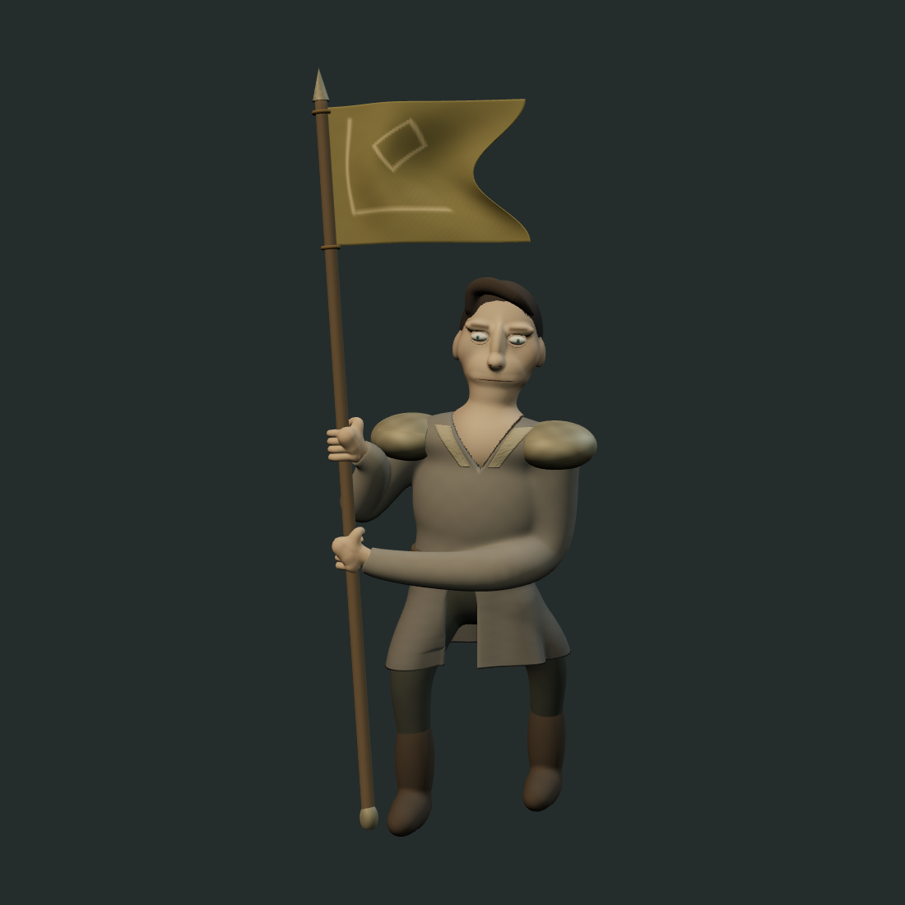

# Fixed gallery delivery

On 2026-10-28 the 22 remaining fixed procedural studies were baked into saved GLBs.
The seven approved native defaults continue to use their existing publications.
Gallery loading and downloading no longer invoke procedural constructors.

The retained recipes match baseline `a2cd6f6` in behavior; only the factory's obsolete
runtime-fallback comment changed. The [bake manifest](../../../../src/art3d/baked/manifest.json)
owns exact exporter/source fingerprints, delivered byte fingerprints and motion metadata.
Generators remain available through the [explicit bake workflow](../../3d.md#rebuild-fixed-studies).

## Matched source and baked views

Banner Bearer, same camera, lighting and animation time. Left/source is reconstructed
by the retained recipe; right/baked is the GLB that the app now loads and downloads.
The review found no visible silhouette, material or pose change in this pair.

| Procedural source                   | Saved GLB                                  |
| ----------------------------------- | ------------------------------------------ |
|  |  |

## Validation and limits

- All 29 gallery delivery journeys pass loading, visible motion, phone layout,
  download and save-isolation checks. Rebuild mode also compares source/export
  poses and rendered views where supported by the existing roundtrip tests.
- Banner Bearer: sampled maximum vertex error `5.247432088457212e-8` model units,
  maximum node error zero; two skinned meshes and eight animated targets.
- All 22 baked studies load through the real loader without procedural imports;
  missing/corrupt delivery and cancelled loads retain visible failure/recovery behavior.
- Byte identity is checked separately from viewer behavior and visual judgment.
  This migration does not claim faster constructors, GPU rendering or resolution
  of the historical Linux rebuild timeouts. Construction limits and assertions remain.

These two views are the retained evidence for this delivery change. Routine logs,
downloaded copies and the other successful comparison captures are temporary.
Keep this record while the delivery decision is current; review it when the bake or
delivery mechanism is superseded. Native authoring validation remains separate.
