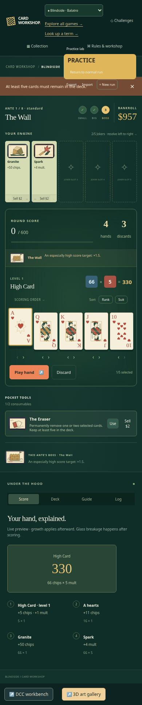
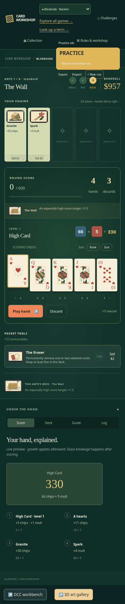

# Disable Eraser selections that cannot preserve five cards

| Original                                                             | Updated                                                             |
| -------------------------------------------------------------------- | ------------------------------------------------------------------- |
|  |  |

390 × 844, scale 1, full page, identical validated practice replay and A-of-hearts selection. Original shows the offscreen rejection after enabled Use; Updated prevents that action. The 51 px alert height explains different page heights and scroll positions. No raw state injection, data loss or trapped-run claim.

- Original source: `bebe081234cfbacab30389373f274e7e88be9759`.
- Reviewed implementation: `cc996edfb098a8c225de30ceb4b9470631b1e683`.
- Change: Include the existing five-card deck floor in destructive-consumable eligibility.
- Acceptance: Block removals below five cards; allow six-to-five removal; consume exactly one tool and clear selection on valid use; preserve the remaining tool, normal save and playable five-card hand.

Original source failed expected-disabled/received-enabled with two selections in a six-card deck. Final 1/1 passed in 7.2 s: block six-to-four, allow six-to-five via keyboard, consume one tool, clear selection, block further destruction and play the five-card hand while preserving the normal save. The fixture has 18 accepted setup commands. Table is shared by normal/practice Blindside and imported only by BlindsideApp; other effect types short-circuit the added predicate.

Pass: one tracked browser boundary journey, scoped lint/format/inventory and build. Independent review accepted with no findings. The fixture is a validated supported practice replay, not evidence of normal-campaign frequency. Full local application/simulation, unrelated browser and native/geometry suites were not run.

Local runtime: Node 24.21.0, npm 11.19.0, Playwright 1.64.0, Chrome 156.0.8078.79. Existing startup, assertion and test guards were retained. This publication reuses valid captures and checks; it adds no gameplay changes. Hosted CI is reported on the draft PR.

Image SHA-256:

- `original-390.png`: `f367f1780bb12539ed234d07ddc1fe0984c4cba6a970e0b7b748cc66a3dc6d4e`
- `updated-390.png`: `d2511859d381db333a58e5b24ad05936d1799b036fca0bd81b3f493350829139`
