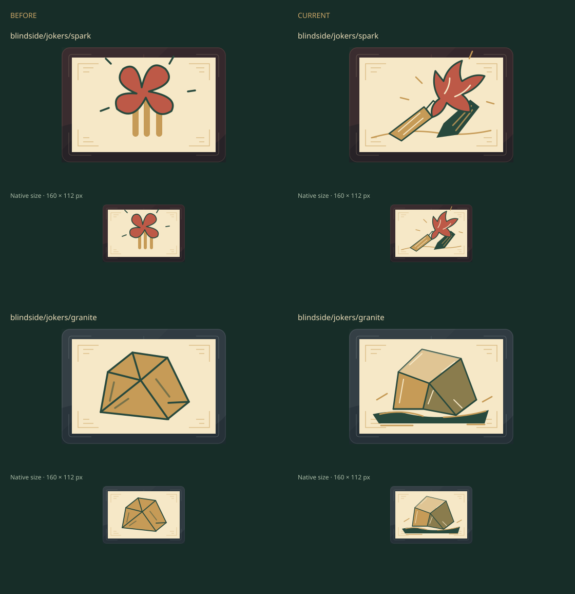
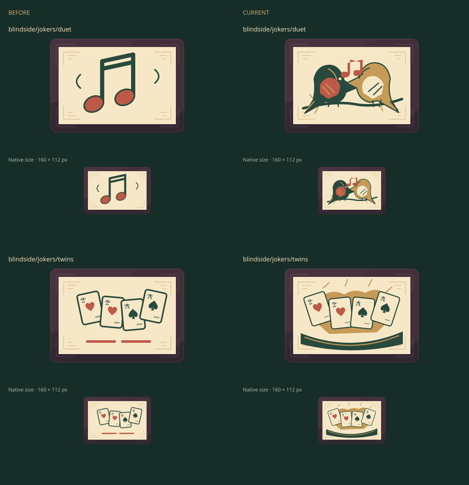
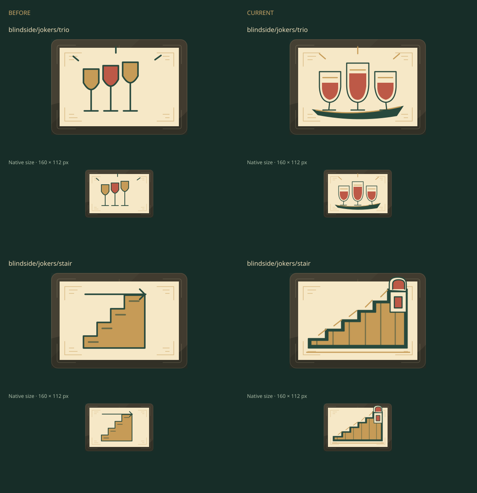

# Blindside opening Jokers · issue 37 WIP review

This is author review evidence for the six opening Joker illustrations in
[PR 41](https://github.com/qianyizhang/game/pull/41). It is not independent visual
acceptance. The source change is limited to
[jokers.tsx](../../../../src/games/balatro/ui/art/jokers.tsx): `spark`, `granite`,
`duet`, `twins`, `trio` and `stair`.

## Matched SVG pixels

The [review manifest](review.json) records 644 decoded exports on each side:
exactly those six IDs changed, with no added or removed IDs and 638 unchanged
pixel renders. Each sheet shows matched before/after art enlarged and at the
export's native 160 × 112 size.







At native size, Spark reads as a struck flame, Granite as a grounded stone,
Duet as two facing birds, Double Take as two card pairs, Trio as three cups,
and Stairway as an ascent to a doorway. Trio's repeated cups and Stairway's
literal steps are the closest to their baselines and need independent scrutiny.
The sheets show the exported art at fixed sizes. The contextual captures below
show it in the actual collection, held-Joker row, and shop.

## Local Chrome context captures

[The context receipt](context/receipt.json) records the matched baseline and
candidate screenshots, crop bounds, source hashes, Chrome version, and a SHA-256
for each PNG. The twelve screenshots cover the collection, five held Jokers,
and Stairway in the shop, at 1440 × 1080 and 390 × 844 viewports. The collection
crops include all six first cards. The shop follows a legal Practice Lab setup;
five held slots make Stairway's purchase action correctly display “Slots full.”

| Context     | Desktop baseline                               | Desktop candidate                               | Phone baseline                               | Phone candidate                               |
| ----------- | ---------------------------------------------- | ----------------------------------------------- | -------------------------------------------- | --------------------------------------------- |
| Collection  | [PNG](context/baseline-collection-desktop.png) | [PNG](context/candidate-collection-desktop.png) | [PNG](context/baseline-collection-phone.png) | [PNG](context/candidate-collection-phone.png) |
| Held Jokers | [PNG](context/baseline-held-desktop.png)       | [PNG](context/candidate-held-desktop.png)       | [PNG](context/baseline-held-phone.png)       | [PNG](context/candidate-held-phone.png)       |
| Shop        | [PNG](context/baseline-shop-desktop.png)       | [PNG](context/candidate-shop-desktop.png)       | [PNG](context/baseline-shop-phone.png)       | [PNG](context/candidate-shop-phone.png)       |

The candidate capture ran at local validation commit
`a235551e441ea96ceb3fc4a9031be693056287a8`, which layers the separate
Chrome test-harness commit `acdb4cffff46d9829eedab080be08c02dc9abb7a`
over art commit `0ac0adc4636610b84fe740c0b495fdec0d43cef6`. The overlay changes
only Playwright startup/configuration and its tests. The illustration source
hash is the same as the art branch: `6603921f69ff9df004e6d16150425e8d26099e242744e3aa30c8cd90d4cd71d4`.
Both startup and test workers launched the official Google Chrome binary from
the extracted vendor package, version `156.0.8078.73`; package SHA-256 is
`fd19c6895dad77f4d7f712c2d9f0d5eb682f4a6e7ff22b1bd0d40d03710d288c`.

The local context capture and four relevant existing Playwright journeys passed:
Balatro collection labels/phone layout; play, shop, buy, reorder, save and
resume; collection/mod guide/export/import; and phone action reachability.
This is author review evidence; independent visual acceptance is still needed.

## Provenance and reproduction

- Baseline: `73a24f5c98e77c365c909bbeac9f37347ef845c7`.
- WIP source: local commit `41bd260915d99f4ad1d67990b2e7d5f0d84a5bd8`,
  published as PR commit `e790257a2e50412d55b4245f639f4459c9b843ea`.
  Both commits have Git tree `15c17ecc33d44b02e06b3c0dfba4142c2a55fb6f`.
- Source SHA-256: `6603921f69ff9df004e6d16150425e8d26099e242744e3aa30c8cd90d4cd71d4`.
- Published manifest SHA-256: `5bc61162e5fe9bd25591154a08cfa972d4de2eacc634c7485623728e92a3303e`.
  It is JSON-format-only different from the generated manifest
  (`fe582c09cad293b40ebf8766558f9d0f8adf42c29a6132fb7ff3c61e1875c495`);
  their parsed contents match. The absolute export paths record the original
  local run; the relative recipe below recreates it in a fresh checkout.
- Sheet SHA-256 in order: `a6dbbe365012b8e03abef494ca22c9c12d84216d34d68a0a0b203427ac2459fb`,
  `66cf0c2bc7c9663e5f59c8ff77ffcc9384d0b47e89dc219a6f55448709c03e02`,
  `5a0db689e97bad8b1d6b29789f0852fe9171660b891cd94bdef6dab763cdd0a0`.

Export the baseline and PR source into separate fresh directories, then run:

```sh
npm run assets:review -- blindside/jokers/spark blindside/jokers/granite \
  blindside/jokers/duet blindside/jokers/twins blindside/jokers/trio \
  blindside/jokers/stair --from test-results/issue37-final \
  --before test-results/issue37-before --out test-results/issue37-final-review
```

The two inputs come from `npm run assets:export -- <directory>` at the baseline
and PR revisions respectively. The retained files here are the three selected
comparison sheets and manifest. The full 644-SVG exports remain local under
ignored `test-results/`; incomplete trial captures are quarantined there and
are not part of the review set.

`npm run check` passed on the WIP source bytes (574 application tests, 37 seeded
playtests). Hosted Chrome passed collection/phone layout, SVG export, and the
shop/buy/reorder smoke journey in [run 40625045254](https://github.com/qianyizhang/game/actions/runs/40625045254).
Those tests produce screenshots in the runner, but the workflow uploads browser
artifacts on failure only. The retained contextual screenshots above came from
the local Chrome run.
The matched context screenshots above have now been inspected locally;
independent visual acceptance remains open.
