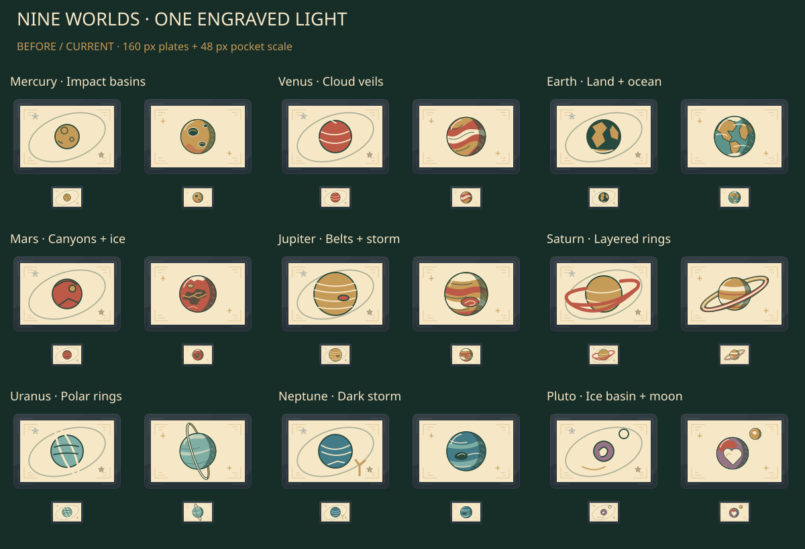
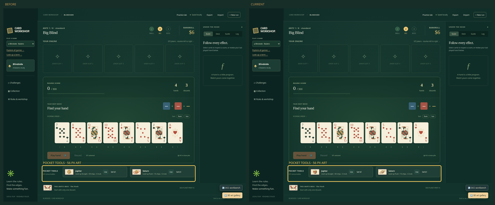
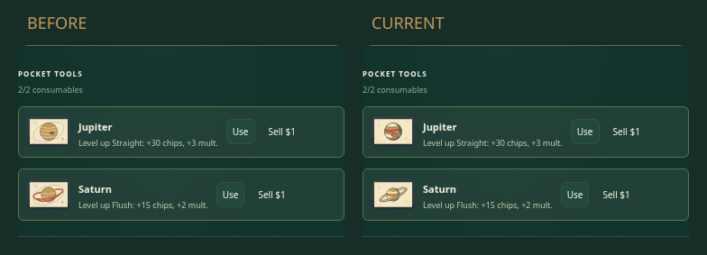

# Blindside planets · issue #71

**Nine worlds. One engraved light.**

## In play · look below the hand

## Surface close-ups

[Mercury / Venus](surfaces-01.png) · [Earth / Mars](surfaces-02.png) ·
[Jupiter / Saturn](surfaces-03.png) · [Uranus / Neptune](surfaces-04.png) ·
[Pluto](surfaces-05.png)

Each sheet pairs baseline/current at 320 px and 160 px. The overview adds the
48 px phone-pocket scale. All worlds share upper-left light and a shadow plane;
surface shapes carry identity before small engraving cuts.

## Actual UI · matched views

| Context    | Desktop                               | 390 px phone                        |
| ---------- | ------------------------------------- | ----------------------------------- |
| Collection | [Nine worlds](collection-desktop.png) | [Nine worlds](collection-phone.png) |
| Big Blind  | [Full table](playing-desktop.png)     | [Full table](playing-phone.png)     |
| Pocket     | [56 px art](pocket-desktop.png)       | [48 px art](pocket-phone.png)       |
| Booster    | —                                     | [Five choices](booster-phone.png)   |

Baseline: main `14f31860a4bf5c7bf568fbacf804c8cd60a3a9ca`, including PR #65.
Both UIs use the same legal `PLANET-PRINT-16` replay, viewport and browser. Side-by-side UI views preserve screenshot pixels. The locator alone adds
a highlight around the pocket region; labels sit above the screenshots.

## V1 → V2

[Representative Jupiter / Saturn v1](giants-v1.png)

- Jupiter: curved belts + rounded storm eye.
- Saturn: hooked rear tips → continuous ring annulus.
- Remaining worlds: impact basins, cloud veils, continents, canyon, polar rings,
  dark storm, ice basin + moon.

## Status

- 🟢 **9 changed / 635 unchanged** illustrations; 644 SVGs exported and decoded.
- 🟢 Collection, phone, purchase, keyboard use, exact hand upgrades, booster rules,
  export/import and reload checks.
- 🟢 Scoped lint, workspace types, production build, inventory; 22 rule/save tests.
- 🟡 Author pixel review complete; independent visual review pending.
- 🔴 Draft PR creation denied by automatic approval review; no PR created or retry.

[Checks and limits](checks.md) · [SVG pixel report](svg-review.json) ·
[Source/image hashes and Chrome provenance](provenance.json)

Planet art only. Content IDs, levels/use rules, save/replay formats, input and
accessibility remain authoritative and unchanged. Accepted Jokers, bosses, tools,
PR #65 performance work and unrelated PRs #62/#72/#73 are outside this delta.
