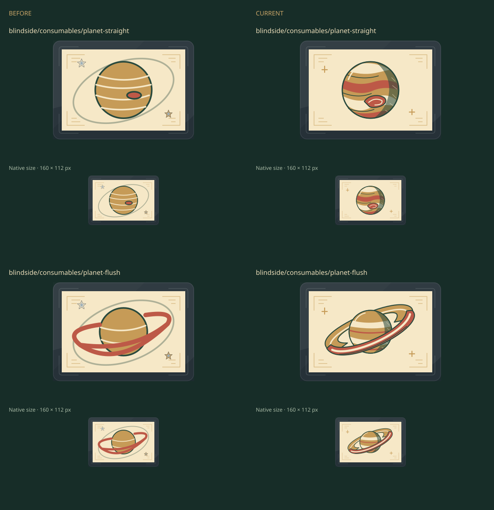

# Blindside planets · issue #71

**Nine worlds. One engraved light.**

## Representative v1

- Jupiter: broad cloud belts, storm eye, right-side shadow.
- Saturn: tilted rings with front/back overlap.
- Next: soften the pointed storm; remove hooked rear-ring tips; finish seven worlds.

Baseline: main `14f31860a4bf5c7bf568fbacf804c8cd60a3a9ca`, including PR #65.
Artwork only; all content definitions, rules, replay versions and saves stay intact.

Technical: 644 baseline/current SVGs exported and decoded; exactly Jupiter and Saturn
changed in v1. Existing Blindside collection/phone journey passed (5.2 s).
Visual: author inspected native/enlarged pixels; final collection, pocket-strip,
phone and acquisition/use/reload checks pending. No independent visual verdict yet.

Temporary exports and logs: `test-results/issue71/`. Final selected evidence and
exact-revision verification will be retained here. Draft remains open for iteration.
