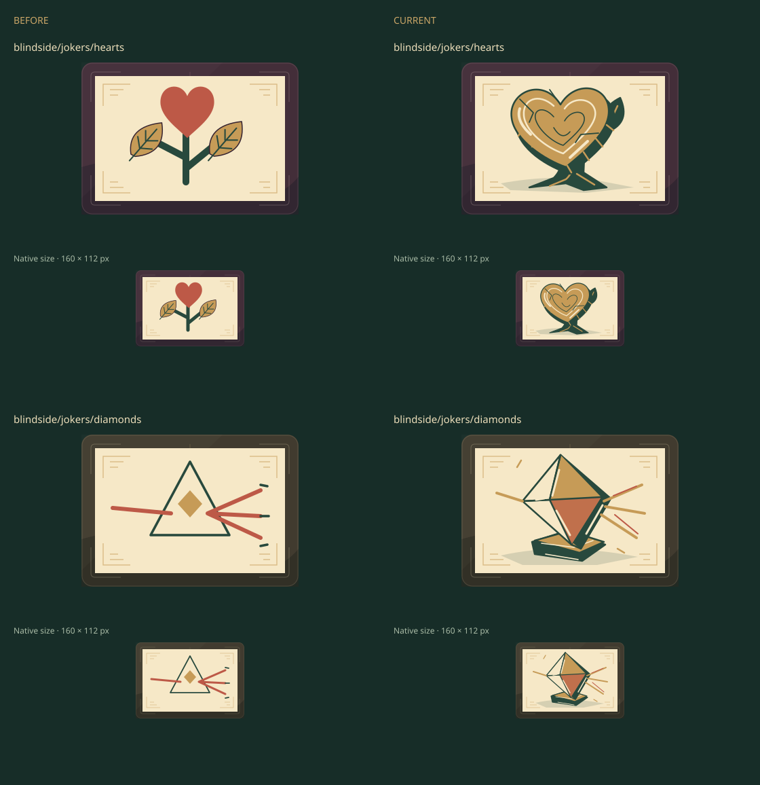
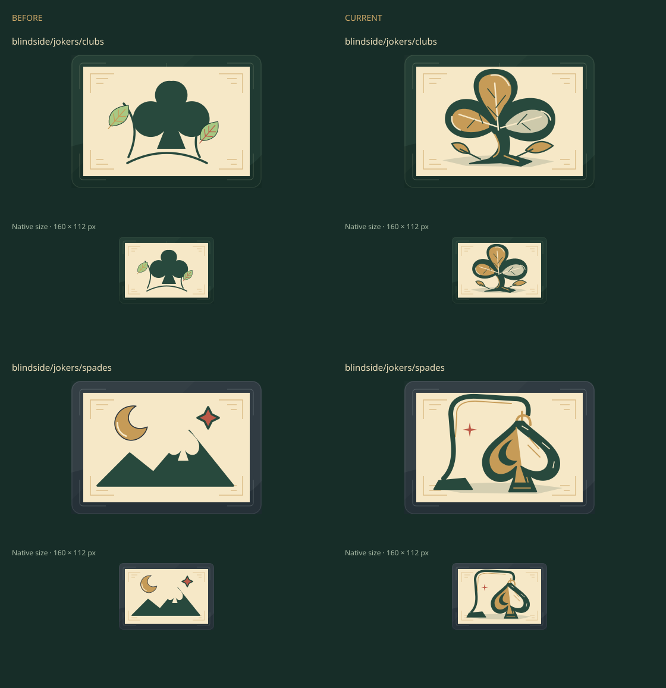
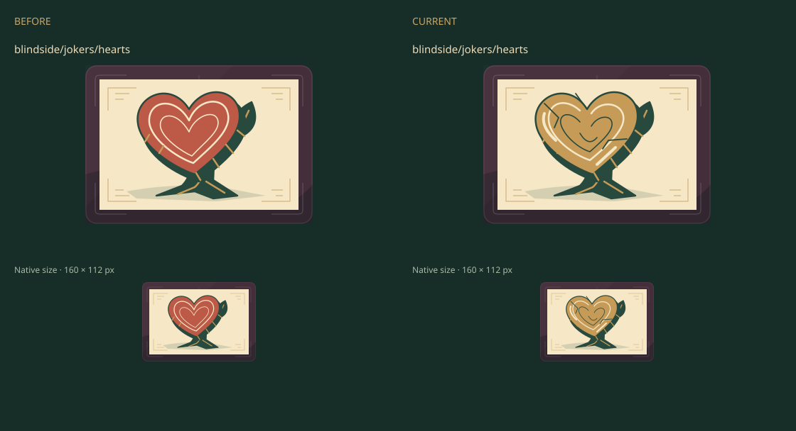

# Blindside suit Jokers · issue 58

Author review of Heartwood (`hearts`), Prism (`diamonds`), Clover (`clubs`) and
Nightfall (`spades`), against main `da8b3c39097a27a300b414af9b89bdceb234a1ff`.
Only these four cases in [jokers.tsx](../../../../src/games/balatro/ui/art/jokers.tsx)
change. Independent visual acceptance is pending.

The quartet uses connected material subjects: heart-shaped cut wood, a mounted
faceted crystal, a cupped trefoil, and a spade-shaped glass lantern. Broad light,
middle and dark planes preserve suit silhouettes at native 160 × 112 size.
HTML continues to own names, prices, effects and controls.





The [pixel receipt](review.json) records 644 decoded exports on each side:
exactly four changed IDs, 640 unchanged, no additions or removals. Opening
Jokers, bosses and fallbacks retain their rendered pixels.

## Representative improvement

Heartwood v1 established bark thickness and roots, but the coral face and evenly
nested hearts read as a plaque. V2 lightens the cut plane, breaks the rings,
and adds a split and edge highlights. Clover's upper lobe was then lowered
clear of the paper boundary before the final set export.



## Reproduce

Export baseline and candidate to separate new directories with
`npm run assets:export -- <directory>`, then:

```sh
npm run assets:review -- blindside/jokers/hearts blindside/jokers/diamonds \
  blindside/jokers/clubs blindside/jokers/spades \
  --from test-results/suits/final --before test-results/suits/baseline \
  --out test-results/suits/final-review
```

The helper needs an installed Sharp module (see [SVG workflow](../../svg.md)).
The source geometry is editable SVG; no raster payload, external request,
DOM ID or animation is added. Contextual browser review and local checks are
pending in this initial draft.
