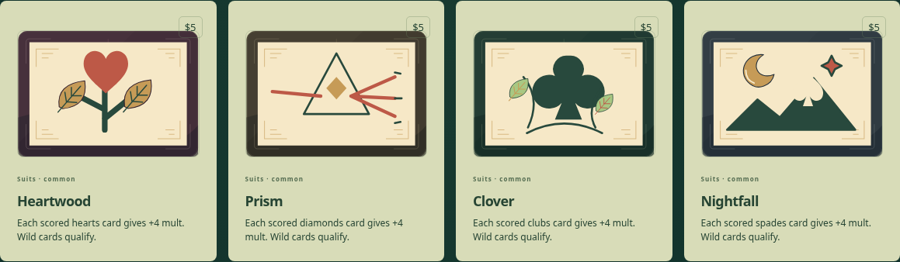
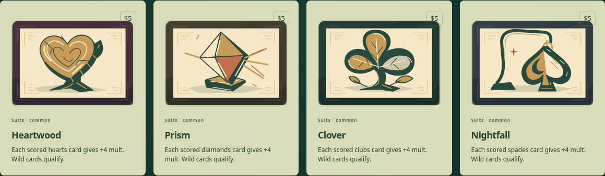
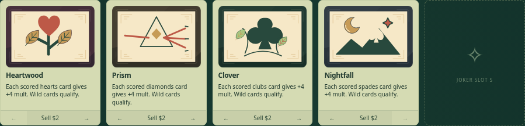
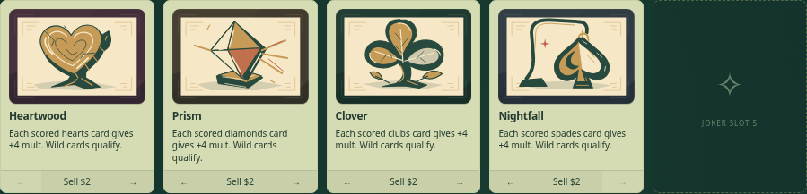

# Blindside suit Jokers · issue 58

Author review of Heartwood (`hearts`), Prism (`diamonds`), Clover (`clubs`) and
Nightfall (`spades`), against main `da8b3c39097a27a300b414af9b89bdceb234a1ff`.
Only these four cases in [jokers.tsx](../../../../src/games/balatro/ui/art/jokers.tsx)
change. Independent visual acceptance is pending.

The quartet uses connected material subjects: heart-shaped cut wood, a mounted
faceted crystal, a cupped trefoil, and a spade-shaped glass lantern. Broad light,
middle and dark planes preserve suit silhouettes at native 160 × 112 size.
HTML continues to own names, prices, effects and controls.


The [pixel receipt](review.json) records 644 decoded exports on each side:
exactly four changed IDs, 640 unchanged, no additions or removals. Opening
Jokers, bosses and fallbacks retain their rendered pixels.

## Representative improvement

Heartwood v1 established bark thickness and roots, but the coral face and evenly
nested hearts read as a plaque. V2 lightens the cut plane, breaks the rings,
and adds a split and edge highlights. Clover's upper lobe was then lowered
clear of the paper boundary before the final set export.


## Reproduce

Export baseline and candidate to separate new directories with
`npm run assets:export -- <directory>`, then:

```sh
npm run assets:review -- blindside/jokers/hearts blindside/jokers/diamonds \
  blindside/jokers/clubs blindside/jokers/spades \
  --from test-results/suits/final --before test-results/suits/baseline \
  --out test-results/suits/final-review
```

The helper needs an installed Sharp module (see [SVG workflow](../../svg.md)).
The source geometry is editable SVG; no raster payload, external request,
DOM ID or animation is added. The contextual and technical evidence below
records the completed scopes separately.

## Local Chrome context and interaction

The [context receipt](context/receipt.json) binds baseline/candidate source hashes,
Chrome provenance, deterministic practice seed/setup, crop bounds and image hashes.
All four matched journeys passed ([local log](logs/context.txt)): desktop 1440 × 1080
and phone 390 × 844 for baseline and candidate. They verify collection effects,
Nightfall purchase for $5, four held Jokers, moving Nightfall left, byte-identical
saved replay after reload, explicit practice resume and horizontal fit. No page
errors were observed. Replay playback is skipped through the existing UI on entry
and resume. Normal saves remain separate from practice.









| Surface        | Baseline desktop                               | Candidate desktop                               | Baseline phone                               | Candidate phone                               |
| -------------- | ---------------------------------------------- | ----------------------------------------------- | -------------------------------------------- | --------------------------------------------- |
| Collection     | [PNG](context/baseline-collection-desktop.png) | [PNG](context/candidate-collection-desktop.png) | [PNG](context/baseline-collection-phone.png) | [PNG](context/candidate-collection-phone.png) |
| Held rack      | [PNG](context/baseline-held-desktop.png)       | [PNG](context/candidate-held-desktop.png)       | [PNG](context/baseline-held-phone.png)       | [PNG](context/candidate-held-phone.png)       |
| Nightfall shop | [PNG](context/baseline-shop-desktop.png)       | [PNG](context/candidate-shop-desktop.png)       | [PNG](context/baseline-shop-phone.png)       | [PNG](context/candidate-shop-phone.png)       |

Author review: each suit stays identifiable in the small phone rack; prices,
effects and movement/sell controls remain visible. Heartwood's stylized rings
and Prism's geometric facets deserve independent review for the intended material
reading. This is self-review, not parent acceptance.

The initial ignored capture script had selector/playback assumptions corrected
before the four passing journeys: exact Prism heading matching, counted Play
button name, and skipping score playback after both play and practice resume.
No application fix, assertion removal or timeout increase was needed. Valid
collection captures from those attempts were reused; the accepted receipt hashes
those exact images. Trial logs remain under `test-results/suits/` locally.

## Existing browser acceptance

All five selected existing local Chrome journeys passed on source commit
`030efb73619fb21f6975a7fc15bfdde5e932bcc8` ([log](logs/e2e.txt)):
standalone SVG decode/filter; Blindside collection labels/phone layout; normal
play/shop/buy/reorder/advance/resume; collection/export/import; phone action
reachability. The unchanged official Chrome harness on main was used.

```sh
CARD_WORKSHOP_CHROME_EXECUTABLE=/absolute/path/to/google/chrome \
  npx playwright test --project=functional \
  tests/browser/artwork.spec.ts tests/browser/art-export.spec.ts \
  tests/browser/workshop.spec.ts \
  --grep 'balatro illustrations|standalone SVG|play, inspect|collection, mod guide|phone layout stays' \
  --max-failures=1
```

The supplemental evidence formatting/inventory check passed
([log](logs/doc-check.txt)). Hosted [run 40646993117](https://github.com/qianyizhang/game/actions/runs/40646993117)
passed for the art commit and is treated only as a sanity check. Local
maintenance/build passed; the broader application gate remains in progress with
a reported Hearth recruitment-harness failure. It is not credited as passing.
