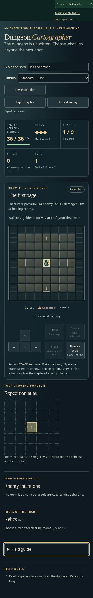
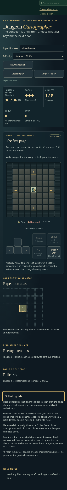
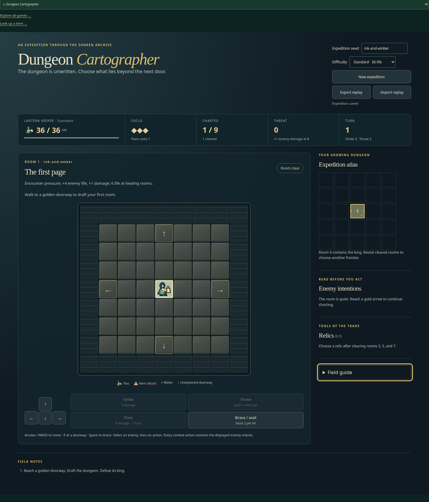
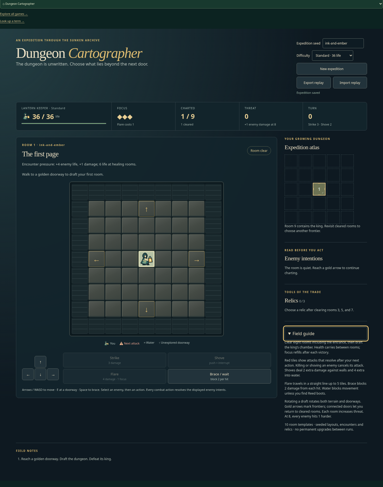

# Preserve native keyboard activation of Cartographer's Field guide

| Original                                                      | Updated                                                |
| ------------------------------------------------------------- | ------------------------------------------------------ |
|  |  |
|           |        |

Same default ink-and-ember Standard expedition, focused Field guide and Space input, scale 1, at 390 × 844 and 1440 × 844. Original stays closed at turn 1; Updated opens at turn 0 with byte-identical saved state. Full-page heights grow when the guide opens; this is a state comparison, not equal-height pixel parity.

- Original source: `bebe081234cfbacab30389373f274e7e88be9759`.
- Reviewed implementation: `bb7885591915d862d1f49eed1db3d0f110eeb766`.
- Change: Leave Space on native button/summary controls to their native activation, while retaining the tactical board's Brace shortcut.
- Acceptance: Space opens/closes the guide without commands, turns or save changes, including active combat; Enter/pointer still toggle it; native button Space works; board Space braces exactly once.

Original source failed the guide-open assertion after the unchanged 5000 ms budget. The first candidate passed the tracked active-combat journey in 4.4 s total; no V1 correction was needed. It also verifies enemy-button Space selection and exactly one board Brace. Hub is the only mount; passive policy review owns a separate board/handler.

Pass: one tracked active-combat browser regression, scoped lint/format/inventory and build; retained 390/1440 px comparison observations. Independent review accepted with no findings. Full-page heights differ because the guide opens; compare at native width. Full local application/simulation, unrelated browser and native/geometry suites were not run.

Local runtime: Node 24.21.0, npm 11.19.0, Playwright 1.64.0, Chrome 156.0.8078.79. Existing startup, assertion and test guards were retained. This publication reuses valid captures and checks; it adds no gameplay changes. Hosted CI is reported on the draft PR.

Image SHA-256:

- `original-390.png`: `56142ecce0285cf005797fb27f53052029025510f7069eb9046c7cd76d723399`
- `updated-390.png`: `e29586339b3f475be8bcb9c7c2e60d6456fca0fd8fcc2c33cc26da4e43a3f3b3`
- `original-1440.png`: `04af2f39b014acb91e86149d6282e1aa16b80a476eec58a75919bf148db54daa`
- `updated-1440.png`: `e0b2bdc0564919ced584b9d9a0c75a98d6e6b049c5aa4a81f9b0a7da41918c2c`
