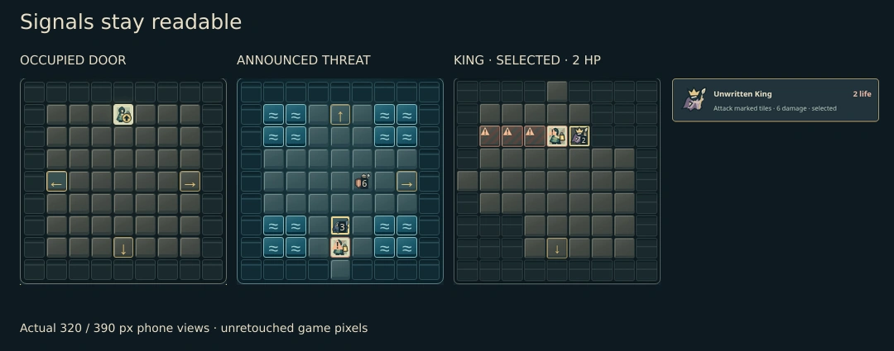

# Cartographer inhabitants · issue #70

**Letters → six shared identities.** Board, life panel and enemy inspector use the same decorative SVG subjects. Names, life, selection and announced attacks remain HTML.

| Context               | Baseline                      | Current                         |
| --------------------- | ----------------------------- | ------------------------------- |
| Desktop · 1440 × 1080 | [Before](before-desktop.webp) | [Current](current-desktop.webp) |
| Phone · 390 × 844     | [Before](before-phone.webp)   | [Current](current-phone.webp)   |

Baseline: `14f3186` (includes PR #65). Same seed `ink-and-ember`, Standard difficulty, north frontier, first valid rotation of offer 0. Screenshots use reduced motion and Google Chrome 156.0.8078.73 in the authorized cloud environment.

The v1 guardian put its right foot under the life badge and stretched the inspector row. The current stance leaves more room for HP; a fixed portrait column aligns all inspector names and intentions. The player carries a lantern, the guardian a shield and polearm, the scribe a bow, the inkling a low curling body, the censer a suspended bowl, and the king a crown and quill.

## Verification · 2026-10-28

- 🟢 Author pixel review: enlarged, 35 px, matched desktop/phone board and inspector, selected king, occupied doorway and threatened hero. Independent visual acceptance remains pending.
- 🟢 SVG review: 650 current / 644 baseline decoded; six additions, all 644 existing exports pixel-identical, none removed. Browser cabinet decode also passes.
- 🟢 Five scoped browser journeys: all four guardian identities, pointer/keyboard selection without a turn or save change, king selection and final combat from a frozen legal v2 replay, phone reload, existing keyboard/replay/import journey, all four occupied frontiers and 320 px threat/overflow checks.
- 🟢 Formatting/inventory (816 sources), focused source/test ESLint, workspace typechecks, production build and seven Cartographer rules/save-continuity tests pass.
- 🟡 No full-suite, native/geometry or performance benchmark claim; this is a static SVG/UI change. Existing build chunk-size warning remains.

Application source is `24e5c34`; scoped browser runs and checks use `9c14771` (only adds the new test and source-map prose). Four browser journeys passed there. One new selector incorrectly matched both subject and doorway SVG; `de64c83` restricts it to the inhabitant. That failed case alone was rerun and passed; other results and screenshots remain valid because the application source is unchanged. The retained failure is a test-selector error, not a game assertion failure.

No rule, content definition, save/replay format, room material, mechanic, input handler or policy source changed. Enemy button accessible names retain their original symbol, name, HP, intent and selected wording; the visual symbol is now a shared decorative SVG.

Chrome was extracted from the official vendor package at `https://dl.google.com/linux/direct/google-chrome-stable_current_amd64.deb`: version `156.0.8078.73`, SHA-256 `fd19c6895dad77f4d7f712c2d9f0d5eb682f4a6e7ff22b1bd0d40d03710d288c`. Node/npm are pinned to 24.21.0 / 11.19.0. No credentials or security configuration were read or changed; no purchases or Site publication occurred.

## Handoff

The implemented branch is `art/70-cartographer-inhabitants`; [draft PR #75](https://github.com/qianyizhang/game/pull/75) contains the source, tests and matched comparisons. The initial PR-creation denial was resolved by one reconsideration after the full game-batch proposal and user approval were supplied. No approval or merge has occurred. Independent visual acceptance and hosted checks remain pending.

Detailed command output and export manifests are retained in the cloud checkout at `.artifacts/cartographer-inhabitants/`. Keep this review bundle through review or 2026-11-27, then reassess. This document and its seven images are the durable review evidence.
