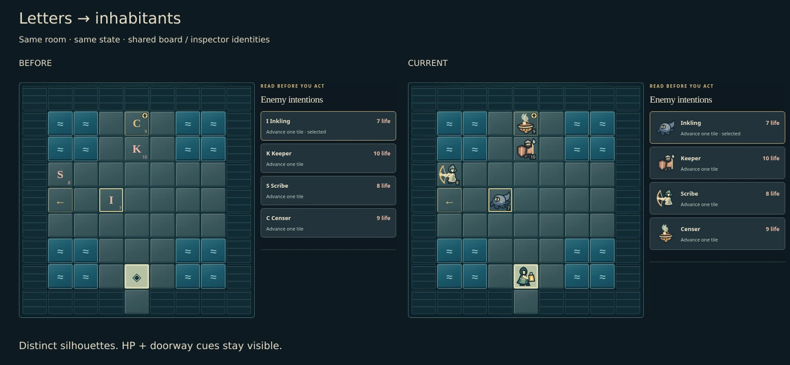
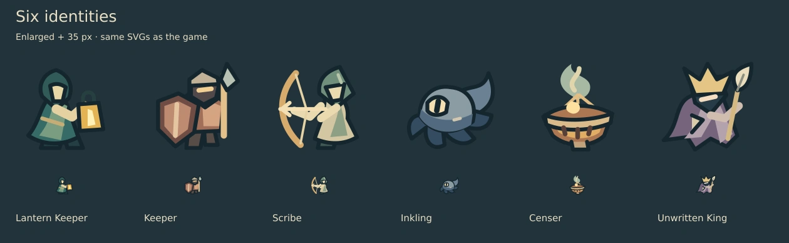

# Cartographer inhabitants · WIP

**Letters → six shared identities.** Board, life panel and enemy inspector use the same decorative SVG subjects. Names, life, selection and announced attacks remain HTML.

| Context               | Baseline                      | Current                         |
| --------------------- | ----------------------------- | ------------------------------- |
| Desktop · 1440 × 1080 | [Before](before-desktop.webp) | [Current](current-desktop.webp) |
| Phone · 390 × 844     | [Before](before-phone.webp)   | [Current](current-phone.webp)   |

Baseline: `14f3186` (includes PR #65). Same seed `ink-and-ember`, Standard difficulty, north frontier, first valid rotation of offer 0. Screenshots use reduced motion and Google Chrome 156.0.8078.73 in the authorized cloud environment.

The v1 guardian put its right foot under the life badge and stretched the inspector row. The current stance leaves more room for HP; a fixed portrait column aligns all inspector names and intentions. The player carries a lantern, the guardian a shield and polearm, the scribe a bow, the inkling a low curling body, the censer a suspended bowl, and the king a crown and quill.

Local two-size review completed. SVG review decoded 650 current / 644 baseline assets: six additions, 644 pixel-identical, no removed or changed existing exports. Technical checks, selected/combat/keyboard/reload journeys and independent visual acceptance are pending. No rule, content definition, persistence or input changes.
