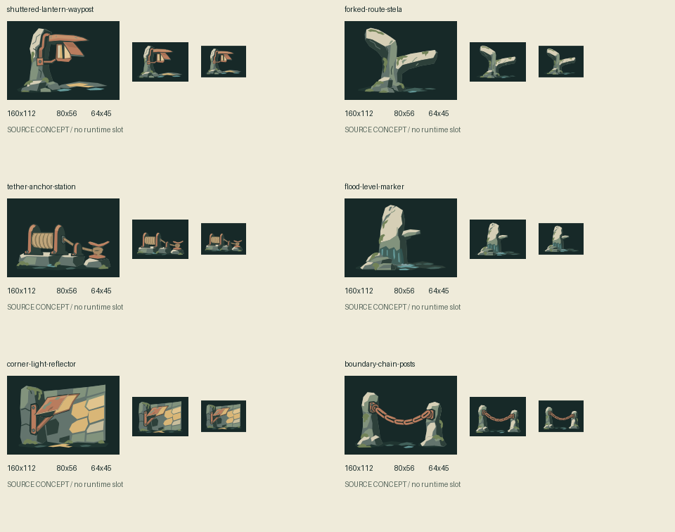

# Cartographer wayfinding fixture source kit

Six future environmental fixtures for route guidance and boundary readability, not existing canon or implemented rules. The exact request, shared-pool grant, usage, outputs and review live once in [call.json](call.json). This one call has a **$6.50 coordinator reservation**, recorded before dispatch; other shared-pool funds and holds are not borrowed.

## Admission and visual brief

Current main is `3a59621069dd1fe912a749d851d27e993507f5dd`. `src/shared/layout/layout.ts` owns matching doorways and a reserved clear cross; `src/games/cartographer/ui/MapCues.tsx`, `FrontierArt.tsx` and `ExpeditionChoice.tsx` own the small rotating frontier cue and room previews. Reuse that arrow for the current tactical UI: these props serve a different, future environmental-composition role at 160×112/80×56, not 35px occupied cells or a new navigation state.

The [first suite](https://github.com/qianyizhang/game/blob/7ec2480ddf89599dff8d7f5d71ce900b728ac822/docs/art/assets/expansion-archive-spire-2026-11-06/README.md) already covers furniture, garden/forge pieces and a floodgate wheel. [The threshold kit](https://github.com/qianyizhang/game/pull/143) covers route mechanisms. These six concepts instead test a directional hooded beacon, forked blank stela, retracing tether station, wet/dry flood marker, corner reflector and connected chain boundary. Their physical silhouettes and roles differ; no extra recolors, relics, gate states or duplicate furniture are admitted.

Common brief: nonliving stone/forged-copper/rope objects with visible load paths and upper-left light; three broad values, quiet dark ink, sage/cream stone and restrained warm accents. Each exact gesture, material and contour is specified once in the prompt. No live catalogue is frozen and no old asset is edited. The art lane owns source upkeep; any later consumer must select useful pieces, fit backgrounds/margins, and pass actual game/accessibility review before adoption.

## Retention and staged registration

Preserve one exact API SVG, six actual local-group extractions and one useful native/compact contact PNG. Temporary rasterizations are inspection aids, not another permanent catalogue. The canonical call contains source cells and digests; derivative geometry/paint is unchanged apart from removing the grid translate. Source-only is distinct from independent/user aesthetic acceptance.

The gallery import is a derived transport, generated by the recipe below into ignored `test-results/wayfinding-history-import.json`. It is validated in isolation; no shared registry/default/selection is changed. Central registration is a **draft blocker**, not a merge-ready claim. Frozen #140/#143 and their branches are untouched. This branch starts at main and has no first-suite ancestor or local file dependency.



Status: one successful request, **$0.165535** usage-derived cost; worker lifetime estimate **$1.093452**, with **$0 active/uncertain reservations**. Native/compact self-review found five candidates and one semantic hold: the corner reflector reads as a folded panel/awning more readily than as a light reflector. Keep it for user review, not automatic adoption. Other exceptions are in the canonical call.

All six preserve source vector content and the requested 28px inset; any renderer edge-rounding differences are recorded rather than claiming universal raster equality. The contact PNG is losslessly retained only after exact decoded-pixel/dimension/alpha/mode/color-metadata comparison. Safety of all seven SVGs, isolated import of seven source revisions, 390px gallery decoding/lineage/shared-call/visible-hold/disabled-selection checks, formatting/inventory/links and unchanged live-source history verification passed. These were manual delivery checks with system Chromium, not the guarded repository browser suite. The few recorded rasterizer edge differences do not alter vector geometry/paint. Central registration remains pending. Both requested IDs were listed by an authenticated, non-generation models preflight; native SVG support/pricing and the prior conservative bound were rechecked in this session. Existing proxy/token binding is reused without printing or saving values. Automatic retries are disabled; an unknown outcome keeps the full grant reserved and stops paid work.

## Rebuild staged import

Run from the repository root after the terminal review. This writes only an ignored staging file, not the shared library or selections.

```python
import json
from pathlib import Path

d = Path("docs/art/assets/cartographer-wayfinding-fixtures-2026-11-06")
c = json.loads((d / "call.json").read_text())
a = c["id"]
revisions = []
for o in c["outputs"]:
    original = "cell" not in o
    note = "Exact API original." if original else f"Cell {o['cell']}; remove its grid translation only. Review: call.json."
    review = c["review"]["exceptions"].get(o["file"], {})
    if review.get("status") == "hold":
        note += " Hold: " + review["reason"]
    revisions.append(dict(
        id=a + ":" + Path(o["file"]).stem, asset=None, attempt=a,
        label="Wayfinding source / " + Path(o["file"]).stem,
        file=(d / o["file"]).as_posix(), digest=o["sha256"],
        parents=[] if original else [a + ":original"],
        runtimeFile=None, runtimeDigest=None,
        notes=note,
    ))
h = dict(schema=1, assets=[], attempts=[dict(
    id=a, title="Wayfinding fixtures / one native SVG request",
    date=c["date"][:10], outcome="returned",
    notes="Future source concepts; request, usage, lineage and review: call.json.",
    files=[(d / f).as_posix() for f in ["call.json", "README.md", "contact.png"]],
)], revisions=revisions)
p = Path("test-results/wayfinding-history-import.json")
p.parent.mkdir(parents=True, exist_ok=True)
p.write_text(json.dumps(h, indent=2) + "\n")
```
