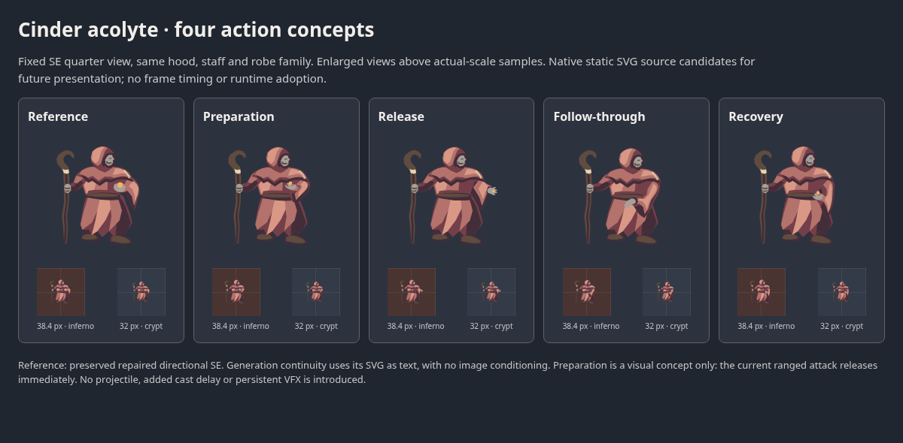

# Cinder acolyte action-pose concepts

Four fixed SE/front-quarter key poses extend the repaired directional acolyte: gathered preparation, outward release, low follow-through and quiet recovery. The staff stays in the right hand and the left hand gestures. Connected waist and sleeve volumes avoid the previous directional sheet's transparent torso gaps. These are static native SVG concepts for future presentation, with no runtime selection or combat change.

Open [the comparison](preview.html) for 38.4 px and 32 px samples on the game's inferno/crypt floor colors, including a 390 px phone layout. The release and follow-through gestures read most clearly; preparation and recovery remain subtle at 32 px. Hood, mantle, asymmetrical sleeves, crook/collar and palette remain coherent. The torso motion is modest and the feet/staff stay anchored. This set is useful for pose review, not a proven animation.

## Admission and source behavior

The existing directional suite (#146) supplies four static quarters but no cast/recovery states. The open hound motion study (#156) addresses a different monster. This independent branch from main adds only this acolyte bundle, rather than importing either earlier PR's full ancestry.

The exact monster is `cultist` / Cinder acolyte: fire ranged, range 6, speed 1.4, HP 46 and damage 10 at the inspected main `3a59621069dd1fe912a749d851d27e993507f5dd`. In `packages/diablo2/src/domain/combat.ts`, an eligible in-range attack immediately creates its projectile, then applies the ordinary 18-unit or elite 12-unit cooldown. Ordinary acolytes have no authored cast windup, facing or animation-phase contract. Preparation here adds no delay; projectile presentation remains separate. No shared `cultist` shape, Glass Regent boss, marker, shadow or runtime file changes.

## Source and receipt

[Reference facts](reference/source.json) identify the exact repaired SE snapshot from canonically registered #146 at `42b23ce774a17aa4025ddca170edc83ff109e4e1`. Its [preserved SVG](reference/acolyte-se.svg) is unchanged. The request includes that source **as text**, with no verified image input/conditioning. Its reference revision is the sole external lineage dependency of this additive import.

One [request](request.json), grant `sprite-acolyte-motion-04`: `gpt-image-2.6-sunburst`, high quality/complexity, SVG author `gpt-6.1-terra` with high reasoning, 1536 × 768. [Budget](budget.json) records the $2.971340 conservative bound before dispatch, within the existing $4.20 reservation. [Receipt](receipt.json) records HTTP 200, 175.47 seconds and `req_b22218347ce64b21a9c0a51b05e029f2`. Returned usage estimates **$0.114529**, releasing $4.085471; this grant has no remaining reservation and no second call. Historical unknown requests, including the $3 Furnace brute hold, remain unchanged and were not retried. Usage is an estimate at documented rates, not an independently verified account charge.

[Original](original.svg) is the exact returned sheet. Four `cultist-se-*.svg` files are raw group extracts: only the outer sheet translations were removed, with a 384-square wrapper. [Extraction](extraction.json) owns cells and digests. No manual artwork correction or rescaling was applied; no raster-wrapped SVG or GIF is present.

## Review and delivery limits

[Validation](validation.json) records SVG safety, source/extraction comparison, actual alpha bounds, native-scale and phone review. Visible footprints are 26.8–31.1 × 32.3–32.9 px at 0.1 scale, with no edge clipping. Preparation/follow-through reproduce sheet pixels exactly; release/recovery each have seven channel differences of at most 1/255 from viewport antialiasing, with unchanged geometry. The single retained PNG is losslessly recompressed with identical decoded scanline data and unchanged non-IDAT chunks.

The portable [history import](history-import.json) contains one attempt and five revisions: original plus four extracts. Every revision has null asset/runtime fields. Isolated import/gallery inspection uses the registered reference ancestry; shared registry and gallery implementation stay untouched. Serial canonical registration is still a draft blocker, and the import requires the #146 repaired SE revision above. The reference file itself is bundled, so no external image fetch is required to inspect this study.

No timing, playback, interpolation or reduced-motion integration has been tested. The candidate has no game-facing or cast-state contract. Any future adoption must preserve immediate ranged attack behavior, target selection, HP/status markers and field-owned contact shadows.
