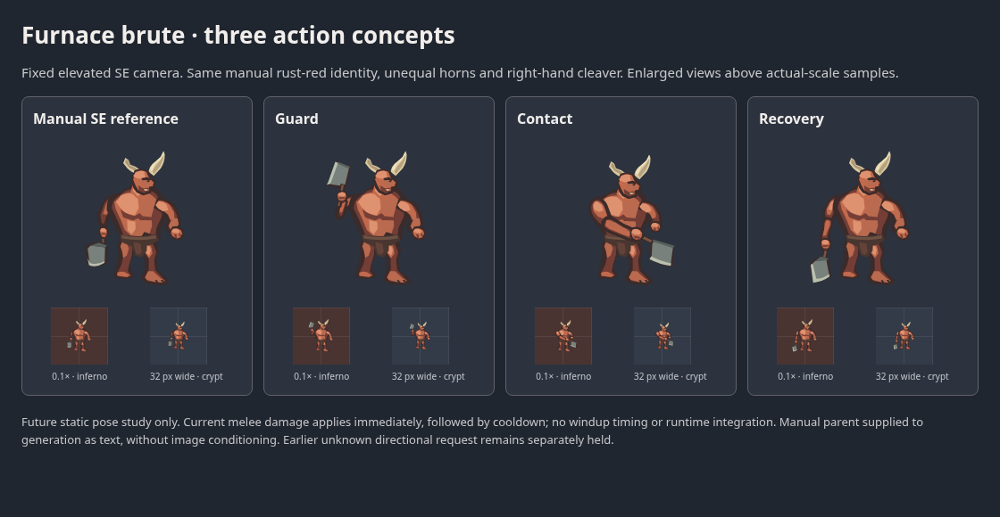

# Furnace brute action-pose study

Three static SE/front-quarter poses extend the manually authored Furnace brute: gathered guard, committed contact and recovery. High-left, low-right and low-left cleaver positions provide the main native-size distinction. The rust-red mass, unequal ivory horns, broad supporting feet and anatomical-right forged cleaver remain coherent. This is future presentation art, with no runtime adoption or timing claim.

[Open the comparison](preview.html) for native inferno/crypt samples and phone layouts. The unchanged manual reference is beside the exact generated extracts. All three gestures read at 0.1 scale and on 32px-wide canvases. Guard/recovery share most torso and leg geometry; contact lowers the head/torso modestly, rather than demonstrating a complete weight transfer. Weapon/arm changes dominate this study. Wrist/grip/handle/blade connections, horn clearance and leg silhouettes were inspected enlarged and native. No hand correction was applied.

## Admission, behavior and dependency

The existing brute #155 supplies four directions without action poses; #156 and #161 address hound/acolyte action studies. This is one physical melee gesture vocabulary, rather than another direction sheet or a retry of the earlier unknown direction request.

Exact identity is `demon` / Furnace brute: physical melee, range1.4, HP70, damage13 and speed1.4 in main `3a59621069dd1fe912a749d851d27e993507f5dd`. `packages/diablo2/src/domain/combat.ts` immediately applies an eligible in-range melee hit and starts the ordinary18-unit/elite12-unit cooldown. Enemy state has no facing or authored ordinary attack phase. Gathered guard specifies no delay; no new damage, range, attack, boss behavior or combat mechanism is introduced. The shared `demon` shape and Lucent boss are untouched.

**Review-only stack on #155.** Base branch `art/directional-emberwake-brute-2026-11-06`, frozen parent `a4bfa14bc6319f2a5333b4d450dde630fc24ff02`; #155 must land first. The genuine design parent is `emberwake-brute-2026-11-06-demon-se`, file `../directional-emberwake-brute-2026-11-06/demon-se.svg`, SHA-256 `e121f28ff55a85201fe494ee98f5f4636225b4fb4da01c3fde90693e2ab9bcf6`. The existing parent file and registration are unchanged. Its exact SVG is supplied in the new prompt **as text**, without image conditioning. This dependent branch does not duplicate parent artwork or discard its real lineage.

## One new request and receipt

[Request](request.json): `gpt-image-2.6-sunburst`, high quality/complexity, SVG author `gpt-6.1-terra` with high reasoning;1536×512, three384×416 workspaces. [Budget](budget.json) preserves grant `sprite-brute-action-16`, unique client trace and pre-dispatch bound **$2.925795**, within the existing **$3** reservation. The client ID is a trace only, not an idempotency or retrieval handle.

[Receipt](receipt.json): HTTP200,164.63seconds, `req_bcba960636e64719b75e63bc6257559a`. Returned usage estimates **$0.098461**; **$2.901539 released**, **$0 remaining** for this grant. The estimate uses documented standard rates and is not independently verified billing. No second call/retry occurred. Earlier unknown outcomes—including the brute direction request's full $3—remain unchanged and separate; they are not released by this successful call.

[Original sheet](original.svg) is the exact API output, SHA-256 `8cca06d0c06c6aa4a0e87afd6a5fa7d891dfda30c6fa37da0d150773eadd214a`. The three `demon-se-*.svg` files are raw group extracts: only outer sheet translations were removed, preserving inner geometry/colors. [Extraction](extraction.json) records exact cells/digests. There is no model reroll, manual derivative, GIF or raster-wrapped SVG.

## Review and registration boundary

[Validation](validation.json) records static SVG safety, three pixel-identical sheet/extract comparisons, transparent margins, silhouette comparisons and 390/320px phone review. Visible bounds are guard28.2×37.5px, contact24.4×36.5px and recovery28.6×37.5px at0.1scale. Contact is narrower than the approximately30px brief due weapon/arm projection; its canvas scale is unchanged. No edge clipping or phone overflow was observed. One retained comparison PNG is losslessly recompressed with identical decoded scanline data and unchanged non-IDAT chunks; other raster QA is temporary.

The shared [canonical library](../../iterations/library.json) now registers one attempt and four source revisions: original plus three extracts, with the real manual SE parent above. The redundant transport import was retired after exact record comparison and consumer tracing; its original remains in source commit `dc7af88172cfc7c6d5d64de69c016e410137e938`. All asset/runtime fields remain null. Existing parent records, game defaults and selection bytes are unchanged. #155 must land first; later library additions require serial reconciliation.

No timing, continuous playback, interpolation, reduced-motion behavior or runtime compatibility has been established. Future adoption must retain immediate melee semantics, exact monster-ID routing, boss/mod fallback, HP/status markers and field-owned shadows. Technical checks and author self-review do not imply user art acceptance.

Registration QA used Node24.21.0 and official Chrome157.0.8103.38. All three extracts again matched their sheet crops pixel for pixel, with unchanged inner geometry and zero edge pixels. Shared-gallery source/compact/enlarged views, exact request/settings and parent/comparison attachments were inspected at desktop1440px and phone390/320px, including20px text, without overflow or page errors. Source-study use stayed disabled; a cancelled removal preview retained the shared original and listed its three derivatives. The gallery uses fitted source/compact boxes; game-scale assessment uses the explicit0.1× and32px samples in the owning comparison. Scoped maintenance, history verification and existing selection/removal/offline browser journeys are reported in validation.json. These checks establish source-history integrity, not animation or game compatibility.
