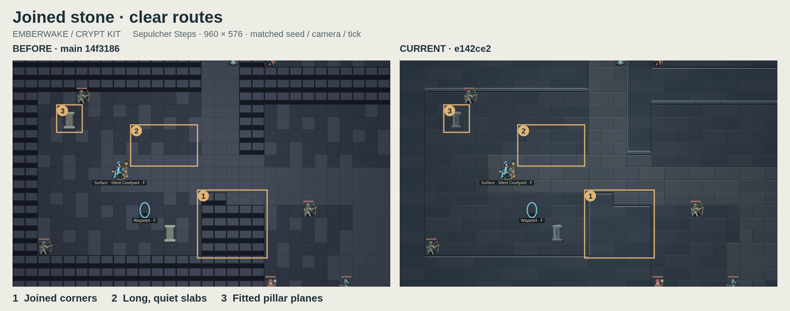
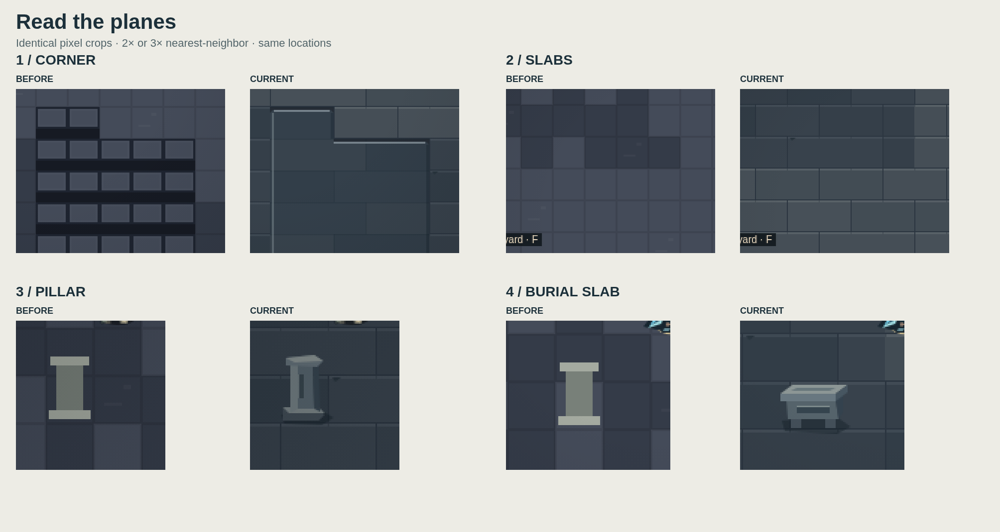
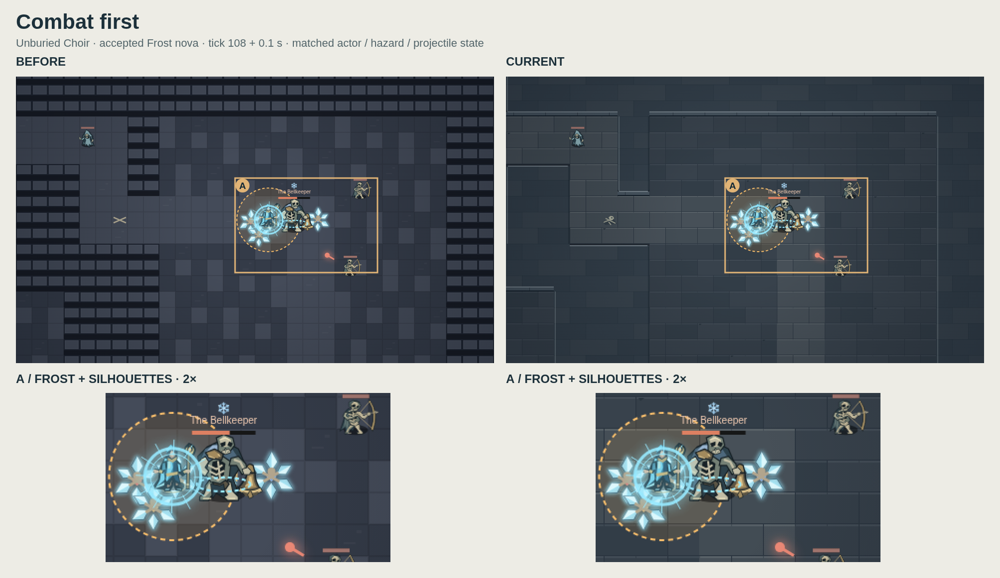

# Emberwake · crypt kit · issue 69

**Joined stone · quiet slabs · clear routes**

| Context             | Before                          | Current                       |
| ------------------- | ------------------------------- | ----------------------------- |
| Native entrance     | [Main](baseline-entrance.png)   | [Kit](current-entrance.png)   |
| Burial slab         | [Main](baseline-altar.png)      | [Kit](current-altar.png)      |
| Crowded combat      | [Main](baseline-combat.png)     | [Kit](current-combat.png)     |
| Fog enabled         | [Main](baseline-fog.png)        | [Kit](current-fog.png)        |
| Actual UI · 1440 px | [Main](baseline-ui-desktop.png) | [Kit](current-ui-desktop.png) |
| Actual UI · 390 px  | [Main](baseline-ui-phone.png)   | [Kit](current-ui-phone.png)   |

## Scope and iteration

[Issue 69](https://github.com/qianyizhang/game/issues/69). Baseline: current main `14f31860a4bf5c7bf568fbacf804c8cd60a3a9ca`, including PR65. Art and test source: `e142ce2d624edcb468ad56b823b0e7c1041d742f`. Later evidence commits do not change those bytes. The source hashes and screenshot hashes are in the [receipt](receipt.json).

Representative: Sepulcher Steps entrance, with a right-angle wall junction, connected route and paired piers. V1 replaced per-cell wall stamps, checker highlights and flat columns. Author pixel inspection found the wall mass too flat and the unconverted burial altar still reading as another column. The [iteration sheet](iteration.png) retains the wall correction. The refined kit adds recessed courses and an exposed ledge, then expands to existing burial slabs and weathered bones. The other crypt regions inherit the same bounded kit.

[crypt-environment.ts](../../../../packages/diablo2/src/ui/crypt-environment.ts) draws crypt cells and existing stone/bone landmarks inside the renderer's existing static terrain build. Wall planes follow adjacent blocked cells; floor slabs span two or three cells. Routes remain lighter. The original terrain-cache key, sight cache, fog pass, actor/effect layers, markers and minimap remain in [render.ts](../../../../packages/diablo2/src/ui/render.ts). No domain, content, save, accessibility-control or other art source changes. The haunted-island studies and PR65 are separate.

## Matched capture protocol

Seed `CRYPT-KIT-69`, Mira, 960 × 576 backing pixels, fixed production camera and identical state/time in each pair. Entrance: `bells-3`, tick 0, player `(8.5, 23.5)`. The burial-slab detail moves the presentation fixture's player to `(26.5, 36.5)`, at tick 0, to frame the existing altar. These are renderer fixtures, not campaign witnesses.

Crowded combat uses seed `FROST-OVERLAP-1`, a legal sandbox jump to the Bellkeeper, movement toward the boss, and advance commands through tick 108. An accepted Frost nova supplies overlapping cold impacts; capture time is tick time plus 0.1 s. Enemies, hazard, projectile, camera and effects are identical in each pair. The existing frost tests separately check opaque actor pixels and pause/reload behavior.

The [fog sheet](fog.png) uses the entrance fixture with reveal disabled. Actual UI captures import the same legal sandbox replay, retain fog, and hold the browser clock after resume. All controls and surrounding UI remain visible. Desktop and phone accessible button text and canvas bounds match; neither viewport overflows. The [context receipt](context-receipt.json) records bounds and labels.

Baseline `render.ts` was copied from the pinned main revision with only import paths made absolute for Vite; its hero, monster, effect and domain dependencies match current. Source scenes were captured once per art revision. Sheets add labels and boxes outside/over exact scene copies; detail enlargements use nearest-neighbor sampling. Raw captures remain linked above. No generated or retouched game pixels.

## Performance and limits

Linux x86_64 cloud container, 5 exposed AMD EPYC 9V74 CPUs; Node 24.21.0, npm 11.19.0, Playwright 1.64.0, official Google Chrome 156.0.8078.73. Disposable profiles and the normal browser startup guard remain enabled. Chrome package URL and SHA-256 are in the receipt. No Mac execution.

Interleaved baseline/current samples, 12 fresh canvases and 240 warm frames per renderer/scene after 20 warmups. Fixed 960 × 576 backing size. Times are `performance.now()` around synchronous Canvas 2D submission: no GPU fence, FPS, sustained-device or physical-phone claim.

| Scene              | Baseline cold p50 | Current cold p50 | Baseline warm p90 | Current warm p90 |
| ------------------ | ----------------: | ---------------: | ----------------: | ---------------: |
| Sepulcher entrance |           12.2 ms |          24.5 ms |            0.6 ms |           0.6 ms |
| Bellkeeper arrival |           11.6 ms |          18.5 ms |            0.6 ms |           0.6 ms |

The extra masonry work increases first-paint submission cost. Warm frames reuse the existing cached terrain; architecture and image dimensions are unchanged. Timings have 0.1 ms resolution and are not general performance guarantees. Full distributions and exact sibling-frame hashes: [performance.json](performance.json). Marsh, desert and inferno representative frames are pixel-identical to baseline in this environment.

## Verification boundary

Completed local browser checks on the delivered source bytes: three existing frost journeys pass; the two new crypt stair/fog/cache journeys pass after correcting paused-first-paint and corner-vignette fixture expectations. Initial strict TypeScript passed before the new browser file was added; final-source diff whitespace passed. These are focused results, not a final-head gate.

The saved cloud workspace became unavailable before final-head processes could start. Pending: formatting/inventory, affected ESLint, strict TypeScript, production build, field-runtime/session tests, and the selected browser run including the developer atlas and generated crypt dungeon. Independent pixel review also remains pending. Full campaigns, unrelated geometry/native authoring and physical-device performance were not selected. Local raw logs and capture helpers are retained in `.artifacts/issue-69-crypt-kit/`; the [receipt](receipt.json) identifies the durable result.

Draft PR creation for `art/issue-69-crypt-kit` targeting `main` was denied by automatic approval review: it found no trusted user authorization for creating/publishing the PR. No PR was created, and that action was not retried. The branch and images were already pushed at `7269c31ef1ec9d05f08aeed9953d1ed49719fbe9`; this documentation correction changes no art or test bytes. No approval, merge or Site publication.
