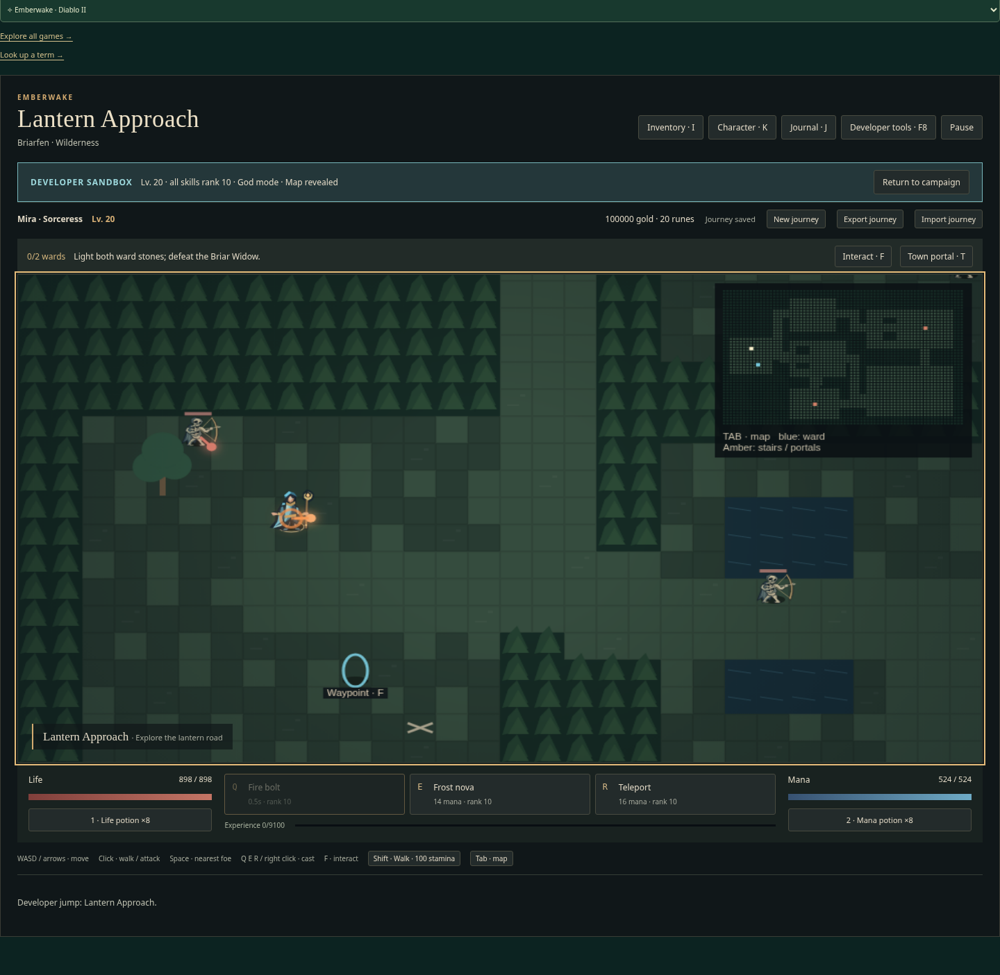

# Reproject Emberwake cursor targets when casting

| Original                                                            | Updated                                                          |
| ------------------------------------------------------------------- | ---------------------------------------------------------------- |
|  |  |

Matched 1440 × 1080, scale 1, public Sorceress sandbox lantern-1, same field cursor, W held 800 ms, then Q; captured 100 ms after Q. Original target y23.4796 remains stale; Updated y20.7596 follows the displayed camera. Native cursor pixels are absent from headless captures; field-relative position was x485.8/y351. Normal-campaign behavior is covered by the tracked tests.

- Original source: `bebe081234cfbacab30389373f274e7e88be9759`.
- Reviewed implementation: `5920de120c525e81ce7dea87503c10c4e46eb18a`.
- Change: Store the last field cursor in logical canvas coordinates and project it through the last displayed camera when keyboard or hotbar casts occur.
- Acceptance: Keyboard/hotbar casts use the displayed cursor target after movement; right-click retains exact target parity after cooldown; self-centered skills stay centered and region arrival clears stale cursor aim.

The normal-campaign original failed target-y equality by 2.6996 tiles. Final keyboard/hotbar cases passed 2/2 in 9.2 s, including accepted right-click parity after cooldown. The unchanged Barbarian centered/region journey passed in V1 (2.1 s). V1 harness corrections count accepted cast commands rather than flushed advance commands and replace unsupported findLast with at(-1) plus a type guard; production code was unchanged. Projection uses viewCamera.current from the last completed render, including display interpolation, not a new simulation camera. Hotbar keeps the last field point; region changes clear it. All heroes share DiabloApp, with Necromancer source-inspected only.

Pass: final 2/2 normal-campaign keyboard/hotbar journeys; unchanged centered-skill/region journey retained from V1; scoped lint/format/inventory and build. Independent review accepted. Final 2/2 and the retained V1 pass are distinct runs. Inputs settle 100 ms after movement; fractional-frame, Necromancer, phone/resize and full-campaign targeting were not separately exercised.

Local runtime: Node 24.21.0, npm 11.19.0, Playwright 1.64.0, Chrome 156.0.8078.79. Existing startup, assertion and test guards were retained. This publication reuses valid captures and checks; it adds no gameplay changes. Hosted CI is reported on the draft PR.

Image SHA-256:

- `original-1440.png`: `8137fb0f6bc8615da807cb18a76a25989f988400c036db65f28591f4f530f00e`
- `updated-1440.png`: `c275120177390da98331c21305a82ee6ab248b90c6789ee3fa557f7568e2148b`
