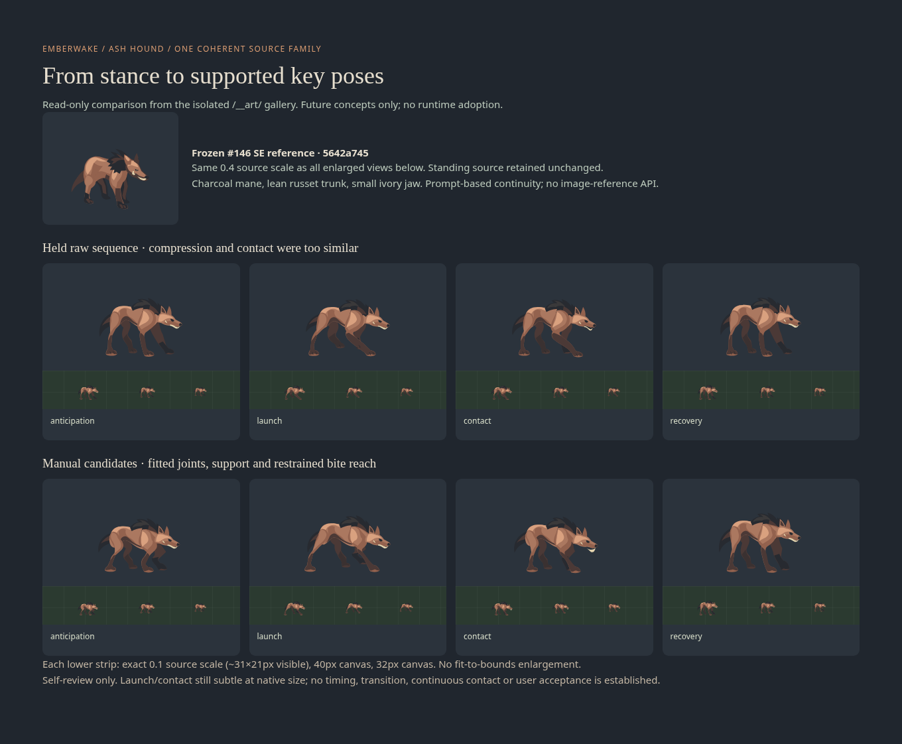

# Ash hound · physical melee motion source study

Candidate-only four-pose study for exact enemy ID `hound`, based on current main
`3a59621069dd1fe912a749d851d27e993507f5dd`. Canonical registration is assigned to
the serial gallery coordinator. No runtime mapping, facing state, gameplay,
selection, merge or deployment belongs to this lane.

## Admission and pre-generation checkpoint

**Need:** evaluate compression, a short supported launch, contact and recovery
for the same Ash hound at about 30×24px. These are **future motion concepts**:
current physical melee approaches to range 1 and applies damage when cooldown
expires; it has no corresponding four-phase animation contract. See
[content](../../../../packages/diablo2/src/domain/content.ts) and
[combat](../../../../packages/diablo2/src/domain/combat.ts).

**Reuse comparison:** inspected current `beast` renderer and the actual frozen
[hound SE SVG from PR #146](https://github.com/qianyizhang/game/blob/5642a745f69c54e2eeb8816fffdcc86d452d8946/docs/art/assets/directional-emberwake-enemies-2026-11-06/hound-se.svg)
and its enlarged/native pixels before drafting. That saved source is the immutable
checkpoint; this lane does not edit it or copy its bundle. The four directional
quarters establish standing anatomy and camera but cannot themselves demonstrate
loaded joints or supported contact. Whole-figure transforms/composition would
move paws and skull rigidly without fitting elbow/hock motion. A single coherent
four-pose source sheet tests that specific gap. Continuity is prompt-based; the
SVG endpoint accepts no image reference. Other views are available in the
[source record](https://github.com/qianyizhang/game/blob/5642a745f69c54e2eeb8816fffdcc86d452d8946/docs/art/assets/directional-emberwake-enemies-2026-11-06/README.md).

**Brief:** `hound` / lean ash-russet living quadruped / anticipation → low
forward launch → planted bite/reach → weight-restoring recovery / high withers,
low haunch, charcoal mane, tapered muzzle and small ivory jaw / screen-upper-left
light, three large value groups / same SE/front-quarter, 27° elevated orthographic
square-tile camera / about 30×24px, checked at 32–40px. No flame, armor, terrain,
baked shadows, text or VFX. The slightly high rump of #146 is a known reference
limitation, not a feature to magnify.

**Cost and ownership:** one original SVG, four extracts if separable, one call
record, one concise import and selected comparison evidence. The art lane owns
this source family; the serial coordinator owns canonical registration. The
motion gap warrants this bounded source study, not a second runtime package.
No GIF, additional creature or second paid request is included. One centrally
reserved US$3 grant, with a verified US$2.979445 planning bound, covers the call.
The planning pool is user-reported, not an independently verified balance.

**Preservation and checks:** retain exact original, held/rejected output and real
derivatives with parents. Keep `hound` separate from `beast`, which also serves
Briar Widow. Current heroes, crypt enemies, selections and shared registry stay
intact. Technical SVG safety, compact visual self-review, isolated real-gallery
inspection and runtime compatibility are separate findings. Canonical import
remains a draft blocker until performed by the serial coordinator.

## Generation

The [canonical call record](../../iterations/files/emberwake-hound-motion-2026-11-06/call.json)
owns the exact prompt/settings, unique client request ID, pre-send reservation,
transport policy and terminal receipt. The configured network-secret binding is
used only through the inherited HTTPS proxy to the official OpenAI endpoint.

## Outcome and visual self-review

**Four useful manually fitted source candidates; raw sequence held.** The exact
[original sheet](../../iterations/files/emberwake-hound-motion-2026-11-06/original.svg)
and its four unchanged cell extracts remain preserved. All extracts render
pixel-identically to their original cells. The generated animals read clearly,
but anticipation barely loads and launch/contact are too similar to establish
a convincing sequence. No second paid request was made.

The displayed [manual candidates](preview.html) share the returned anticipation
master to retain skull and trunk identity. Separate limb root, knee/elbow,
hock/wrist and paw constraints create a compressed anticipation, a pushing rear
support and reaching foreleg, a shorter planted contact and a taller recovery.
A two-plane neck bridge follows the body/head masses; the contact lower jaw opens
slightly. Toe cuts tied to the old feet were removed. The separate
[manual authoring record](../../iterations/files/emberwake-hound-motion-2026-11-06/manual-authoring.json)
records those actual operations and limitations. These derivatives have their own
revision IDs and parent links; they are not presented as untouched model output.

At the exact common 0.1 source scale, raw visible bounds are 30.5–31.7×21.5–22.5px;
manual bounds are 30.8–32.4×20.4–22.6px. The lower loaded poses deliberately lose
height. No individual fit-to-bounds enlargement hides the target-size comparison.
The evidence also shows 40px and 32px canvases. Silhouette, charcoal mane, russet
planes and the small ivory jaw survive reduction; the scar and tiny face marks
cannot be credited at native size. Manual launch/contact separation is still
subtle there. Front-quarter depth is shallower than the standing source. Timing,
in-between transitions, continuous contact, final anatomy and user acceptance
remain open; this is not a production animation or seamless loop.

Ordinary hound damage resolves immediately on entering attack range when its
cooldown permits. A nearer living ally within four tiles may be targeted instead
of the player. Cooldown is 1.8 simulation seconds, or 1.2 for elites. Nothing in
this source study adds an anticipation delay or changes those rules.

## Receipt and registration handoff

The single call returned HTTP 200 in 206.81 seconds, request
`req_8ac799526adb43f5aca448c9f76ef69d`. Engine: `gpt-image-2.6-sunburst`; SVG author:
`gpt-6.1-terra`, high effort. Image quality/complexity: high/high, 1024×768, `n=1`.
SVG does not support streaming, partial images or reference-image input; none
was sent. Transparent isolation is prompt-specified rather than using the
PNG/WebP transparency parameter.

Usage: 1,405 image-model text inputs, 1,204 image outputs; 2,568 author inputs,
13,578 author outputs (including 3,188 reasoning tokens, not charged twice).
Standard uncached usage-derived cost: **US$0.113603**, active hold **US$0**,
releasable central reservation **US$2.886397**. This is not an invoice or account
balance verification. No unused allowance is reused in this lane.

The additive [history import](history-import.json) contains two attempts and nine
revisions: one exact original, four raw extracts and four manual derivatives.
All are unassigned source studies with null runtime files. It was imported into
an isolated real `/__art/` gallery and each revision's decoded artwork, parent,
source record and disabled game-use action was inspected. That is **not canonical
registration**. The single serial coordinator should import this file from the
frozen PR head after integrating this family. Do not copy this branch's isolated
test registry; the shared registry and selections are unchanged.

[Validation](validation.json) separates static safety, exact raw extraction,
footprint measurements, isolated gallery checks, visual findings and coverage.
The preview file is a retained review page; cloud Chromium denied its `file://`
navigation with `ERR_BLOCKED_BY_ADMINISTRATOR`, so that action was stopped and
not retried. Required gallery inspection used the independent, already running
loopback application. No file-page browser verification is claimed.

Local checks passed on pinned Node 24.21.0/npm 11.19.0: repository formatting,
maintenance inventory/links (901 managed sources, no errors), shared history
verification (709 current sources, 92 revisions, no selections), isolated import
verification (101 revisions, no selections), and all 11 history contract tests.
All nine SVGs pass the static vector safety check; four raw extracts match their
sheet pixels exactly; every figure has transparent edge margins. The actual
isolated gallery decoded all nine revisions, showed exact settings/parents and
disabled game-use controls, and fit a 390px viewport without horizontal overflow
or browser errors. This custom Chromium review is not the repository Google
Chrome E2E suite. Full application/geometry/native suites and runtime adoption
were not exercised because this family has no executable or runtime consumer.
Hosted CI is reported against the frozen PR head separately. Canonical import,
continuous-motion review and user selection remain open.
