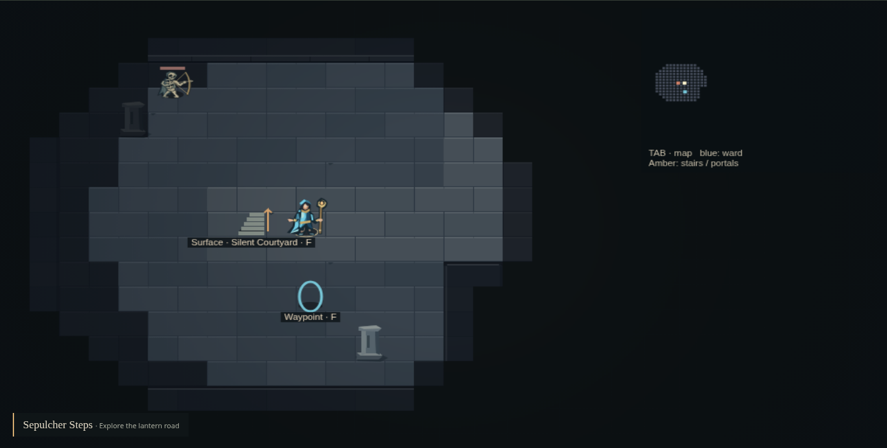
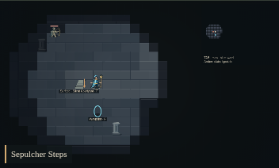

# Emberwake stair direction

The Sepulcher Steps surface return (`bells-3/up` → `bells-1`) displayed a
downward arrow beside “Surface · Silent Courtyard”. The renderer now uses the
existing `up` portal identity to orient that arrow upward. Descending arrow
coordinates, stairs, labels, interaction, fog, actors and world content are unchanged.

| Actual game view                          | Baseline                                                      | Corrected                                                  |
| ----------------------------------------- | ------------------------------------------------------------- | ---------------------------------------------------------- |
| Desktop canvas, 1388 × 703                |  |  |
| Phone canvas, 352 × 212 at 390px viewport |               |            |

Whole UI: [baseline desktop](baseline-desktop.png), [current desktop](current-desktop.png),
[baseline phone](baseline-phone.png), [current phone](current-phone.png).
The affected marker is left of the hero, immediately above the surface label.

Captures use the same legal `CRYPT-KIT-69` sandbox replay, a move beside the
stairs, frozen clock, explored fog and desktop/390px viewports. Baseline revision:
`89e37bc0f5a6ee8c7494946764ac5c0943ce67b7`. [Evidence identities](evidence.json)
pin source and PNG SHA-256 values, measurements and changed-pixel bounds.
Only the arrow differs: 208 pixels on desktop and 15 on phone, including the
whole-UI comparisons; all other captured pixels are equal.

Independent review accepted v1 after inspecting all eight matched images; no v2
was requested. This accepts the direction correction only. The cue remains tiny
on phone, and the initial entrance actor overlap is outside this repair.

Technical checks are separate from that visual verdict. The new browser regression
checks the exact surface/descent routes and rendered amber arrowheads using legal
movement with fog retained. It failed on the baseline (upper wing 0 pixels versus
lower wing 4), then passed with the correction. All three crypt browser tests passed,
including return/reload persistence and terrain-cache/fog behavior. Scoped ESLint,
root TypeScript, formatting, maintenance inventory/links and the production build
passed. No SVG, gameplay, native-asset or full functional rerun was required.

Runtime: Node 24.21.0, npm 11.19.0, Playwright 1.64.0 and Chrome 156.0.8078.73,
using the unchanged local startup/version guards and 30-second deadline.
