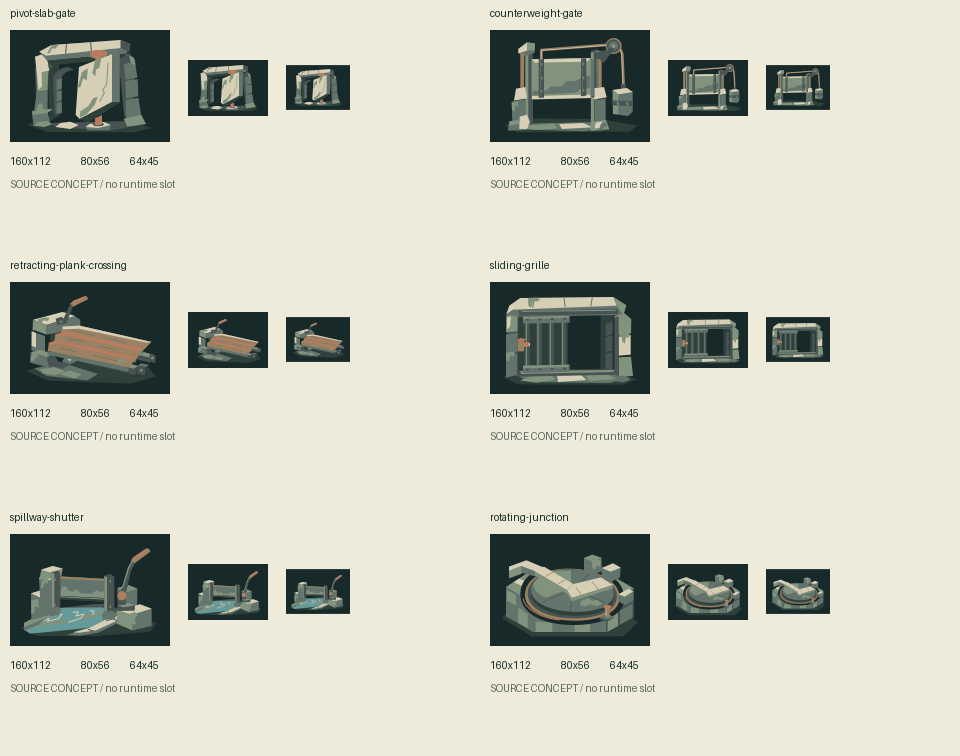

# Cartographer threshold mechanisms

Six future source concepts for threshold motion and support, independent of [the completed first suite](https://github.com/qianyizhang/game/blob/7ec2480ddf89599dff8d7f5d71ce900b728ac822/docs/art/assets/expansion-archive-spire-2026-11-06/README.md). The shared-pool coordinator granted **one** request with a **$6.50 reservation**, recorded before dispatch in [the call record](call.json). Other pool capacity is not assumed available.

## Admission and brief

Existing `src/shared/layout/layout.ts` owns matching doorways, quarter-turn room rotation and an always-clear central cross. `src/games/cartographer/ui/ExpeditionChoice.tsx` previews those rotations; `MapCues.tsx` and `FrontierArt.tsx` provide a separate small navigation arrow. None defines an illustrated physical mechanism or an interactive closed-door state. These concepts are environmental composition sources for a future expansion, not additions to the current 35px board, blocked passages or a new interpretation of those rules.

The first suite already provides a circular floodgate wheel, stairs, hinged screens, culvert and furniture. Reuse those for their existing purposes. This batch instead tests a spindle-supported pivot gate, rope/counterweight load path, nested guided planks, lateral grille/pocket, low shutter/lever, and an inset quarter-turn route disk. Ordinary recolors or alternate furniture were rejected as duplicate scope. Current open PRs #137–#140 were audited in the prior source review; current main remains `3a59621069dd1fe912a749d851d27e993507f5dd`.

Common brief: nonliving stone/forged-metal mechanisms, visibly connected support, unequal planes and useful passage-shaped negative space; subdued archive stone/sage/copper and upper-left light. Intended review sizes are 160×112 and 80×56, with an additional 64×45 contour check. The exact subject gestures, material interpretations, positions, safe inset and vector constraints occur once in `call.json.request.prompt`. No prior asset is edited, so there is no old source to checkpoint or unchanged catalogue to freeze.

Ownership and cost: the archive art lane owns source review, exact original and six actual extractions. Keep only useful candidates; no permanent runtime slot, default, selector, game art or canonical history is created. Any future interactive use needs its own rules, accessibility and game-context review. Artwork validity and self-review do not establish independent or user acceptance.

## Provenance and review

`call.json` is the authoritative request/settings, grant, response usage/request ID, cost, output digest, lineage and exception record. The exact sent request is reconstructible from its documented JSON serialization; the prompt is not duplicated into another file. No credentials are stored. Model support and standard pricing were rechecked immediately before this request; both requested models appeared in a successful authenticated models-list preflight, using the existing configured proxy/binding.

A terminal result will be preserved as `original.svg`; extracted groups retain their local background and remove only the grid translation. This is a source-art bundle, not an animation or a player. Retain a single useful native/compact contact sheet; use temporary rasterizations for comparison rather than a permanent raster catalogue. Generate the required additive gallery import from this shared call record, validate it in isolation, and keep that redundant transport document temporary. The reconstruction recipe below preserves the registration contract without committing another output inventory. Shared registries stay untouched.



Status: one successful request, **$0.141775** usage-derived cost, lifetime worker estimate **$0.927917**, and **$0 outstanding reservation**. Six author candidates passed native/compact visual inspection. The guided planks read more clearly than their retracting action at compact size; no mechanism is engineering-certified or implemented. Some foreground reaches a 24px inset instead of the requested 28px; nothing paints outside its cell.

All six extractions preserve exact vector geometry/paint and remove only the group grid translation. Rasterizer rounding creates a few edge-pixel differences (documented in `call.json`), so universal byte-identical raster extraction is not claimed. The contact PNG's lossless optimization was verified exactly for decoded pixels, dimensions, alpha, mode and color metadata.

SVG safety (seven files), the seven-revision staged import, 390px gallery decoding/lineage/settings, disabled selection and formatting/inventory/links checks passed. Central registration remains a draft blocker; this is not merge-ready or adopted game art. No continuation artwork existed before this grant. The earlier coordination ledger remains a historical record; this confirmed shared-pool grant supersedes its former fixed lane ceiling for this one call.

## Rebuild the staged additive import

The gallery transport is derived, not another source of truth. This recipe writes only an ignored staging file; it does not register or select art. Each original/extraction receives a revision, with shared prompt/settings/usage through the one attempt.

```python
import json
from pathlib import Path

d = Path("docs/art/assets/expansion-archive-spire-continuation-2026-11-06/thresholds")
c = json.loads((d / "call.json").read_text())
a = c["id"]
revisions = []
for o in c["outputs"]:
    original = "cell" not in o
    revisions.append(dict(
        id=a + ":" + Path(o["file"]).stem, asset=None, attempt=a,
        label="Threshold source / " + Path(o["file"]).stem,
        file=(d / o["file"]).as_posix(), digest=o["sha256"],
        parents=[] if original else [a + ":original"],
        runtimeFile=None, runtimeDigest=None,
        notes="Exact API original." if original else
              f"Cell {o['cell']}; remove its grid translation only. Review: call.json.",
    ))
h = dict(schema=1, assets=[], attempts=[dict(
    id=a, title="Threshold mechanisms / one native SVG request",
    date=c["date"][:10], outcome="returned",
    notes="Future source concepts; exact request, usage, lineage and review: call.json.",
    files=[(d / f).as_posix() for f in ["call.json", "README.md", "contact.png"]],
)], revisions=revisions)
p = Path("test-results/thresholds-history-import.json")
p.parent.mkdir(parents=True, exist_ok=True)
p.write_text(json.dumps(h, indent=2) + "\n")
```
