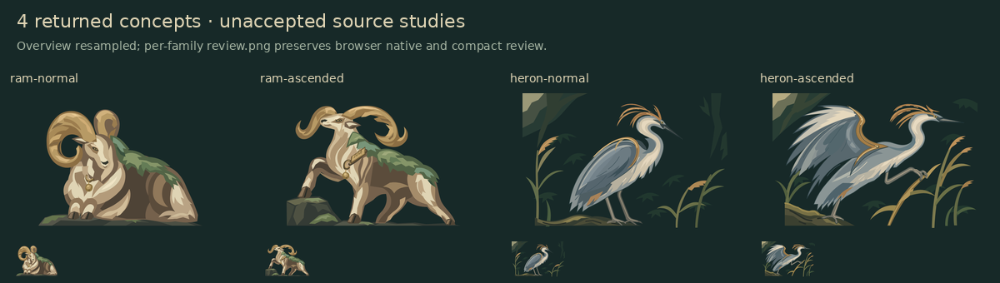

# Four Hearth portrait source candidates

This first suite contains **four of 36 planned concepts**: ram and heron
normal/ascended pairs. The other 32 were not generated in this suite; later
continuation work is separate. These are unassigned expansion concepts, with no
invented canon, runtime slot, rules, selection or adoption.

## Brief and admission decision

Base `3a59621`, November 6, 2026. The user requested optional SVG directions for
future expansion. Existing Hearth `content/minions.ts` and
`CreatureIllustrations.tsx`, plus the focused small-unit compact review, supplied
the natural-color, connected-plane and selective-gold reference. Existing small
units and wolves remain unchanged. Recoloring those assets cannot evaluate the
new ram/heron anatomy, silhouettes and normal/ascended support gestures.

The original plan also compared Blindside's paper/forest-ink Jokers and
Scrapyard's 20-role suite for distinct future objects/machines, avoiding PR #137's
subjects. Those unexecuted scaffolds have no live consumer here and remain
recoverable at `f8cef09`. The continuation reuses game palettes and construction;
future adoption still requires an owned purpose, quality/admission review and
actual game/phone context. This study owns only saved sources and review evidence,
with no new dependency, renderer or maintained runtime variant.

## Records, cost and failure

Each actual call has one `call.json` containing its exact sent prompt/request,
settings, sanitized response usage/request ID, review, or genuine failure:
[ram](hearth-ram/call.json), [heron](hearth-heron/call.json),
[tortoise](hearth-tortoise/call.json). Original vectors remain `original.svg`;
normal/ascended SVGs are named group extractions. The
[shared history](../../iterations/library.json) owns the IDs, digests, parents and
extraction recipes for three attempts and six outputs. The redundant import
transport is retired after checking its canonical facts and migrating its sole
README consumer. Exact call records remain here once per request.

Two `gpt-image-2.6-sunburst` calls with medium `gpt-6.1-sol` SVG authoring succeeded.
Known estimated cost is **US$0.257728**. The tortoise connection closed after
301.04 seconds without artwork, HTTP status, request ID or usage. Its billing
remains **unknown**, with the **full $7.50 reservation retained**, not a known
charge; no retry occurred. No credential was created, changed or exposed.

The historical [opening ledger](spend-ledger.json) is retained byte-for-byte
because continuation accounting pins its digest. It is historical evidence, not
current shared-pool spending authority. This cleanup makes no paid call and
changes no ongoing reservation/accounting. Three never-dispatched prepared
requests are also retained at their pinned paths/digests for continuation:
[badger](hearth-badger/request.json), [mantis](hearth-mantis/request.json),
[moth](hearth-moth/request.json). Their duplicate prompt copies were removed.

## Review and verification

Author review inspected enlarged, 160×112, 80×56 and 64×45 views. Ram's resting
and stepping contours read clearly; the wider ascended horn arc needs identity
review. Heron's folded/raised wings are distinct, but copper edging reads
ornamental and the background is busy. Per-call records retain the full findings.
User aesthetic acceptance and actual game frames/selected states remain pending.

[QA](qa.json) consolidates source safety/bounds, native comparisons, lossless
PNG evidence and isolated import/gallery results. Three extracted renders are
pixel-identical to their source cells; heron ascended differs in 130 color
channels by at most 5/255 with equal alpha. This is recorded as an antialias
exception, not pixel equality. All six SVGs and four PNGs remain byte-for-byte
identical to the original suite.

Open `/__art/#asset=__unassigned` on the local development server and find
`expansion-hbs-20261106` among the source revisions. **Generation and authoring
attempts** includes the ram, heron and failed tortoise records, with their exact
settings and failure. This branch registers 709 assets, 98 revisions and zero
selections. The failed attempt has no invented image; all six new revisions remain
unassigned, with adoption disabled.

Live gallery inspection covers every revision, its native/compact image, parent
records and exact call text, plus desktop, 390px and 320px layouts at 16px/20px
text. Technical checks do not establish aesthetic acceptance; user review and any
future game-context verification remain pending. No artwork, runtime, gallery
implementation, default or selection changes are included. Other unmerged art
PRs have independent shared-history additions; later integration must reconcile
those additions without replacing existing records.
