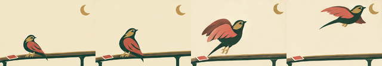

# A Wing Above the Market

A new Blindside candidate story: the Nightjar watches above a lone face-down card,
then leaves the rail for the open sky. New events and setting are proposed fiction;
the existing Joker and its scoring rule stay unchanged.

[Watch the native GIF](story.gif) · [Browsable storyboard](index.html) ·
[Review and limits](review.md) · [Grounding and planned beats](brief.md)

Two original 16-frame GIFs, 300 ms per frame. The joined local derivative contains
all 32 original frames at their original timings: **9.6 seconds**, once through.
The chapter boundary is a visible cut with redraw drift, not seamless continuity.

Originals: [opening SVG](reference.svg), [Watch](chapter-1.gif), [Away](chapter-2.gif).
The only retained input PNGs are the actual [opening raster](reference.png) and
[Watch endpoint](references/chapter-1-last.png). Inspection frames are temporary.
[References](references.json) records exact input hashes and reconstruction;
[animation](animation.json) records timing, joined lineage and decoded evidence.

Exact prompts, trace IDs, request IDs, returned usage and original-output hashes
live once per call in `calls/`. [Common settings](../continuation-generation.json)
reconstruct the sanitized requests without storing encoded images or credentials.
Three successful calls cost an estimated **$0.197560** from returned usage and
published rates. No active/unknown local request or unused block reservation.

[Validation](validation.json) distinguishes technical and visual findings.
[Staged import](history-import.json) has four unassigned source-study revisions;
canonical registration is pending the serial coordinator. No runtime consumer,
selection or user aesthetic acceptance is claimed. No shared infrastructure changed.
