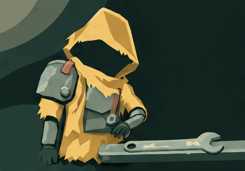

# Between Waves — held motion study

**Incomplete candidate fiction.** One native SVG pilot and one useful Notice
chapter are preserved beside three held Engage attempts. The planned tightening
and final test were not generated. No completed story,accepted canon or runtime
adoption is claimed.

| Source                           | Review status                                                             |
| -------------------------------- | ------------------------------------------------------------------------- |
| [SVG opening](reference.svg)     | Useful composition pilot                                                  |
| [Notice GIF](chapter-1.gif)      | Useful4.8s chapter; reference/pose drift documented                       |
| [Engage original](chapter-2.gif) | Held: grip/ring/length continuity                                         |
| [Engage r1](chapter-2-r1.gif)    | Held: apparent-length change;2D measurement is not proof of3D deformation |
| [Engage r2](chapter-2-r2.gif)    | Held: jaw/hex-fastener seating remains unconvincing                       |

Every GIF stays native and contains all16 original300ms frames. All64 frames
were inspected temporarily; there is no permanent frame catalogue. Two PNGs
remain solely because they were exact actual API inputs. Originals,C2PA markers,
request/usage/client IDs,reference recipes and five source revision identities
remain intact. The five calls cost an estimated**$0.370241**; this is not a
verified billing statement or artwork acceptance.

[Review and stop reasons](review.md) · [Original storyboard proposal](brief.md) ·
[Compact frame/timing evidence](animation.json) · [Actual PNG lineage](references.json) ·
[Canonical source history](../../../iterations/library.json) · [Checks and limits](validation.json)

Canonical registration contains five actual attempts and five source revisions. The shared settings file is
[stored once](../continuation-generation.json); exact prompts,responses and
usage live once per request under `calls/`. Existing game defaults stay unchanged.

All four originals loop natively. This study has no joined GIF; it makes no
claim to fix shared gallery Stop/Play after a nonlooping joined GIF ends.

## Canonical registration boundary

Open `/__art/#asset=__unassigned` and find `Between Waves`. All five original
outputs and both exact sent PNG inputs remain unchanged, with explicit original/
input/attempt lineage and source failure judgments. The three held Engage trials
remain visible, rather than becoming a finished or accepted story. No Tighten/
Test output, assembly or runtime identity is invented.

The redundant import transport was retired after exact canonical comparison and
README consumer migration. Shared settings are byte-identical to the independent
Cartographer/Hearth story branches, without an unmerged ancestor dependency.
Native playback, Stop, reduced-motion blocking, exact prompt/settings/input
inspection, lineage and desktop/phone enlarged-text layouts receive actual
gallery review, followed by scoped maintenance/history and affected browser
journeys. Independent library additions require serial reconciliation.

Actual shared-gallery inspection passed five source revisions, 19 exact
desktop/mobile text/input views, full native playback, Stop/image recreation,
reduced-motion blocking, lineage, disabled Use and six viewport/font combinations
without page errors. All four GIF/timing digests match animation.json; both
exact input PNGs and recorded frame lineage verify. Frame-accurate restart is
not asserted here, and there is no once-playing assembled GIF in this study.
Scoped repository gate outcomes follow; no artwork acceptance is implied.

Registration passed `format:maintenance`, `assets:history -- verify`
(709 assets/97 revisions/zero selections) and all three asset-history browser
journeys at normal limits (33.3s aggregate). Existing registered assets/sources/
selection bytes and every other owned artwork/input/call/review file remain
unchanged. This is technically reviewable provenance for an incomplete held
study, not a finished story or artwork acceptance.
