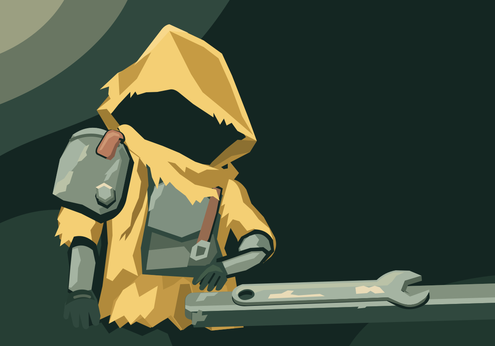

# Between Waves — held motion study, incomplete

**Incomplete:** one useful Notice chapter and three held Engage attempts.
No tightening,test or completed story; no runtime adoption.

One text-guided native SVG returned under grant `story-scrapyard-pilot-03`.
The exact prompt, response, usage and request ID live once in
[the call record](calls/reference.json); its common settings are linked by the
staged import. No API input image was sent for this generation.

Author self-review: **useful scene pilot, physical repair unproven**. The yellow
hood, dark face opening, worn steel and image-left shoulder identity survive at
160×112. The near arm remains attached below the plate; the opposite hand rests
beside the wrench. The hexagonal fastener stands proud of the plate. Background
detail stays quiet. Production SVG safety and native/compact rendering passed;
this is not user acceptance or accepted story canon.

The wrench is oversized: a later chapter must lift and turn it visibly before
its jaw could meet the fastener. The reach/contact is a real test, not a promised
outcome. Extra chest and forearm armor complicates the silhouette but does not
add another shoulder plate. The broad glove fingers are stylized. The subsequent grip event is reviewed below; lift, contact, tightening and
successful repair remain unproven.

## Chapter one — Notice

[Play the original GIF](chapter-1.gif). All16 frames were inspected in temporary
contact sheets and native real-time GIF playback. The downward hood inclination
and opposite glove reaching/closing on the wrench handle are visible. The arm
beneath the plate stays attached and relaxed; one wrench stays on the ledge,
one shoulder plate and proud fastener remain. No tightening was observed or
claimed. The clip has16 unique composed frames,300ms each,480×336,4.8s.

The GIF shifts shapes/placement rightward and uses a grainier painted texture
than the cleaner SVG; its first frame is not an exact match to the sent still.
The final frames settle with small changes rather than a pixel-identical hold.
These are continuity limits, not a seamless transition or rejected API outcome.
The useful observed grip can ground a continuation. Exact prompt/settings,
client trace ID, response and usage are in `calls/chapter-1.json`; there was one
request and no retry.

## Chapter two — Engage · HELD

[Original held GIF](chapter-2.gif). All16 frames and native playback were
reviewed. The wrench visibly lifts and turns through the requested upper arc;
the opposite arm stays attached and the jaw reaches the loose fastener. The
starting composition broadly follows chapter one's endpoint, with small
pose/texture drift. The plate stays on the image left and no tightening or
repaired-arm test is established.

**Hold for tool continuity:** the glove moves toward the wrench head rather than
staying beside the ring-ended handle. The lower shaft extends much farther in
projection and the ring end disappears below the frame. Jaw engagement is
visible, but a constant-length rigid tool and intended near-ring grip cannot be
verified. Do not promote this trial into a completed sequence or infer that the
repair succeeded. Preserve the complete original and all16 frames in evidence;
no frames are removed or hidden. It returned successfully as an API request;
visual hold and billing outcome are separate facts.

## Chapter two revision — ring/grip improved, length still HELD

[Full original revision](chapter-2-r1.gif). The same two exact PNG inputs were
sent once under grant `story-scrapyard-gif-06`; no automatic retry. All16 frames
and native real-time playback were inspected. The ring end stays in frame,
the glove remains close to it and the arm stays connected. The jaw reaches the
fastener, with no observed tightening. This improves the specific ring/grip
failure in the first trial.

**Constant apparent length still fails review.** Approximate manual image-plane
landmarks from ring-hole center to the base of the open jaw decrease from about
178px at frame0 to about133px at frame15; intermediate frames shorten during
the turn too. Landmark placement has several pixels of uncertainty, but the
roughly20–25% decrease is much larger. This is a2D appearance check,not a3D
rigidity measurement. No depth/foreshortening explanation is accepted as proof
of the explicitly requested constant apparent length. Keep this as an improved
motion study with a hold; do not treat its endpoint as a verified repair state
or proceed automatically to tightening.

The projected-span check above is deliberately limited: it establishes that the
requested image-plane span was not maintained,not that a3D rigid object must
have deformed. Ring/head shape changes and depth tilt can cause foreshortening.
No camera/depth calibration exists to prove or rule out that explanation. The
subsequent endpoint-only repair tests the composition without the earlier
conflicting pose anchor; it does not erase this source or retroactively accept it.

## Final allowed repair — contact still HELD; motion path stopped

[Full original final repair](chapter-2-r2.gif). It used only the exact chapter-one
endpoint PNG,removing the earlier SVG pose anchor,and constrained the glove near
the low-waist fulcrum. It was the ONE permitted repair in finishing block
`story-scrapyard-finish-block-07`,sent once with a unique client trace ID. No
additional narrow-angle diagnostic was dispatched.

All16 frames and native playback were reviewed. The whole tool/ring stays in
frame,the glove stays near the ring,and the arm remains connected. Apparent
ring-to-jaw span varies less than r1: approximate sampled image-plane spans are
around160–175px. Several pixels of landmark uncertainty and plausible projected
foreshortening prevent a claim of exact rigidity or a proven3D deformation.
The hand still travels farther left than the requested anchor region.

The decisive hold is contact: the final open jaw appears to surround the copper
strap area ABOVE the original lower hex fastener,while the fastener is obscured
by the solid head. Clear seating around the hex cannot be verified. Do not
interpret mere overlap as mechanical engagement or begin tightening from this
endpoint. No repair success or ending test has been observed.

Under the block's explicit stop rule,this motion path ends here. One of its
three calls executed and settled; two unused calls/$3 reservation are returned
for coordinator pool reconciliation. No Tighten,Test,extra diagnostic or further
retry was sent. No cropped excerpt substitutes for the failed full action and
no completed story is claimed for this incomplete arc. Its draft is a held
motion study preserving failure evidence,not a finished narrative. The useful SVG/Notice
study and every full held original remain available for later human review.

Only native SVG/GIF originals, both exact sent PNG inputs and concise records
are retained. Other PNG renders, source comparisons and all64 extracted frames
remain temporary. The chapter-one endpoint is now retained because it was actually sent.
The held chapter-two endpoint remains temporary and is not a planned input. No permanent frame catalogue, new player, runtime
selection or runtime integration is added here.
