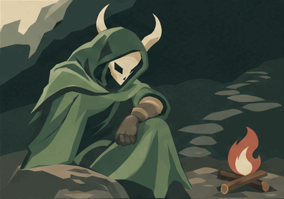
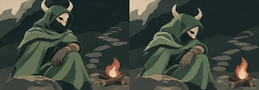

# One Quiet Breath — Spire story candidate

**Revised ending keeps both horns in frame;the original clipped ending remains
inspectable.** The Silent lets a guarded hand relax at a campfire,then makes a
small look toward the climb. Candidate fiction,not accepted history,an HP effect
or a runtime replacement.

[Responsive review](index.html) · [Revised assembled GIF](story-r1.gif) ·
[Let Go original](chapter-1.gif) · [Again framing correction](chapter-2-r1.gif) ·
[Clipped Again original](chapter-2.gif) · [First assembly with hold](story.gif) ·
[Original SVG](reference.svg)

Both assemblies contain32 original300ms frames,9.6s each,with exact respective
source pixels/timing. The revised ending has approximately15–19px horn clearance
in all16 frames. It keeps seated body scale and hand/knee support;the gesture
is quieter than the original rise. Pose/texture drift at the cut remains.No
seamless,fixed-geometry or user-acceptance claim.

The original chapter crops horn tips at frames5–6 and9–15. Its GIF,first joined
assembly and [original comparison](compact.png) remain unchanged;no failed
frames are removed or hidden. [Review](review.md) records the before/after and
independent assessment.

Four calls cost an estimated**$0.297804**. Native SVG/GIF originals,two exact
sent PNG inputs and two selected compact comparisons remain;other frame review
outputs are temporary. Exact prompts/settings/responses/usage and lineage live
once per call/shared record,not a permanent PNG catalogue.

[Grounding and original proposal](brief.md) · [Checks](validation.json) ·
[Staged source-only import](history-import.json)

The HTML uses native GIF playback once and an SVG for reduced motion. Shared
gallery Stop/Play after a nonlooping ending has a known restart limitation;this
package does not fix it or claim true pause/seek. Central registration remains
pending. Existing game defaults stay unchanged;technical/author checks do not
establish user acceptance.
