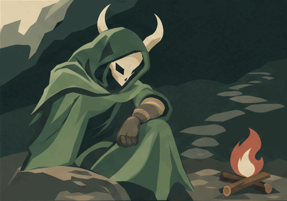
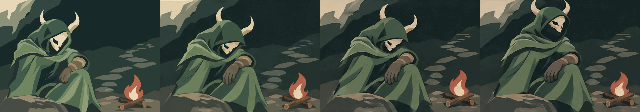

# One Quiet Breath — Spire story candidate

**Coherent two-chapter vignette,with an ending-framing hold.** The Silent lets a
guarded hand relax at a campfire,then lifts her mask toward the climb. This is
candidate fiction,not accepted history,an HP effect or a runtime replacement.

[Open the responsive review](index.html) · [Assembled native GIF](story.gif) ·
[Let Go original](chapter-1.gif) · [Again original](chapter-2.gif) ·
[Original SVG](reference.svg)

The joined GIF has32 original300ms frames,9.6s,assembled locally from two16-frame
API outputs. Source pixels/timing are preserved exactly;the cut still has pose
and texture drift. Late chapter-two horn tips clip the top edge. No frames were
removed or hidden,and no seamless or fully-in-frame claim is made.

Three calls cost an estimated**$0.234239**. Native SVG/GIF originals,two exact
sent PNG inputs and one compact comparison remain;all other frame inspections
are temporary. Exact prompts/settings/responses/usage and lineage are normalized
in `calls/`,`references.json` and `animation.json`,not a permanent PNG catalogue.

[Story grounding and proposal](brief.md) · [Observed review and holds](review.md) ·
[Checks](validation.json) · [Staged source-only import](history-import.json)

The HTML uses native GIF playback once and an SVG for reduced motion. Shared
gallery Stop/Play after the nonlooping ending has a known restart limitation;
this package does not fix it or claim true pause/seek. Central registration and
visual framing correction remain draft blockers. Existing game defaults stay
unchanged;technical checks do not establish acceptance.
