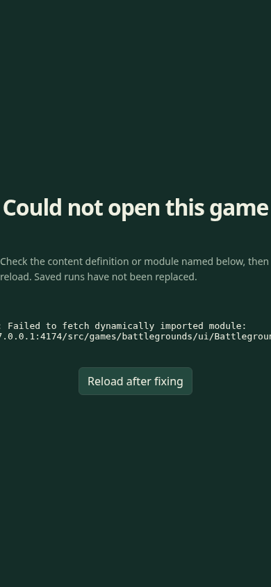
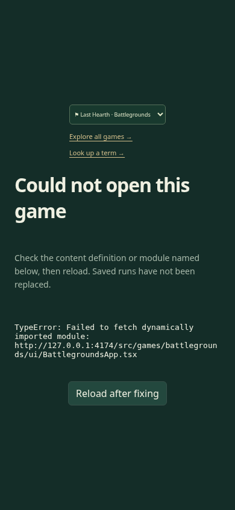

# Recover navigation after a screen fails to load

| Original                                                                      | Updated                                                                            |
| ----------------------------------------------------------------------------- | ---------------------------------------------------------------------------------- |
|  |  |

[Original desktop](original-1440.png) · [Updated desktop](updated-1440.png)

A failed lazy module replaced the entire game interface with an error and reload
button. The prior saved run remained intact but could not be reached through the
error screen. The fix keeps Choose game available, clears active auxiliary-screen
state when switching, and contains long diagnostic text on a phone. The existing
alert and reload action remain; game rules and replay/save formats are unchanged.

## Matched evidence

Original source: `bebe081234cfbacab30389373f274e7e88be9759`. Updated source:
`60a5191d34a4ce924b69da706955a1f148e4979e`. These are preserved actual Chrome
156.0.8078.79 captures at scale 1: phone 390 × 844 and desktop 1440 × 1080.

Both views start Blindside's default FIRST-LIGHT Small Blind, then select Last
Hearth while its lazy module request is deliberately aborted. The saved Blindside
bytes remain identical. This controlled fault exercises the existing production
interaction; it is not evidence of a spontaneous network incident. The matching
views use localhost4174 and the same run, viewport and zoom.

## Verification and independent review

- Original source plus the new regression fails at the missing Choose game control. V1's Challenges recovery also failed: switching changed the game URL but retained the failed screen. The final callback clears Challenges, gallery and workbench markers; final tests cover all three.
- **Final:** `playwright test --project=functional tests/browser/shell.spec.ts` passed 8/8 (22.8s), covering keyboard navigation, saved bytes, reload after fault removal, contained phone layout and auxiliary-screen exit/reload state.
- **Retained from V1:** seven replay-import/lifecycle journeys passed in the earlier 12-test run (30.8s). Those seven were not rerun after the recovery callback refinement; they are separate from the final eight shell results.
- Final scoped ESLint, four-file Prettier, maintenance inventory/link checks and TypeScript/Vite build passed, with the existing large-chunk warning. Node 24.21.0/npm 11.19.0 and Playwright 1.64.0 were used; CI stayed unset and existing guards remained intact.
- Independent reviewer accepted the final four-file diff and actual phone/desktop pixels with no remaining in-scope findings. The shared-boundary callback and phone picker ordering findings were corrected. The reviewer inspected retained logs without rerunning tests; final static/build results were owner-reported.

Full application/simulation, geometry, native Blender and unrelated browser suites
were not run locally. The PR records hosted CI separately. The ignored
`.artifacts/game-load-recovery/` bundle retains original and V1 failure traces,
logs, probes, hashes and capture scripts; this directory is the durable comparison
set for review. No captures were regenerated for publication.
