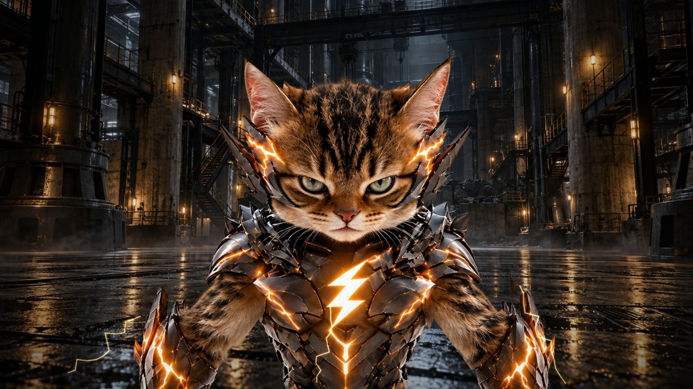
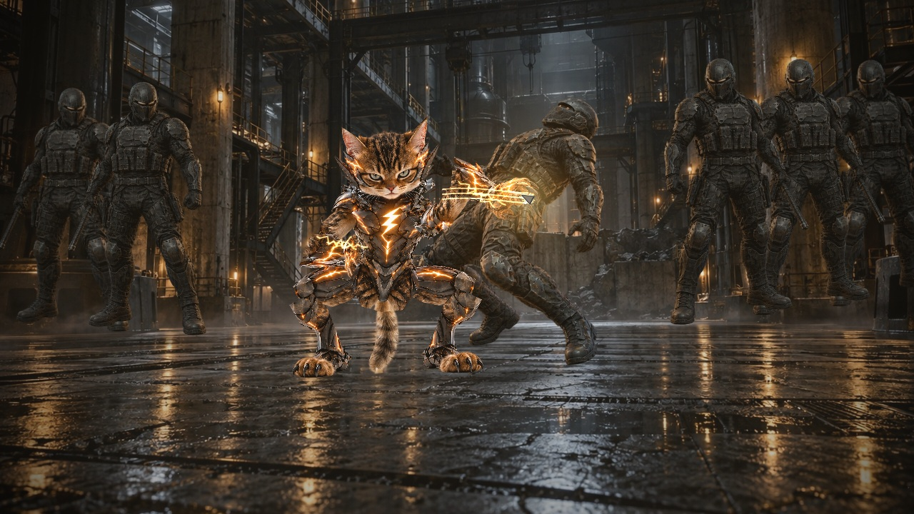
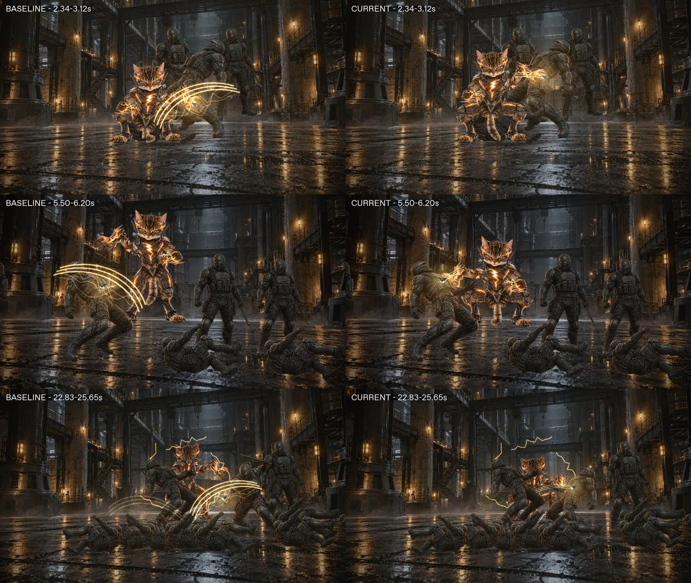

# 金弧裂爪 · 黑甲雷袭

30 秒黑金猫科英雄动作短片。单文件 HTML 无按钮、文字叠层或播放控件；
人物、场景、动作、金白电弧、火花、残影和声音均随文件交付，无运行时网络依赖。

[Creation journey](creation-journey.md) records the initial 3D attempt, the 2.5D
pivot and the subsequent reference-based revision.

当前修订以用户提供的三视图为造型依据。Image Gen 据此生成
[正面角色母版](hero-front.webp)与[背面角色母版](hero-back.webp)，保留大猫头、
棕色虎斑毛发、裸露毛臂、宽大爪足、锯齿黑甲、发光裂纹与胸前闪电标志。
这些是参考图衍生的透明素材，并非原图的逐像素抠图。

- [播放源文件](film.html)：1280 × 720，16:9，900 个确定性帧，30fps。
- [完整 GIF](golden-claw.gif)：512 × 288，900 帧，30 秒，无声，循环播放。
- [带音效 MP4](golden-claw.mp4)：960 × 540，恒定 30fps，30 秒，H.264/AAC。
- [开场近景](opening.jpg)与[战斗画面](action.jpg)：同一交付的实际渲染帧。





## 动作与声音

| 时间     | 表现                                       |
| -------- | ------------------------------------------ |
| 00–04 秒 | 贴脸锁敌、首秒电弧爪击、拉远后低位切入     |
| 04–08 秒 | 低头闪避、肘击、空中爪击、墙面反扑         |
| 08–12 秒 | 电弧擦镜、高处下扑、落地环形冲击与连击     |
| 12–17 秒 | 精英单位、蓄力近景、连续猎影突进与重击     |
| 17–22 秒 | 墙面折返、跃起、倒挂入镜、近身突袭         |
| 22–27 秒 | 半秒蓄能、环场连闪、密集爪痕与单点终结     |
| 27–30 秒 | 倒地敌群、收束电流、英雄定姿、前冲擦镜切黑 |

敌人由 6 人增加至 12 人，包含精英单位与最终头目。命中事件统一驱动敌人
失衡与倒地、爪痕、碎片、火花、冲击环、停顿和镜头震动。

无背景音乐。动作音效由文件内的确定性 Foley 合成器生成，包括破风、
电弧、低频撞击、金属震动及轻微呼吸；它们不是实拍同期录音。
浏览器可能要求先点击画面才能解锁声音；画面仍自动播放且不显示控件。
GIF 格式不支持音轨，MP4 保留完整音效。

## 实现与质量边界

这是写实材质的 **2.5D 动作动态分镜**。主角由正背面透明母版分成头部、耳朵、
躯干、骨盆、四肢、爪足和尾巴，通过二维骨骼拟合、双段肢体 IK 与姿态插值运动；
落地动作约束爪足位置，耳朵有轻微摆动，尾巴随动作弯曲。敌人使用四个反应姿态，
配合工业场景底片、连续路径、分层视差、镜头与程序特效合成。
它仍不是完整三维骨骼电影；二维切片接缝、透视转身、真实接触形变、立体绕拍
及结构破坏尚未达到原始电影级 CG brief 的要求。
保留这些限制供审阅，不把技术检查通过作为电影质感验收。

本次由作者自审。检查过近景、战斗、倒挂、终结与收尾实际帧，修正过
前景遮挡、敌人图集切片带入邻近姿态、远景站位和结束后敌人重新站起的问题。
终结命中后敌人保持倒地；非终结命中才允许明确恢复。图像由本次 Image Gen 生成；
全部实际使用的图像字节已嵌入 HTML，HTML 是可编辑的唯一播放源。

[原版开场](baseline-opening.jpg)与[原版战斗帧](baseline-action.jpg)保留为对应时间点的
对照；当前预览和视频采用新的参考角色与运动实现。

### 接触动作修订

先以 1.40–2.30 秒的短段验证首击：保留足底支撑，加入收爪与可达的躯干高度伸展，
让命中特效来自求解后的爪尖轨迹。该短段经独立查看实际 MP4 后获得局部认可；
这不代表整片或原始电影级 brief 已验收。

随后逐个检查其余命中点，仅修正实际出现同类问题的动作：

| 范围（秒）                                                  | 修正                                                                     |
| ----------------------------------------------------------- | ------------------------------------------------------------------------ |
| 2.60、7.25、14.55、21.40、23.05、24.06、24.40、24.74、25.42 | 减少击打时躯干下沉，爪击伸向躯干；落地动作保留足底支撑，扑击保留悬空腿姿 |
| 5.85、15.10、23.72、25.08                                   | 按空中身体高度调整可达手臂，避免爪尖从敌人上方掠过                       |
| 11.14、18.00                                                | 修正踢击脚端高度，并用实际脚端驱动接触                                   |
| 10.50、11.48、13.45、14.00、18.85、20.35、23.38             | 保留原有出击姿态，将独立的大弧线改为窄幅爪尖轨迹                         |

相关段落在伸展与收势期间朝向当前敌人，在两击之间转向。快速连击的敌人先完成当前
接触，再移向下一击；不再在受击瞬间提前离位。肘击、滑铲、落地冲击、重击和终结
的主角姿态没有重做。重击与终结附近仍可见前一击重新定位后的少量飞散碎片。



十个短段共 331 帧的同时间对照用于本轮作者自审。首击已认可的 28 帧保持像素一致；
15 个新增姿态修正保留 200/162 的上臂、前臂长度，命中时腕部可达距离为
96.88–326.79，处于 38–362 的双段臂可达范围内。技术数值只用于排除脱节和支撑回归，
视觉结论仍限于这些接触比原稿更清楚，二维切片、转身和遮挡限制仍存在。

最终 GIF、MP4、开场与战斗预览来自同一次 900 帧捕获；其中 331 帧与已审阅短段的
JPEG 字节一致。捕获源的 SHA-256 为
`84aa3b0315047db933d7efb5a044196af07781b27707de21a2e118f9ff0a9178`。

## 导出与验证

HTML 暴露无界面的捕获接口：`window.film.ready`、`film.frame(0..899)`、
`film.seek(seconds)`、`film.audioBuffer()`。帧接口进入手动模式，停止自动推进；
重复采样同一帧得到相同画面。音频为 48kHz 单声道浮点采样。

在浏览器等待 `film.ready` 后，依次调用 `film.frame(i)` 并导出 canvas。
交付 GIF/MP4 使用全部 900 帧，分别导出为 512 × 288 和 960 × 540。
帧图片命名为 `%04d.jpg`，音效保存为 `foley.wav` 后：

```sh
ffmpeg -framerate 30 -i '%04d.jpg' -vf scale=512:288:flags=lanczos,palettegen=max_colors=96:stats_mode=diff palette.png
ffmpeg -framerate 30 -i '%04d.jpg' -i palette.png -lavfi '[0:v]scale=512:288:flags=lanczos[v];[v][1:v]paletteuse=dither=none:diff_mode=rectangle' -loop 0 -final_delay 3 golden-claw.gif
ffmpeg -framerate 30 -i '%04d.jpg' -i foley.wav -vf scale=960:540:flags=lanczos -c:v libx264 -preset slow -crf 18 -pix_fmt yuv420p -c:a aac -b:a 160k -movflags +faststart -frames:v 900 -t 30 golden-claw.mp4
```

GIF 时间单位为 10ms，无法表达恒定的 33⅓ms 帧间隔。交付使用 30/40ms
交替延迟，900 帧总计恰好 30 秒，平均 30fps；MP4 为恒定 30fps。

维护测试解析 HTML 内联脚本、检查嵌入资源及无 UI/无网络依赖约束，并独立解析
GIF 的尺寸、全部图像块和总延迟。浏览器测试加载交付原文并拒绝额外请求，
检查七段画面的变化、重复 seek、结尾黑场、音频与窄屏比例。
这些测试位于现有工具测试和浏览器检查范围内。

```sh
node --test packages/workshop-tools/art/golden-claw.test.ts
npm run test:browser -- --project=functional tests/browser/golden-claw.spec.ts
```
