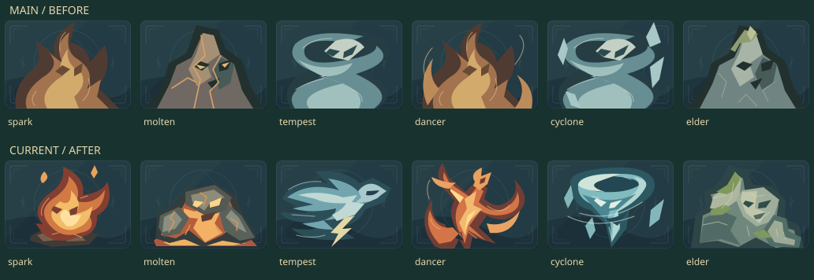
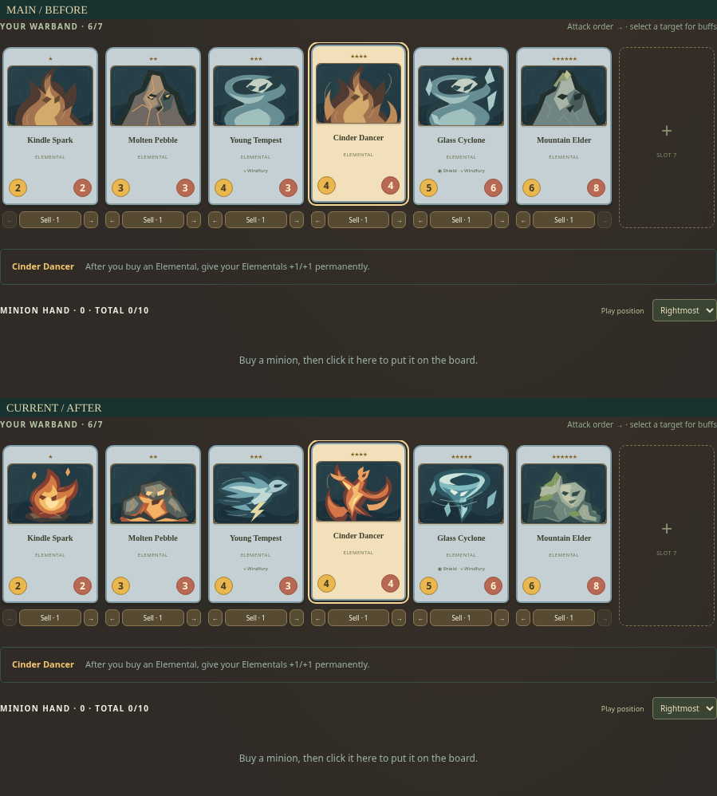
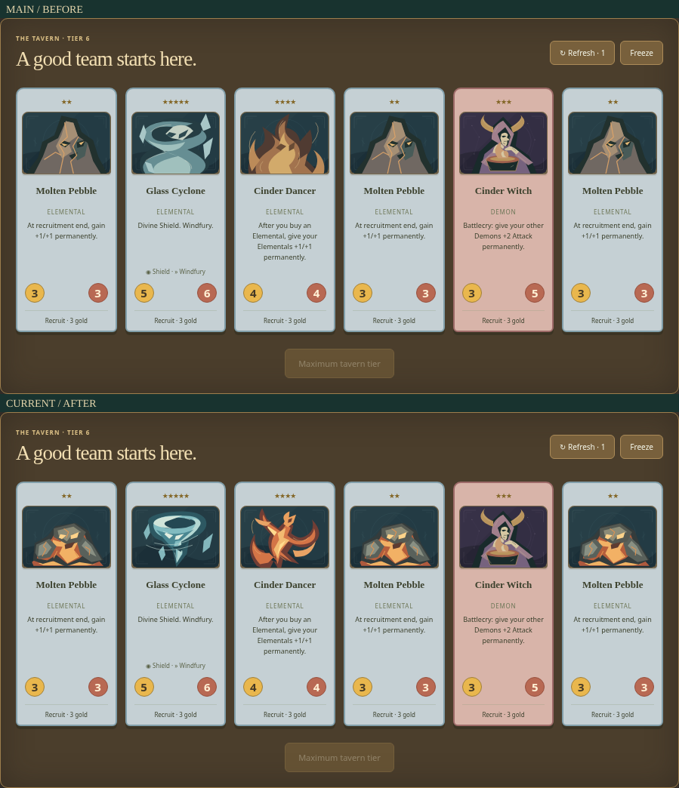

# Last Hearth core elementals · issue 59

[Issue #59](https://github.com/qianyizhang/game/issues/59) asks six core elementals to stop repeating three portrait templates. The renderer is [MinionArt.tsx](../../../../src/games/battlegrounds/ui/MinionArt.tsx). Baseline main is `da8b3c39097a27a300b414af9b89bdceb234a1ff`; final art and browser-test source is `9ed7497b40141d5283e5270ea6922a90a70f2584`. Evidence commits add no further artwork changes.

| ID        | Physical interpretation and leading gesture                                                 |
| --------- | ------------------------------------------------------------------------------------------- |
| `spark`   | A buoyant ember curls upward from cooling charcoal; a round core and split flame tip.       |
| `molten`  | A squat basalt creature sags around a hot liquid belly; both fists meet the lava pool.      |
| `tempest` | A storm front drives right, leaving open sky between trailing gusts and a lightning strike. |
| `dancer`  | A high reaching arm, crossed pointed foot and answering fire ribbons form a dancing figure. |
| `cyclone` | A hollow glass funnel has a rounded lip, a broken twisting waist and orbiting shards.       |
| `elder`   | A terraced mountain shoulder rises above a forward stone face and a heavy planted hand.     |

The representative v1 separated Tempest/Cyclone before expanding the set. Author inspection found a rigid leading face on Tempest and a cup-like faceted rim on Cyclone. V2 curved the face, rounded the hollow opening and interrupted the funnel waist. [V1 against baseline](v1-pair.png) and [v1 → v2 at native and 2×](v1-to-v2-pair.webp) retain that decision. The remaining four forms then developed distinct forces, weight and material planes.

## Matched exports

Every image uses this column order: **Spark, Molten, Tempest, Dancer, Cyclone, Elder**. The upper row is baseline; the lower row is current.

| View                  | Evidence                                   |
| --------------------- | ------------------------------------------ |
| Normal · 160 × 112    | [Matched sheet](normal.webp)               |
| Normal · 320 × 224    | [Enlarged matched sheet](normal-zoom.webp) |
| Golden · 160 × 112    | [Matched Golden sheet](golden.webp)        |
| Small board · 68 × 48 | [Matched small-size sheet](board.webp)     |

The [export receipt](export-receipt.json) records 644 decoded SVGs at each revision: exactly the twelve requested normal/Golden IDs change, 632 remain pixel-identical, and no IDs are added or removed. Source outside `ElementPortrait` is byte-identical to baseline, including the accepted mechs, human crew, Golden framing, dispatch and unknown-ID fallback. Golden uses the existing palette and corners while retaining each subject's value structure and identity. SVG export bytes are hashed in the receipt; complete temporary cabinets remain under `test-results/elementals-before` and `test-results/elementals-six-v2`.

## Actual-game review

| Context                   | Baseline                                               | Current                                              |
| ------------------------- | ------------------------------------------------------ | ---------------------------------------------------- |
| Selected board · 1440 px  | [Before](context/before-selected-warband-1440.webp)    | [After](context/after-selected-warband-1440.webp)    |
| Tavern · 1440 px          | [Before](context/before-tavern-1440.webp)              | [After](context/after-tavern-1440.webp)              |
| Collection · 1440 px      | [Before](context/before-collection-1440.webp)          | [After](context/after-collection-1440.webp)          |
| Combat · 1440 px          | [Before](context/before-combat-1440.webp)              | [After](context/after-combat-1440.webp)              |
| Selected board · 390 px   | [Before](context/before-selected-warband-390.webp)     | [After](context/after-selected-warband-390.webp)     |
| Board right end · 390 px  | [Before](context/before-selected-warband-390-end.webp) | [After](context/after-selected-warband-390-end.webp) |
| Tavern · 390 px           | [Before](context/before-tavern-390.webp)               | [After](context/after-tavern-390.webp)               |
| Tavern right end · 390 px | [Before](context/before-tavern-390-end.webp)           | [After](context/after-tavern-390-end.webp)           |
| Combat · 390 px           | [Before](context/before-combat-390.webp)               | [After](context/after-combat-390.webp)               |
| Collection · 390 px       | [Before](context/before-collection-390.webp)           | [After](context/after-collection-390.webp)           |
| Recruited hand · 1440 px  | [Before](context/before-recruited-hand-1440.webp)      | [After](context/after-recruited-hand-1440.webp)      |
| Golden hand · 1440 px     | [Before](context/before-golden-hand-1440.webp)         | [After](context/after-golden-hand-1440.webp)         |
| Golden board · 1440 px    | [Before](context/before-golden-board-1440.webp)        | [After](context/after-golden-board-1440.webp)        |
| Golden board · 390 px     | [Before](context/before-golden-board-390.webp)         | [After](context/after-golden-board-390.webp)         |

The public Practice Lab uses `ELEMENTAL-REVIEW-804` with all six IDs on board, tier 6 and 10 gold. A legal refresh offers Molten, Cyclone and Dancer. The test recruits Molten into hand, plays it into the seventh slot, enters combat and reloads. `GLASS-TRIPLE-1` starts with two Cyclones; refreshing and buying the third produces the actual Golden card, then playing it opens Discover. Its selected board, combat presence and reload are checked. Neither journey writes the normal save.

The [context receipt](context-receipt.json) records identical baseline/current accessible labels, art bounds, selected-board and combat save hashes, Golden unit and save hashes, browser provenance and 28 screenshot hashes. Desktop art bounds are approximately 108 × 76 px; phone board bounds are 68 × 48 px. Phone rows scroll horizontally inside the page, so both ends are retained. Combat is paused at frame 0 for matched captures. WebP conversion is lossless; screenshot pixels were not retouched.

Author self-review: the six contours and three broad value groups remain distinct at the smallest board size. Fine engraving reduces at that scale, while the flame core, lava belly, lightning strike, dancer's reach, glass opening and mountain shoulder remain visible. Golden Cyclone retains the opening and narrow foot. Independent visual acceptance remains pending.

## Scoped verification

The final art and test bytes are pinned above. Node 24.21.0, npm 11.19.0, Playwright 1.64.0 and official Google Chrome 156.0.8078.73 were used in the Linux cloud workspace. Chrome package URL, checksum and explicit executable path are in the context receipt. The normal startup guard and disposable profiles remain enabled.

- 🟢 [Candidate local E2E](logs/browser-current.log): 2 passed in 9.4 s; [matched baseline](logs/browser-baseline.log): 2 passed in 8.9 s. Covers the journeys described above, phone overflow, labels and practice-save isolation.
- 🟢 [Existing collection/export E2E](logs/collection-export.log): 2 passed in 9.8 s. The exported cabinet decodes every SVG without application CSS; the Hearth collection retains labels and phone layout.
- 🟢 [Affected application checks](logs/application.log): 12 tests pass across the game and shield-feedback files.
- 🟢 [Production build](logs/build.log), affected TSX/test ESLint, strict TypeScript, [formatting/inventory](logs/maintenance.log) and `git diff --check` pass. The build retains its existing large-chunk warning.
- 🟡 Hosted PR sanity and independent visual acceptance are pending. The change is confined to SVG presentation and its verification; unrelated geometry, native Blender, policy matrices and full browser campaigns were outside the selected scope.

Reproduce the affected browser journeys with `CARD_WORKSHOP_CHROME_EXECUTABLE=<absolute official Chrome binary> npm run test:browser -- --project=functional tests/browser/hearth-elementals.spec.ts`. The optional `ELEMENTAL_REVIEW_URL` points the same tests at a separately served baseline worktree. No rules, stats, tiers, keywords, controls, content IDs, saves or replay meaning changed.
