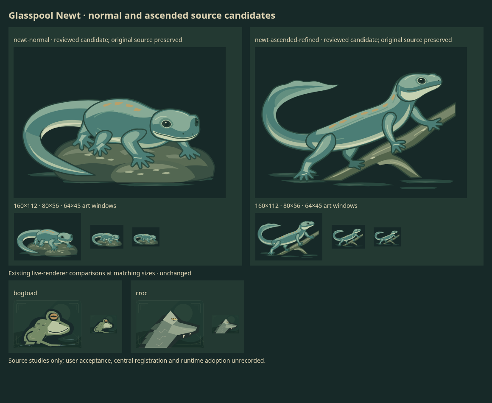

# Glasspool Newt normal and ascended candidates

**One returned native SVG pair, candidate-only.** Normal is an exact extraction;
the reviewed ascended choice is a separate manual support cleanup. The packed
original and held ascended extraction remain intact. User review and central
registration are pending; no runtime slot, accepted canon or mechanics are added.

## Brief and reuse decision

A small smooth-skinned newt supplies a low curved body, short blunt head, four
short rounded-toe limbs and one long flattened tail. Normal rests on wet stone
with an open C tail; ascended climbs a forked root with a higher lifted tail/crest.
Shared teal/sage/ivory skin and quiet ochre marks connect the identity. Body angle,
support, tail gesture and silhouette change together, rather than just color.

At main `3a59621069dd1fe912a749d851d27e993507f5dd`, inspected the roster, retained
request/call briefs and recent PRs; no newt/salamander brief was found.
[Bog Toad](../creatures/bogtoad.md) is a compact tail-less crouch with broad jaw;
[Ancient Crocolisk](../creatures/crocolisk.md) emphasizes its toothed jaw/armored
neck. Their actual SVG renderers were viewed temporarily at 320x224, 160x112 and
64x45. Neither supplies the newt's continuous full-body tail gesture. Ram, heron
and mantis source studies also differ. Existing art remains untouched; unknown
tortoise/badger requests are excluded and were not retried.

## Inventory and visual outcome

[Exact sheet](original.svg) · [normal extraction](newt-normal.svg) ·
[held ascended extraction](newt-ascended.svg) ·
[refined ascended](newt-ascended-refined.svg).

Both extractions preserve source geometry/paint/root attributes and remove only
their grid translation while setting a 720x512 viewBox. Normal has 46 paths;
ascended 41. The ascended original includes an unnecessary detached root sliver.
The manual derivative removes only its two paths, leaving 39; every remaining
node/attribute is identical. This is an authored edit, not a second API output.

Native/card/compact self-review finds the normal and refined ascended useful:
connected head/neck/torso/tail, four leg chains, planted supports, different action
and a clear long-tail silhouette. The ascending tail is a lifted open curl rather
than the exact requested S. Digit separation is stylized; tiny toe counts are not
proven by a readable silhouette. Normal retains more headroom. Both remain distinct
at 64x45 while fine toe/ripple details diminish. This is source review, not an
installed-game frame adaptation, independent review or user acceptance.

[QA](qa.json) records safety, bounds, extraction signatures, rendering limits and
lossless evidence. Both cells stay within the viewport but exceed the requested
safe inset slightly: normal minX30.923/maxX683; ascended minX23.865/maxY481 versus
x40..680/y36..476. No crop occurs. API metadata reports transparent; actual cell
background rectangles are opaque #172928.

Normal's matched screenshot crop is pixel-identical. Ascended local-coordinate
rasterization differs on 7,828 pixels (maximum channel difference44, alpha equal);
restoring translate(720 0) reproduces the original right crop exactly. Thus paint
and geometry are exact, while placement-related antialiasing is not claimed equal.
The only manual-change pixel region is x579..682/y308..422, the detached sliver.

One retained review PNG was losslessly optimized from 199,982 to 199,131 bytes;
decoded RGB pixels, 1160x950 dimensions and alpha/color metadata match. Reference
renders, native captures, controls and intermediate layouts remain temporary.
No redundant prompt copies, per-path inventories or unchanged catalogue snapshots.

## Actual request, grant and accounting

[Exact sent payload](request.json) · [canonical grant/call receipt](receipt.json).

`character-new-family-04` was initially $3, then amended **in place** to **$4.20**
before dispatch. Earlier preflight spent nothing. One request used the verified
`gpt-image-2.6-sunburst` SVG route, `n=1`, `1440x512`, medium quality/complexity,
and `gpt-6.1-terra` medium reasoning. No Luna experiment or model substitution.
Existing `OPENAI_API_TOKEN` binding, configured HTTPS proxy, verified TLS,
1800-second timeout, unique ASCII client trace, no redirects and zero retries.
Both forms share one generated reference/layout; no separate SVG image input.

Returned in **162.88s**, request `req_0e5a0f1fbb8e459d8ec51f6ce415d9f0`.
Usage: image text755/output489; Terra input1,861/output9,761, including reported
reasoning471. Standard estimated cost:
`(755*5 + 489*30 + 1861*1 + 9761*5)/1e6 = $0.069111`.
Reasoning is not counted twice. This is usage-derived estimation, not an invoice.
The unused **$4.130889** planning reservation can be released.

Lane lifetime is **$0.964044 estimated**, **zero active calls/new unknowns**, with
separate historical **$7.50 tortoise + $7.50 badger unknown holds unchanged**.
The coordinator's opening pool facts were $6.315390 successful estimates + $25
unresolved reservations. Adding the revised grant once gives $35.515390 inclusive
exposure, only $1.20 above the earlier $34.315390; our historical holds are already
included in that $25. Current shared availability belongs to the coordinator.
**No second paid call is authorized or planned.**

The accepted planning policy is $3.06 for deliberately overcounted Terra context/
output at long-context rates plus $1.14 image/prompt allowance. The latter covers
32,768 image-output tokens, <=8,000 prompt bytes and contingency; it is a
conservative planning assumption, not an API-enforced cap. See
[Terra limits/rates](https://developers.openai.com/api/docs/models/gpt-6.1-terra),
[image rates](https://developers.openai.com/api/docs/models/gpt-image-2.6-sunburst)
and [SVG schema](https://developers.openai.com/api/reference/resources/images/methods/generate).
The stricter $3 preflight stop and revised authorization remain in Git history.

## Registration and checks

[Temporary additive import](prepared-history.json) stages one paid attempt, one
manual attempt and four exact sheet/cell/derivative revisions. No invented runtime
slot. Serial central registration is a draft blocker; shared registry mutation
remains with its coordinator. Source originals, grant amendment, exact settings,
usage, trace ID, hold and authored derivative are all retained.

Final maintenance and isolated history/gallery results are in QA. No frozen PR
branch, game source/default, dependency, account or credential change. No merge,
deployment or issue edit. A future unknown request must retain its full bound and
stop; no retry follows from this study.
