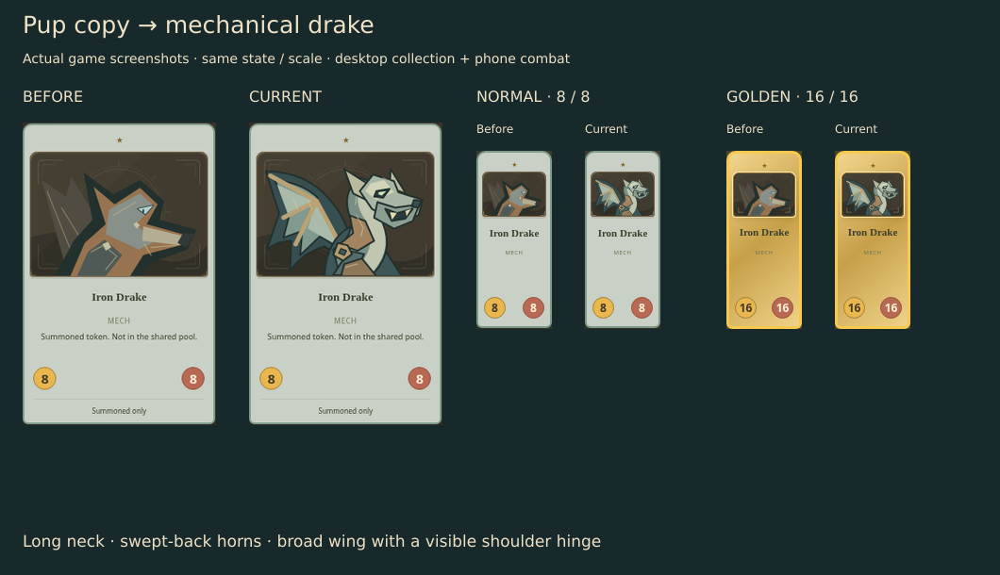
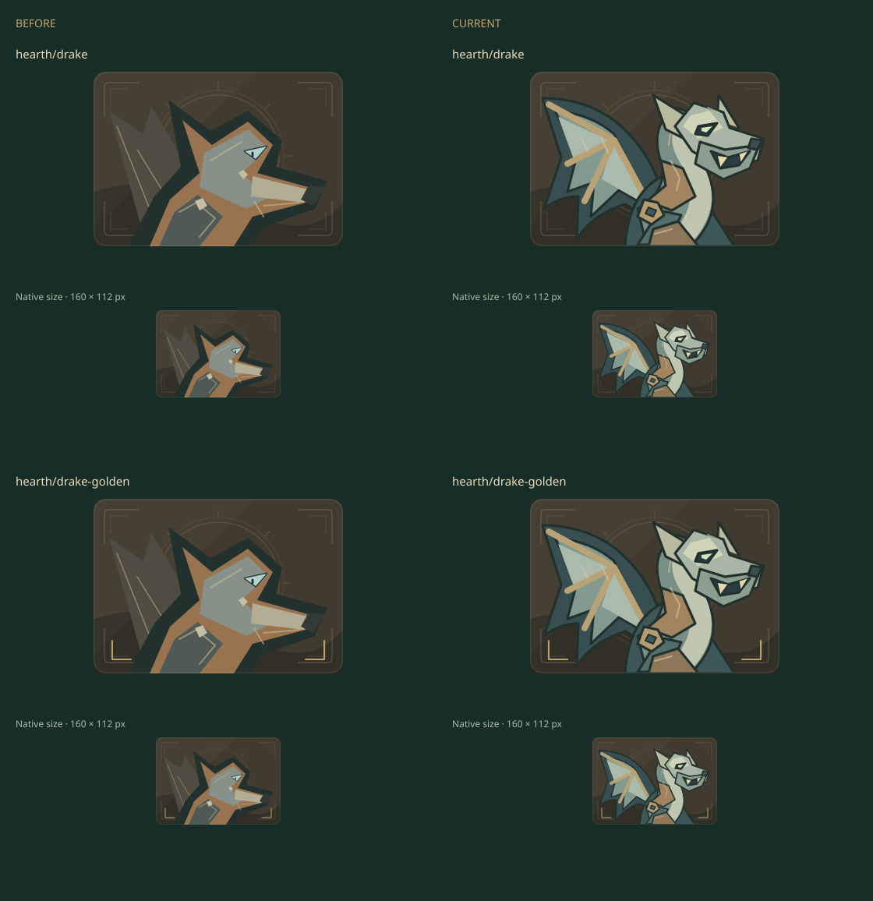

# Iron Drake · visual checkpoint

**Pup copy → mechanical drake.** One distinct dragon subject; existing normal/golden treatment, labels and stats preserved.

| Actual game view     | Before                                   | Current                                    |
| -------------------- | ---------------------------------------- | ------------------------------------------ |
| Collection · desktop | [Before](before-collection-desktop.webp) | [Current](current-collection-desktop.webp) |
| Collection · 390 px  | [Before](before-collection-phone.webp)   | [Current](current-collection-phone.webp)   |
| Combat · desktop     | [Before](before-combat-desktop.webp)     | [Current](current-combat-desktop.webp)     |
| Combat · 390 px      | [Before](before-combat-phone.webp)       | [Current](current-combat-phone.webp)       |

Baseline: main `08ca09dcac428f963c581d8bd05485a097323ad7`. Source: `src/games/battlegrounds/ui/MinionArt.tsx`, `MetalPortrait`, export IDs `hearth/drake` / `hearth/drake-golden`.

## Defect and refinement

The baseline duplicates Clockwork Pup’s canine head and shoulder, adding one small triangular wing. Compact combat art reads as another Pup. [The initial evidence](before-identities.webp) is explicitly a **source SVG preview**, not a screenshot.

The first version added a rising neck and broad wing. Phone review exposed two upright horns that still read as ears and an unclear wing attachment. The refinement sweeps the horns back and fits a visible copper hinge into the shoulder. Three broad value groups, a hooked jaw and restrained engraving keep the mechanical subject readable at 80 × 56 px.

The figure immediately above is a **source SVG preview**. The opening figure and linked collection/combat views are actual game screenshots.

## Verification · 2026-10-29

- 🟢 Three local browser journeys pass: normal and golden Mechanical Egg summons → keyboard inspection → desktop/phone playback/seek → reload with byte-identical practice save and normal-run isolation; standalone cabinet delivery decodes all 650 SVGs.
- 🟢 Export comparison: only `hearth/drake` and `hearth/drake-golden` change; all other 648 assets are pixel-identical, including Pup and Egg.
- 🟢 Production build, focused source/test ESLint and existing combat rules tests pass. Formatting/inventory recorded in the local closeout bundle.
- 🟡 Author pixel review complete. Independent visual acceptance and hosted exact-head CI remain pending; no full-suite, native/geometry or performance benchmark claim.

Application/test source: `ab96005`, followed by numeric helper-prop correction `cc43e33`. The latter produces byte-identical standalone SVGs for both variants; successful browser checks and screenshots remain valid and were not repeated. The initial build type error and correction are retained separately.

Matched combat protocol: public Practice lab, seed `IRON-DRAKE-5`, Forgekeeper, tier 5. Normal board: one Mechanical Egg; frame 7 summons an 8/8. Golden board: three Eggs, Refresh, buy the first offer to trigger a triple, play golden Egg and choose the first discover; frame 12 summons a golden 16/16. The Copper Beetle opponent avoids the unrelated canid 3D stage. Early capture attempts with a canid opponent loaded that stage asynchronously; their unstable crops were rejected and are not used here. Source rules, saves, input handlers and 3D performance work are unchanged.

Chrome 156.0.8078.73, pinned Node 24.21.0 / npm 11.19.0, reduced motion, same camera/viewport/state per matched pair. Existing official Chrome package provenance is retained with the cloud tools; no new credentials, paid tools, security changes, Mac access or Site publication.

## Delivery status

Branch: `art/hearth-iron-drake`. Baseline evidence was pushed at `069a19d` before automatic approval review denied creation of the specific Iron Drake issue, citing missing authorization for that issue and payload. That denied operation is known not to have executed and was not retried. Implementation, tests and final evidence remain local; no draft PR was attempted as an alternate route. Specific publication confirmation is pending.

Detailed logs, v1 captures, source exports and the failure/correction records live in `.artifacts/hearth-drake/`. Retain through review or 2026-11-28, then reassess. No merge authority is claimed.
