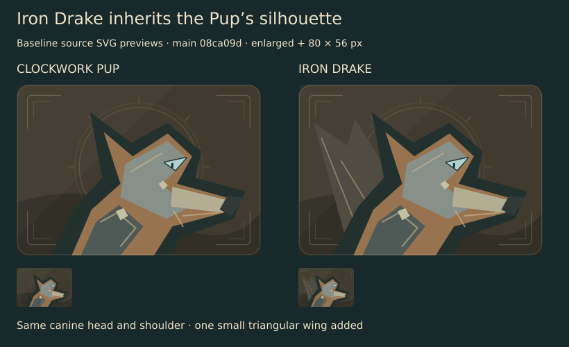

# Iron Drake · baseline

**Problem:** Iron Drake inherits Clockwork Pup’s canine head and shoulder; a small triangular wing is the only new contour. At compact size the summoned 8/8 still reads as the Pup.

These are **source SVG previews**, enlarged and at 80 × 56 px, from main `08ca09d`. They are not game screenshots. Source: `src/games/battlegrounds/ui/MinionArt.tsx`, `MetalPortrait`; export IDs `hearth/pup` and `hearth/drake`.

Bounded change: give Iron Drake its own mechanical dragon gesture—long articulated neck, hooked jaw, and one broad wing rooted into the shoulder. Preserve Clockwork Pup, Mechanical Egg, the golden treatment, all labels/stats, combat, rules and saves. Review a first version before refining. Actual matched collection/combat desktop and phone views, normal/golden previews and scoped checks are pending.
