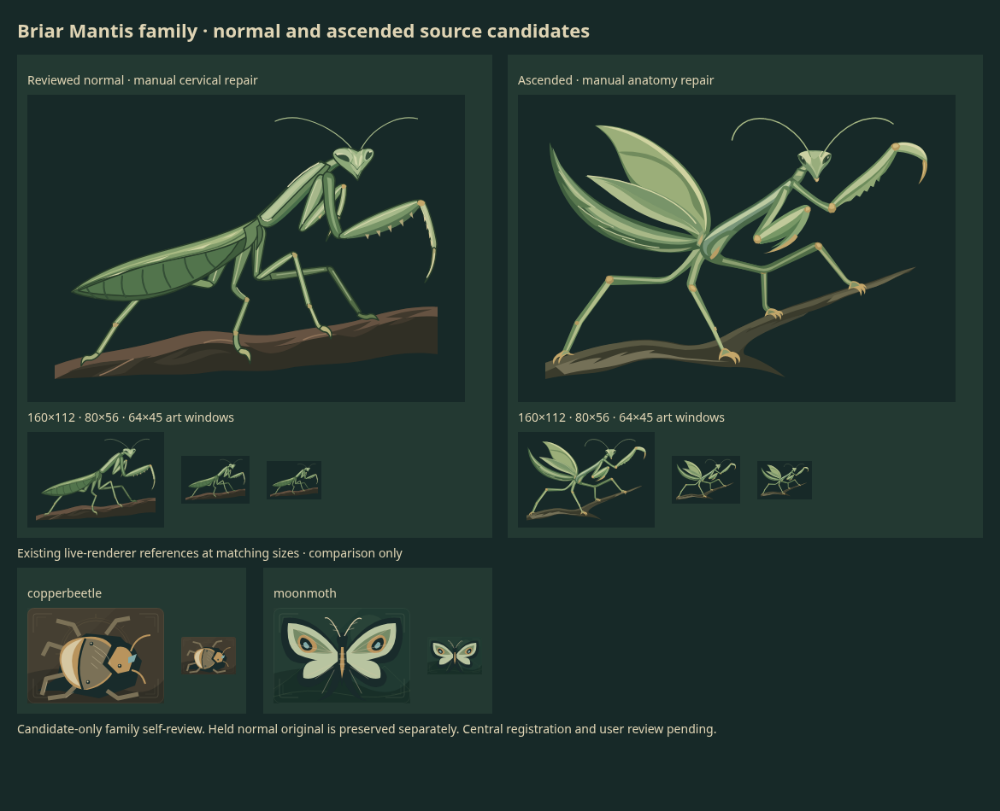

# Briar Mantis normal and ascended family

**Candidate-only family; both reviewed choices are authored derivatives.** Two
paid calls returned. Their exact originals are preserved with anatomy holds;
separate native SVG repairs produce the useful normal/ascended pair below.
Central registration and user review remain pending. No runtime slot, game rule,
canonical history, adoption or default change is implied.

## Brief and admission decision

Purpose: explore the user's future Hearth expansion direction through a long,
articulated insect silhouette: triangular head, elongated prothorax, unequal
raptorial forelegs, tapered abdomen and four supported walking legs. The ascended
pose changes body lean, raised claw, forked support and opened leaf planes.
These form one purposeful family, rather than a recolor or separate tiny PRs.

At base `3a59621069dd1fe912a749d851d27e993507f5dd`,
[existing Copper Beetle and Moon Moth renderers](../../../../src/games/battlegrounds/ui/ExpansionPortraits.tsx)
were inspected and temporarily rendered at matched 160x112 and 64x45 sizes.
Their compact armored body and broad wings do not supply the mantis's narrow
normal gesture or open raptorial foreleg contour. The comparison above supports
a distinct source study while reusing Hearth's palette and value hierarchy.
Another moth was deferred because
[Moon Moth already has SVG and living 3D artwork](../creatures/moonmoth.md).
No existing asset is edited, superseded, selected or checkpointed by this study.

The bundle retains two exact API originals, two necessary authored derivatives,
one canonical record per paid call, one shared QA/index and two meaningful review
PNGs. Temporary reference SVGs, native captures and alternative review layouts
remain ignored. No dependency, runtime export or unchanged catalogue dump.

## Originals, repairs and review

| Source   | Exact original and hold                                                 | Authored candidate                                                                                                   |
| -------- | ----------------------------------------------------------------------- | -------------------------------------------------------------------------------------------------------------------- |
| Normal   | [Original](original.svg): visible head/prothorax gap                    | [Connected normal](mantis-normal-connected.svg): add three cervical paths                                            |
| Ascended | [Original](ascended/original.svg): neck gap and fifth walking-leg chain | [Six-leg ascended](ascended/mantis-ascended-anatomy.svg): remove five extra-chain paths and add three cervical paths |

Every remaining original node and attribute is unchanged in each derivative.
Original bytes are never overwritten. These are manual anatomy repairs, not
misrepresented model outputs. [Normal before/after evidence](review.png) preserves
the first admission decision. [Shared QA](qa.json) records source hashes, structural
comparison and pixel-component checks: both original heads are disconnected;
both repaired heads connect to their thoraces. All pixel changes lie inside the
intended repair regions. This supports, rather than substitutes for, visual review.

Self-review at 1024x720, 160x112, 80x56 and 64x45 finds a coherent useful pair:
six leg chains, two head-rooted antennae, clear unequal forelegs and anchored feet.
Normal rests on a low twig; ascended leans outward across two branch levels and
opens its claw and leaf planes. Sage/leaf chitin, ivory upper-left planes, small
fitted eyes and restrained ochre joints connect the designs. Continuity used
shared text and side-by-side review; native SVG generation received no image input.

Limits: broader ascended wing-cover stylization and finer tarsal/antenna detail
at 64x45 remain visible author-review limits. Original path counts (82/113) exceed
the soft prompt targets, without violating a hard API limit. The normal's highest
antenna reaches y=53.714714, 0.285286px above its requested safe margin; no paint
escapes either viewport. API metadata says transparent but both originals contain
the requested opaque background. This is source review, not installed-game frame
adaptation, independent approval or user acceptance.

Both retained PNGs were losslessly optimized; decoded RGB pixels, 1170x950
dimensions and alpha/color metadata match their temporary captures. Normal evidence
fell from 161,039 to 158,962 bytes; family evidence from 223,964 to 221,680 bytes.

## Actual call and spending

Both calls used one `POST https://api.openai.com/v1/images/generations`, the existing
bound credential and configured HTTPS proxy, standard processing, verified TLS,
1800-second timeout, no redirects and zero automatic retries. Exact shared settings:
`gpt-image-2.6-sunburst`, `n=1`, native SVG, `1024x720`, medium quality/complexity,
`gpt-6.1-terra` author with medium reasoning.

| Call     | Grant                          |    Time | Estimated usage | Exact record/payload                                         |
| -------- | ------------------------------ | ------: | --------------: | ------------------------------------------------------------ |
| Normal   | `character-mantis-pilot-02`    | 120.97s |       $0.067579 | [Call](call.json), [payload](pilot-request.json)             |
| Ascended | `character-mantis-ascended-03` | 142.58s |       $0.076660 | [Call](ascended/call.json), [payload](ascended/request.json) |

Each grant reserved **$4.20** before dispatch in a local commit. Both settled from
returned image and SVG-author usage: **$0.144239** total for this family. Reasoning
is included in output tokens and is not charged twice. These are token-derived
estimates, not invoices. The grants release $8.255761 of unused planning capacity;
current shared free capacity remains the coordinator's decision.

Lane lifetime known usage is now **$0.894933 estimated**, with **zero active calls,
zero new unknowns**, and separate historical **tortoise $7.50 + badger $7.50 holds**.
Neither was retried. The opening owner receipt is local commit
`28734956a69f613992189783680e7a7b57023a28`, under
`docs/art/assets/expansion-hearth-blindside-scrapyard-continuation-2026-11-06/`.
That ledger and these incremental canonical calls preserve the cumulative trail.
Other lanes' accounting is not duplicated here; the common $40 pool is not this
worker's allowance. **No further paid call is planned or authorized here.**

The granted planning bound used
[Terra's published limits/rates](https://developers.openai.com/api/docs/models/gpt-6.1-terra):
1.05M input at long-context $2/M plus 128K output at $7.50/M = $3.06, deliberately
overcounting context overlap. The $1.14 image/prompt allowance covers 32,768
reference-output tokens at [$30/M](https://developers.openai.com/api/docs/models/gpt-image-2.6-sunburst),
up to 8,000 prompt bytes at $5/M and 10% contingency ($1.125344). This image-token
allowance is a conservative planning assumption, not a documented or API-enforced
cap; both grants acknowledged it. Initial capacity was insufficient until the
coordinator received another lane's settled receipt.

The ascended call includes a fresh ASCII `X-Client-Request-Id`, preserved in its
record. It aids support tracing; it is not an idempotency key or retrieval handle.
That guidance arrived after normal completed, so no trace header is invented for
normal. Both payloads are consumed, not permission to rerun them.

## Latency evidence and verification

Historical [Terra/low actors](../scrapyard-suite/actors/response.json) and
[equipment](../scrapyard-suite/equipment/response.json) sheets at medium quality,
high complexity and 1152x768 returned in 82.41/66.53s. The
[single Sol/medium Cub](../hearth-effort-comparison/single-medium-response.json)
returned in 208.80s but retained eye/foreleg limits. Earlier low-effort living
batches had structural failures; the
[batch workflow](../../../../skills/card-art/references/batch-assets.md) requires
an anatomy pilot before repeating an approach. These Terra/medium singles returned
below the previous 301.04s boundary, but still needed anatomy repairs.

Subject, scope, quality, complexity, model and output length changed together;
this is not a controlled latency/quality comparison or a timeout guarantee.
Prior tortoise/badger clients already used 1800s timeouts. A service/intermediary
close near 300s remains an inference; diagnostics do not identify the component.
The [official guide](https://developers.openai.com/api/docs/guides/image-generation)
separates image complexity from author effort and does not support SVG streaming,
partials or SVG image edits. No unverified background/reference-edit workaround.

[Staged history](prepared-history.json) records two paid attempts, two manual
attempts and four exact original/derivative revisions, with no invented runtime
slots. Final isolated history/gallery and maintenance results are in QA. Central
registration remains a draft blocker; the serial coordinator owns that mutation.
No original selection, shared registry, frozen published branch or game source is
changed. Any later uncertain request must keep its full reservation and stop.
