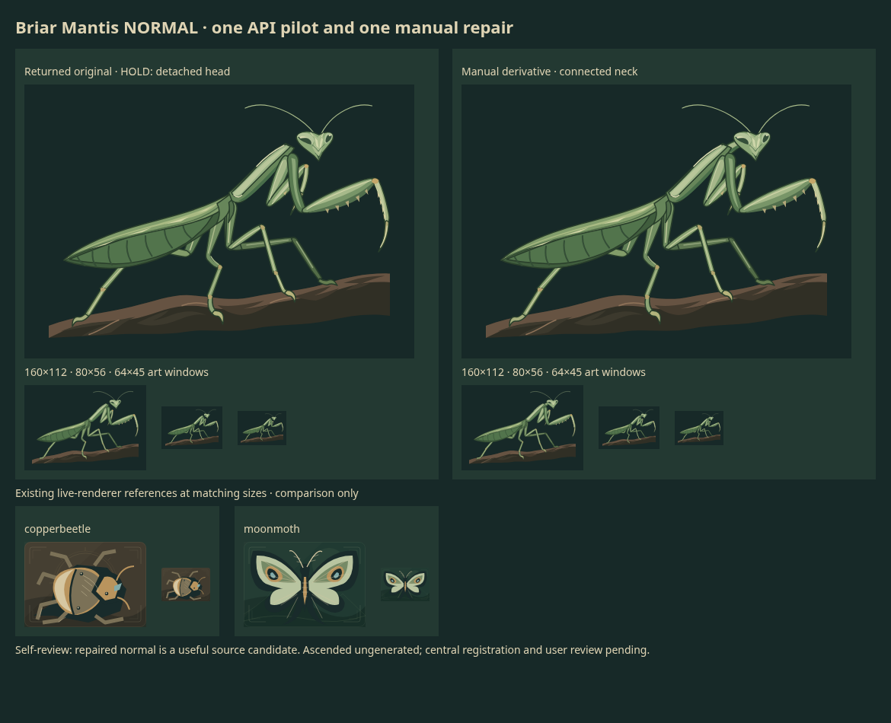

# Briar Mantis normal pilot

**Returned and self-reviewed; ascended ungenerated.** Grant
`character-mantis-pilot-02` reserved $4.20 for one normal-only call. It returned in
**120.97s** for **$0.067579 estimated usage**. The exact original has an anatomy
hold; a separate manual cervical repair is a useful source candidate. No runtime
slot, rule, canonical history, user adoption or published PR is implied.

## Brief and admission decision

Purpose: evaluate the user's requested future Hearth expansion direction through
an elongated, articulated insect silhouette: triangular head, long prothorax,
unequal folded forelegs, tapered abdomen and four anchored walking legs.
The old packed mantis brief remains never dispatched. Only this normal pilot ran
once. Tortoise and badger are excluded; neither unknown request was retried.

At base `3a59621069dd1fe912a749d851d27e993507f5dd`,
[existing Copper Beetle and Moon Moth renderers](../../../../src/games/battlegrounds/ui/ExpansionPortraits.tsx)
were inspected and temporarily rendered at matched 160x112 and 64x45 sizes.
Their compact armored body and broad wing planes do not supply the mantis's long
narrow diagonal gesture or open raptorial forelegs. The matched comparison above
supports a distinct source candidate while reusing Hearth's natural palette,
three value groups and art-window conventions. A new moth is deferred because
[Moon Moth already has SVG and living 3D artwork](../creatures/moonmoth.md).
No existing asset is edited, superseded, selected or checkpointed by this study.

The owner retains one exact original, one necessary distinct derivative, a shared
call record and one combined review PNG. Temporary reference SVGs/native renders
remain ignored. No new dependency, runtime export or unchanged catalogue dump.
Central registration and user review remain later gates.

## Actual call and spending

[Exact sent payload](pilot-request.json) · [grant, usage and request ID](call.json)
· [technical/visual QA](qa.json) · [staged history import](prepared-history.json).

One `POST https://api.openai.com/v1/images/generations` used the existing bound
credential through the configured HTTPS proxy, standard processing, verified TLS,
1800-second timeout, no redirects and zero automatic retries. Exact settings:
`gpt-image-2.6-sunburst`, `n=1`, native SVG, `1024x720`, medium quality and
complexity, `gpt-6.1-terra` author with medium reasoning. This payload is consumed,
not permission to rerun it. Request: `req_ddaba39188104bd0a522b70420073907`.

Returned usage: image text input 599, reference output 924, Terra input 1,724 and
Terra output 7,028 tokens, with reported reasoning 1,128. At standard rates,
`(599*5 + 924*30 + 1724*1 + 7028*5)/1e6 = $0.067579`.
Reasoning is included in output and is not charged twice. This is a token-derived
estimate, not verified billing. The settled grant releases $4.132421 of planning
capacity; current shared free capacity remains the coordinator's decision.

Lane cumulative known usage is **$0.818273 estimated**, with **two separate unknown
holds: tortoise $7.50 and badger $7.50; zero active calls**. The opening owner
receipt is local commit `28734956a69f613992189783680e7a7b57023a28`, under
`docs/art/assets/expansion-hearth-blindside-scrapyard-continuation-2026-11-06/`.
That ledger plus this incremental call are the receipts; other lanes' accounting
is not duplicated here. The common $40 pool is not this worker's allowance.

The granted **$4.20 planning bound** used
[Terra's published limits/rates](https://developers.openai.com/api/docs/models/gpt-6.1-terra):
1.05M input at long-context $2/M plus 128K output at $7.50/M = $3.06, deliberately
overcounting context overlap. The $1.14 image/prompt allowance covers 32,768
reference-output tokens at [$30/M](https://developers.openai.com/api/docs/models/gpt-image-2.6-sunburst),
up to 8,000 prompt bytes at $5/M and 10% contingency ($1.125344).
That image-token allowance is a conservative planning assumption, not a documented
or API-enforced output cap. The coordinator granted it with that limitation.
Initial free capacity was $3.487463; a later equipment settlement freed capacity.
No assumption about current pool availability or another call follows.

## Visual outcome and manual derivative

[Exact original](original.svg): useful long diagonal silhouette, unequal forelegs,
natural leaf-green chitin and quiet dark field. **Hold unchanged:** the head floats
above the prothorax. Technical decoding did not excuse that anatomy failure.

[Connected derivative](mantis-normal-connected.svg): insert one group,
`cervical-connection`, containing three flat-paint paths before `prothorax`.
Every original node/attribute is unchanged. It bridges the posterior head edge to
the thorax with a short tapered cervical segment and two modeled value planes.
No paid request or recoloring. The full-size changed-pixel box is only
`(695,147)..(731,182)`. A pixel-component check confirms that the original head
and thorax are disconnected and the repaired ones connected; this supports the
visual finding rather than establishing biological accuracy by itself.

Self-review at 1024x720, 160x112, 80x56 and 64x45 finds the connected normal useful
for continuing this family: six leg chains, two head-rooted antennae, clear foreleg
negative spaces and four twig contacts remain readable. Fine tarsal/antenna detail
reduces at 64x45. The original has 82 paths (85 after repair), above the suggested
40–65 soft target. Both are safe native SVGs and remain inside the viewport.
The highest antenna reaches y=53.714714, 0.285286px above the requested safe margin;
this minor prompt deviation causes no crop. Exact API metadata says transparent,
but the actual original has its requested opaque background rectangle.

The retained PNG was losslessly optimized from 161,039 to 158,962 bytes; decoded
RGB pixels, 1170x950 dimensions and alpha/color metadata match. Native captures
and discarded comparison layouts remain temporary, not additional artwork states.
No actual-game selection, frame adaptation or independent visual acceptance is claimed.

## Latency evidence and next family gate

Historical [Terra/low actors](../scrapyard-suite/actors/response.json) and
[equipment](../scrapyard-suite/equipment/response.json) sheets at medium quality,
high complexity and 1152x768 returned in 82.41/66.53s with 4,251/3,234 SVG output
tokens. The [single Sol/medium Cub](../hearth-effort-comparison/single-medium-response.json)
returned in 208.80s but retained eye/foreleg limits. Earlier low-effort living
batches had structural failures; the
[batch workflow](../../../../skills/card-art/references/batch-assets.md) recommends
an anatomy pilot before repetition. Keep medium author effort for this living
family rather than treating low effort as a proven equal-quality shortcut.

The smaller normal pilot returned below the earlier 301.04s tortoise/badger
boundary, and its defect was small enough to repair by hand. Subject, scope,
quality, complexity, model and output length changed together; this is not a
controlled latency/quality experiment or a guarantee against future disconnects.
Both prior clients already used 1800s timeouts. A server/intermediary close near
300s remains an inference; diagnostics do not identify the component. The
[official guide](https://developers.openai.com/api/docs/guides/image-generation)
warns that complexity can increase latency, and SVG cannot stream partials or
use the image-edit endpoint. No heartbeat/reference-edit workaround is claimed.

**Propose one ascended call only if separately granted:** same species, palette,
1024x720 native SVG and medium/medium/Terra-medium controls; same $4.20 planning
policy. Lean outward on a forked branch, one raptorial foreleg extended diagonally,
the other close to the thorax, wing covers lifted asymmetrically and four walking
feet supported at two levels. Explicitly require a continuous cervical connection.
Changed gesture, support and silhouette should make this a coherent two-pose
family, not a recolor or separate tiny PR. No ascended payload has been dispatched.

Retain exact originals, holds, usage and meaningful derivative lineage. A new
uncertain outcome retains its full reservation and stops further paid work.
Only completed pair QA, isolated history/gallery verification, serial central
registration and user review can advance the family toward publication/adoption.

Preparation and delivery checks: pinned Node 24.21.0/npm 11.19.0
`npm run format:maintenance` passed (901 managed sources). Disposable-clone
history import/verify passed: 709 assets, 94 revisions, zero selections and 709
source registrations. Existing gallery UI decoded both focused revisions and
exposed exact settings/usage/lineage at 1440px and 390px without page errors.
Chromium blocked file-URL navigation; the supported localhost HTTP preview worked
without policy or TLS changes. No hosted CI or central registration is claimed.

Later tracing guidance arrived after this call completed. For a future separately
granted, never-dispatched call, add a unique ASCII `X-Client-Request-Id` and retain
it with sanitized request facts; it is a support-tracing identifier, not an
idempotency key or retrieval handle. Do not alter completed call facts, enable SVG
streaming/partials or test an unverified background workaround.
