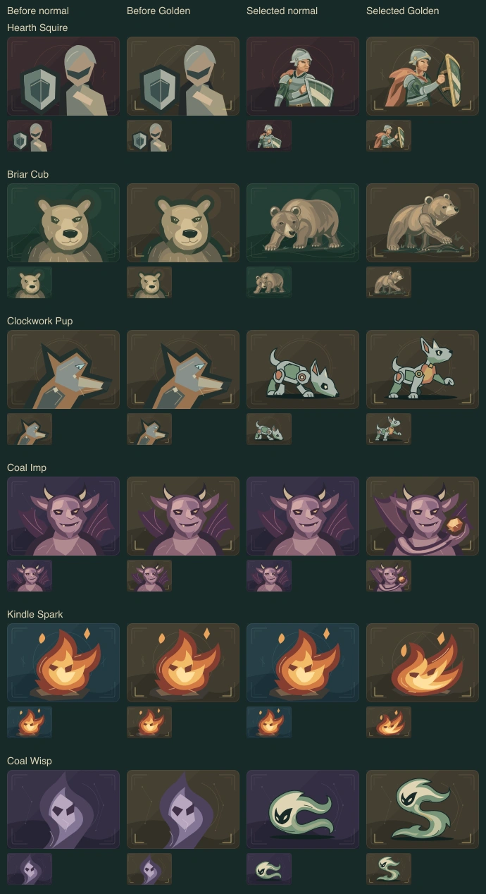
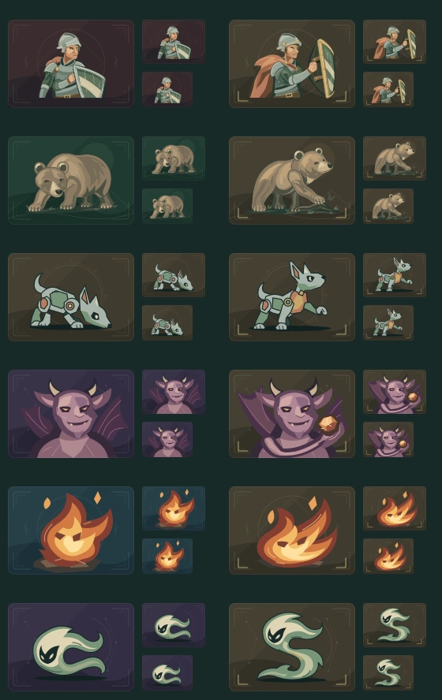
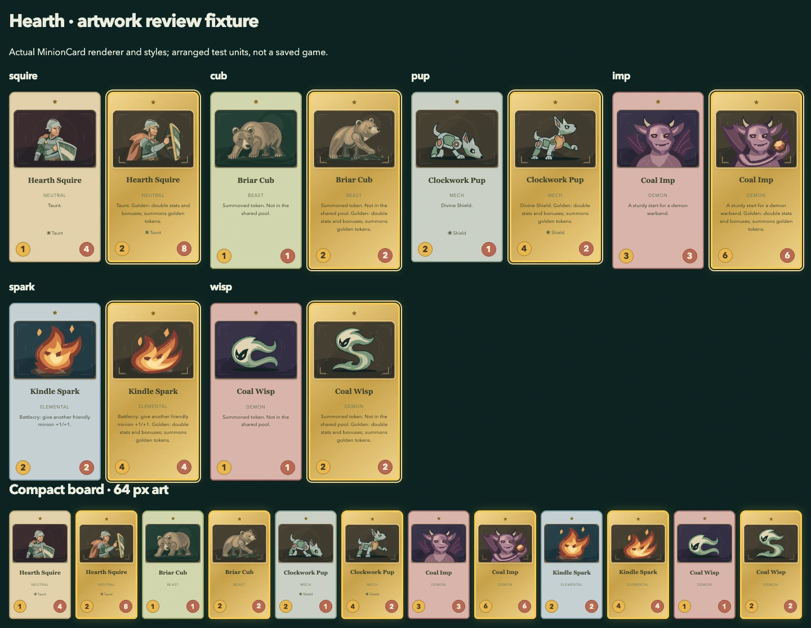

# Hearth · refined opening units

**Selected and installed locally, November 6, 2026.** The user authorized continued
refinement until author satisfaction, after rejecting the first packed Squire and
Cub. Ten scenes are updated; the stronger existing normal Imp and Spark remain.
All six normal/Golden pairs now have distinct gestures. This is the author's
selection under that instruction, not a claim of subsequent user acceptance.
Paid refinement has stopped because the selected set passes the author review
below. No other cohort or GIF was generated.

Source checkpoint: `43586fd`, on `codex/hearth-packed-small-units`. Existing key
reuse remained authorized; no credential changed or is stored here. The
[original low sheet](../hearth-small-units-batch/README.md) and
[single/MAX comparison](../hearth-effort-comparison/README.md) remain preserved.
The latter's MAX transport failure establishes neither quality nor zero billing.

## Selected set

Normal is left, Golden right. The [vector sheet](selected-sheet.svg) and twelve
`selected-*.svg` files are exports from the same renderer used by the game.
[Selection hashes](selection.json) identify this reviewed snapshot. Editable
runtime paths live in `src/games/battlegrounds/ui/small-units/`, with the shared
Imp construction in `FiendIllustrations.tsx`; `MinionArt.tsx` owns selection and
retains existing frame, tribe palette and fallback precedence.

| Pair          | Selected source and adaptation                                                                                                                                                                                                                                                | Author verdict                                                                                                                                                                            |
| ------------- | ----------------------------------------------------------------------------------------------------------------------------------------------------------------------------------------------------------------------------------------------------------------------------- | ----------------------------------------------------------------------------------------------------------------------------------------------------------------------------------------- |
| Hearth Squire | New focused two-scene request, `squire-r1-*`. Waist-up guard replaces the cramped full figure. `squire-selected-*` converts paint gradients to explicit steel, cloth and skin colors; modeled planes remain. Strip both full-cell backgrounds and DOM IDs for the live frame. | Face, shoulder, elbow, wrist and shield contact connect. Low close guard versus raised forward brace reads at 64 px; cloak and shield thickness support the gesture.                      |
| Briar Cub     | New focused pair, `cub-r1-*`. Organic crouch and a step over a low root replace the rejected blocky body and high-five pose. Remove cell background and fit to the current frame.                                                                                             | Continuous muzzle/neck/shoulder, small animal eyes and planted paws. Golden has a curved reaching foreleg, with other paws supporting its body. The stylized anatomy reads at board size. |
| Clockwork Pup | Original packed `pup-normal.svg` and `pup-golden.svg` in `../hearth-small-units-batch/`. Remove cell background, fit to the frame.                                                                                                                                            | Sniffing crouch versus raised forepaw; connected mechanical hinges and a fitted copper chest. Simple packing was useful here.                                                             |
| Coal Imp      | Keep the existing normal portrait byte-for-byte. Hand-refine Golden in `FiendIllustrations.tsx`, reusing its face and plum materials. An opened wing and connected bent arms present a coal beyond the cheek.                                                                 | Existing demon identity remains stronger than the green packed candidate. Golden has a different contour and supported object; the face stays readable at 64 px.                          |
| Kindle Spark  | Keep the existing normal byte-for-byte. Hand-refine `spark-golden-manual.svg` into a low sweeping flame with the same orange/cream planes and carved eyes.                                                                                                                    | Normal compact curl versus Golden lifted sweep; warm pointed contour stays distinct from the cool Wisp.                                                                                   |
| Coal Wisp     | Original packed `wisp-normal.svg` and `wisp-golden.svg`, with cell background removed and frame fitted.                                                                                                                                                                       | Curled C versus rising split-tail S; quiet cool planes retain the same spirit identity without extra small detail.                                                                        |

The original outputs and extractions remain unchanged. Selected derivatives are
explicitly adaptations, not exact API returns. No raster wrapper, external
resource, script, animation or visible text enters the live SVG. DOM IDs and paint
references are absent from the live selected scenes, so repeated cards cannot
collide. HTML still owns names, stats, controls and accessible labels.

## Requests and cost

Each successful request used `gpt-image-2.6-sunburst`, one native SVG, 1600 × 560,
high image quality and complexity, with medium `gpt-6.1-sol` SVG-author reasoning.
Each output contains two 800 × 560 scenes with separable groups. Canvas per
subject, composition, prompt, image quality and reasoning all differ from the
first packed experiment; this is a useful workflow result, not a controlled
proof that reasoning effort alone caused the improvement.

| Attempt   | Result                                               | Time             | Estimated API cost |
| --------- | ---------------------------------------------------- | ---------------- | ------------------ |
| Squire r1 | Two returned scenes; both selected after adaptation  | 237.95 s         | $0.153532          |
| Cub r1    | Two returned scenes; both selected                   | 234.59 s         | $0.145384          |
| Imp r1    | HTTP 502; no art, request ID or usage returned       | Failure retained | Unknown            |
| Imp r2    | Explicit focused retry, same payload; HTTP 502 again | Failure retained | Unknown            |

Known new generation cost is **$0.298916**, about **7.5¢ per new selected Squire/Cub
scene**, excluding unknown charges for the two failed Imp attempts. Manual Imp
and Spark refinements caused no additional image API call. Including the original
$0.160006 sheet and the earlier $0.145621 single Cub, known generation cost across
this Hearth exploration is **$0.604543** for ten installed updates, about **6.0¢ per
update**, plus unknown charges for the earlier MAX failure and both Imp failures.
These are token-based estimates, not an invoice, and include rejected successful
outputs. Hand work and review time are not included.

Exact prompts, request JSON, original sheets, extracted pairs, response usage and
request IDs are linked by filename here: `squire-r1-*`, `cub-r1-*`, `imp-r1-*`,
`imp-r2-*`. Imp r2 reused the exact r1 prompt, preserved in both request payloads.
Each attempt had its own folder and no automatic retry. After two 502 responses,
stop that route and improve the existing art rather than repeating an unchanged
request. The prompt and raw request helper, error bodies, initial wrong-paint
preview, corrected previews and review fixture remain in the single working bundle
`.artifacts/hearth-refinement-2026-11-06/`. All are under the user's current
[preservation hold](../../README.md#image-26-batch-workflow); cleanup does not
remove rejected work or prompts.

## Visual and runtime review

[Phone review](review-phone.webp) uses the same renderer and styles. These are
labeled fixtures, not a fabricated saved game. Full cards preserve labels, stats,
Golden text and selected borders. Compact cards use 77 px widths, with roughly
64 px artwork; all twelve selected views remain distinguishable. Every pair was
also inspected enlarged, at 160 × 112, 80 × 56 and 64 × 45 in the actual ArtScene
frame. The author accepts the selected gesture, support, material and family
consistency; this is self-review, not independent visual approval.

The first frame helper omitted Squire paint definitions. That made its preview
dark without changing the source. The corrected resource-preserving preview and
explicit flat-color adaptation were reviewed separately. The first integration
also retained Pup/Wisp cell backgrounds; these were removed before final review.
Both intermediate versions remain preserved rather than being mistaken for final
candidates.

Technical verification passed:

- `npm run check`: maintenance/build, 191 tooling and 81 DCC contracts, 587
  application tests, 8 shader CPU tests and 37 seeded simulations. Application
  tests took 140.31 s and simulations 6.50 s. No geometry/native runtime is claimed.
- Nine gallery/export/Hearth browser journeys passed in 32.9 s. After the final
  request-history wording change, the per-game gallery and Hearth collection
  journeys passed in 12.7 s; the collection adds a tenth unique affected journey.
- The separate twelve-scene full/compact MinionCard fixture passed in 2.0 s,
  including selected Golden borders, decorative SVG semantics, absence of DOM
  IDs/raster resources and 390 px reflow. Screenshots were visually inspected.
- Skill validation, XML/local-resource validation, raw original-byte and prompt
  comparisons, selected export hashes and `git diff --check` passed.

The export
contains 689 SVGs: exactly ten named Hearth exports change; all other 679,
including normal Imp and Spark, remain byte-identical to the baseline.
No game rule, content definition, stats, shop odds, timing, save or replay meaning
changes. Geometry/native animation checks are outside this static SVG scope.
Logs remain in the working bundle as `check.log`, `browser.log` and
`browser-final.log`. The build retains its existing large-chunk advisory; it is
not a failed gate. No hosted check, push or independent aesthetic review is claimed.

The gallery shows the refined set first and retains Batch 02/03 under collapsed
history. The source remains an on-demand snapshot; rebuild after source changes.
The historical records retain their original request limits and findings, with
new status banners linking this outcome. This resolves their now-stale statements
about current art and authorization without rewriting the old attempts.

## Method retained for later batches

Pack simple mechanical and abstract units when their contours survive compact
review. Give anatomy-sensitive subjects a focused single or small pair and change
composition when the original construction fails. A normal/Golden pair can share
palette and identity while giving each pose enough canvas. Reuse strong existing
normals; adapt their upgrade gesture instead of filling a replacement quota.

Preserve all local paint resources during extraction and review. Adapt gradients
intentionally before removing IDs; silent missing paint is not a model-quality
verdict. Keep exact originals and label every derivative. Review every chosen
scene in its actual frame and smallest use before stopping. The
[batch art workflow](../../../../skills/card-art/references/batch-assets.md) owns
these reusable decisions. The earlier SVG/GIF studies remain references; GIF is
still reserved for purposeful special effects and transformations.
