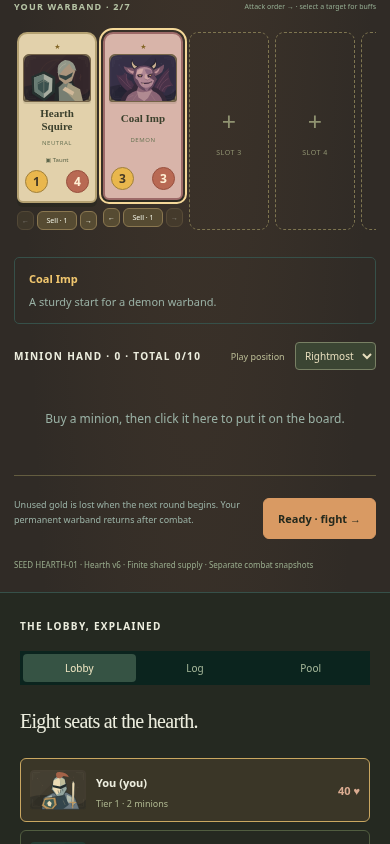
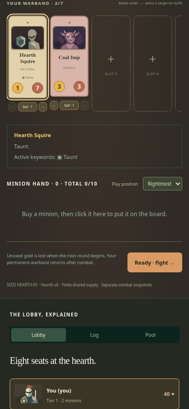
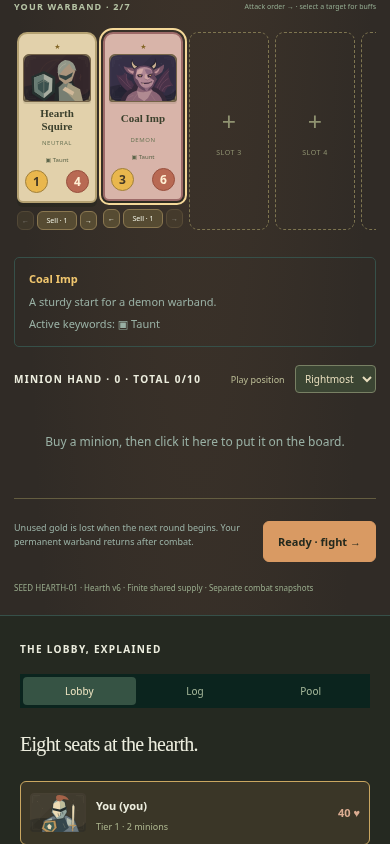

# Preserve Last Hearth's buff target while reordering

| Original                                                                     | Updated                                                                 |
| ---------------------------------------------------------------------------- | ----------------------------------------------------------------------- |
|  |      |
|                       |  |

390 × 844, scale 1, normal HEARTH-01 Oathkeeper run and the same warband-panel anchor. After the move, Original selects Squire; Updated retains Imp. After the power, Original gives Squire +3 health; Updated gives Imp +3 health and Taunt. The pre-move captures are byte-identical.

- Original source: `bebe081234cfbacab30389373f274e7e88be9759`.
- Reviewed implementation: `1ff2d5ca5de9933565de54e7a9308dabb6573bf7`.
- Change: Preserve the effective target's unit ID before either reorder command, including moves of another minion.
- Acceptance: Keep the displayed target after either reorder direction; preserve explicit reselection; apply the hero power to that unit at its normal cost; preserve arrow bounds and accepted move order.

The original regression failed because Coal Imp's aria-pressed state changed to false after reordering. Final targeted browser command passed 6/6 in 17.6 s; the separate Mixed Rivals check passed 1/1 in 5.0 s and verified seat-0 move/power commands, target identity, stats and gold. BattlegroundsApp owns both modes; no rules or save format changed.

Pass: six affected Classic/recruitment/spell browser journeys, plus one separate Mixed Rivals integration journey; scoped lint/format/inventory and build. Independent review accepted with no remaining findings. Mixed Rivals is one supplemental 390 px journey, not a tracked regression or full arena audit. Full local application/simulation and unrelated browser/native suites were not run.

Local runtime: Node 24.21.0, npm 11.19.0, Playwright 1.64.0, Chrome 156.0.8078.79. Existing startup, assertion and test guards were retained. This publication reuses valid captures and checks; it adds no gameplay changes. Hosted CI is reported on the draft PR.

Image SHA-256:

- `original-move-390.png`: `ad4c5f9b253761284a1987df6f20d2db43ad0d1ce54a9fc013057ebc987a2c27`
- `updated-move-390.png`: `ab1544c8e8eef1c850bf1ead16a07adafcdd6c73a462820256f8491cb2d8211a`
- `original-power-390.png`: `989e3c809a5474d95ec1aa3dcecbbfdc86419df53a1d58311b8b66a3c2eaeb65`
- `updated-power-390.png`: `874e8bd0ab000b27717609f9b4701edba48216f9e9859a405416a9186f229e2c`
