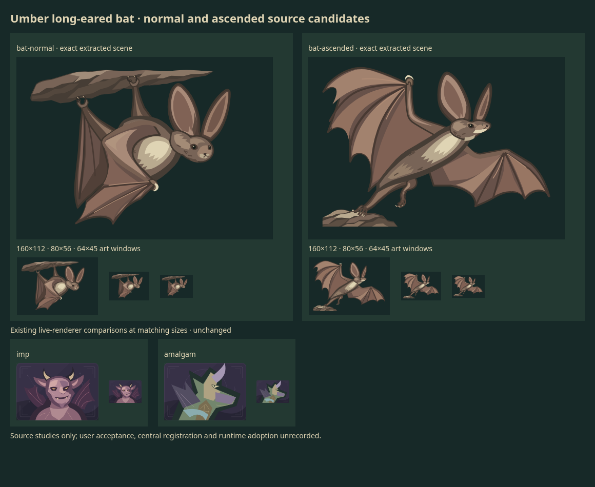

# Umber long-eared bat normal and ascended candidates

**Future source study, unadopted.** One granted native SVG request returned both
portraits. The exact packed original and two raw geometric extractions are
preserved. Both are reviewable candidates after author self-review; no manual
artwork repair was needed. No canon, gameplay power or stable runtime slot.

## Brief and reuse decision

Normal hangs diagonally beneath a small rock lip, with two hindleg grips and
unequal partially folded membranes. Ascended launches from a different rock lip
with asymmetric opening wings, one pushing hindfoot and one released foot.
Shared long ears, umber fur, warm brown membranes, ivory chest planes and fitted
eyes connect the identity while support, action and silhouette change together.
Wings are the forelimbs; there are no added human arms, horns or bird feathers.

At main `3a59621069dd1fe912a749d851d27e993507f5dd`, preflight inspected the roster,
27 open PR descriptions and 680 changed paths across 26 candidate PRs. No
standalone bat family was found. [Coal Imp](../creatures/imp.md) and
[Wild Amalgam](../creatures/amalgam.md) provide membrane techniques but retain
horned demon/chimera anatomy. Their actual current SVGs were compared temporarily
at 320x224, 160x112 and 64x45 before dispatch; those portraits cannot supply this
natural four-limbed hanging/launching mammal without changing their identities.
Reuse Hearth's frame/palette/value conventions while preserving those existing
uses. Ram, heron, mantis and newt candidates also retain distinct silhouettes.
The blocked anatomy reference site was not revisited or accessed by another route.

## Outputs and visual outcome

[Exact packed API original](original.svg) · [normal cell](bat-normal.svg) ·
[ascended cell](bat-ascended.svg). Each cell sets a 720x512 viewport and removes
only its grid translation, preserving all geometry, paint and root attributes.
Normal has 63 paths; ascended has 58. There is no hidden recolor or hand repair.

Author inspection at native 720x512, 160x112, 80x56 and 64x45 finds continuous
shoulder/elbow/wrist/finger and membrane planes, connected fur head/body, fitted
eyes and two hindlegs in each pose. In normal, the far folded membrane meets the
left ankle; the separate hindleg continues from that ankle into the body. This
can initially read ambiguously, so the limb chain was inspected at native size.
Ascended changes the body axis and wing angles while retaining recognizable face,
ears, chest and membrane materials. Matched Imp/Amalgam comparisons support a
separate natural flying-mammal source purpose rather than another demon variant.

Limits: the normal grips overlap the rock face, so contact depth is stylized,
not a biomechanics proof. Its membranes are more open than a fully wrapped roost.
Ears are exaggerated; fine finger/toe detail reduces at 64x45. Both shapes remain
readable, but neither is installed-game framing, independent approval or user
acceptance. No flight simulation or animation is claimed.

[QA](qa.json) keeps technical checks separate. Both cells stay within their
viewports. Normal minX39.235 is 0.765px beyond the requested x40 inset; ascended
minY30.933 is 5.067px above y36. No paint is cropped. API metadata says transparent,
but both actual cell backgrounds are opaque #172928.

Normal's matched screenshot crop is pixel-identical. Ascended local-coordinate
rasterization differs on 6,252 pixels (maximum channel difference31, equal alpha);
restoring its original translate(720 0) reproduces the original right crop exactly.
Geometry and paint are exact; antialias equality across placements is not claimed.
The single retained review PNG was losslessly optimized from 206,320 to 204,525
bytes, with identical decoded RGB pixels, 1160x950 dimensions and alpha/color
metadata. Native captures, controls and reference renders remain temporary.

## Paid request and reservation

[Exact sent payload](request.json) · [canonical grant/call receipt](receipt.json).

Fresh grant **character-bat-family-18** reserved **$4.20** before dispatch at local
commit `fcceb3476aef940b20ee0302808b7d38fc89add7`. Grant17 was previously released
without any dispatch; this is a new brief, not an uncertain retry.

Exactly one `POST /v1/images/generations`: `gpt-image-2.6-sunburst`, `n=1`, native
SVG 1440x512, two 720x512 cells, medium quality/complexity, `gpt-6.1-terra` medium
reasoning. Existing token binding and configured HTTPS proxy, verified TLS,
1800-second timeout, no redirects and zero SDK/transport retries. A unique ASCII
client trace is retained; it is not an idempotency or retrieval key. The pair
shares one generated reference/layout, without external image/reference input.

Returned in **132.12s**, request `req_62839ca8cf6946918180345a8d886158`.
Image text input849/output489; Terra input1,955/output9,451, including reported
reasoning794. Standard cost estimate:
`(849*5 + 489*30 + 1955*1 + 9451*5)/1e6 = $0.068125`.
Reasoning is not counted twice. This is usage-derived estimation, not an invoice.
The **$4.131875** unused planning capacity can be released.

Lane lifetime is **$1.032169 estimated**, zero active calls/new unknowns. Separate
historical **$7.50 tortoise + $7.50 badger unknown holds remain intact**; neither
was retried. Opening shared exposure was **$39.320146**, including this grant once
and **$28 unresolved reservations** (our $15 holds are a subset). The coordinator
owns current shared accounting. **No further paid call is authorized or planned.**

Planning assumptions: deliberately overcounted Terra author context/output at
long-context rates reserves $3.06, plus $1.14 for image/prompt. The latter covers
32,768 reference-output tokens at $30/M and <=8,000 prompt bytes at $5/M, plus 10%
contingency. This accepted conservative policy is not API-enforced. See
[Terra limits/pricing](https://developers.openai.com/api/docs/models/gpt-6.1-terra),
[image pricing](https://developers.openai.com/api/docs/models/gpt-image-2.6-sunburst)
and [SVG controls](https://developers.openai.com/api/reference/resources/images/methods/generate).
A lost connection would have retained the full grant with no blind retry.

## Registration and verification

The [canonical library](../../iterations/library.json) registers one actual attempt
and three source revisions with exact parents/digests and null asset/runtime fields.
The redundant import was retired after exact fact comparison and consumer tracing;
its original remains at source commit `cc52101f8b00f2ac2d5317434a6442d34c92887b`.
Originals, requests/receipt, review PNG, previous records and selections are unchanged.
The review PNG retains its production-time registration caption; current status is here.
[QA](qa.json) records independent gallery/geometry/pixel checks and their limits.
Later canonical-library additions require serial landing reconciliation.

Only useful evidence is retained: one original, two actual cells, one contact
sheet and concise shared call/QA/index records. No duplicated prompt, per-leaf
metadata dump, catalogue snapshot or new player/tooling. No game/runtime/default,
frozen branch, account, credential, dependency, merge or deployment changes.
