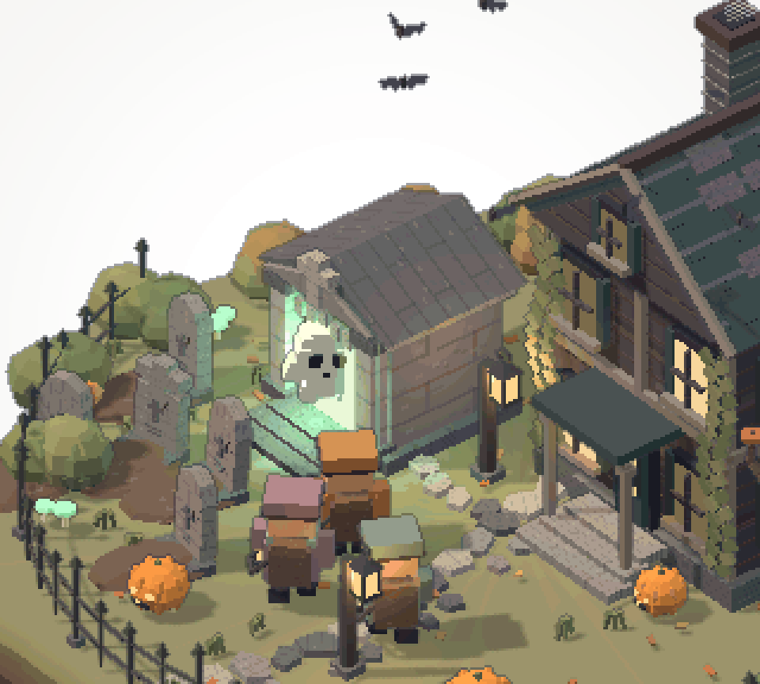

# Little Haunt · pixel diorama

A fifteen-second isometric haunted-island study: three chibi hunters capture
11 ghosts, confront a giant crypt ghost with crossed lantern beams, then settle
into a calm wide orbit. The island includes a haunted manor, graveyard, crypt,
dead tree, pumpkins, lanterns, mushrooms, bushes and a front iron fence.

[Download the full-resolution GIF](little-haunt.gif).

## Delivery

- 960 × 864 pixels, 375 frames at 25 fps; exactly 15 seconds, looping.
- Rendered at 320 × 288 and enlarged by nearest-neighbour sampling: each art
  pixel occupies an exact 3 × 3 block.
- Orthographic isometric camera, depth-based outlines, restrained surface
  texture, palette quantisation and a white radial-vignette background.
- Fixed GIF palette with dithering disabled; no UI or audio.
- Original export: 30,818,429 bytes.
- SHA-256: `adcbca90b7e3340dcbb632198babce87e213e127763ac1196de7efcedef6a91f`.

## Verification and scope

The standalone Three.js render completed without browser errors. Every decoded
GIF frame was checked: 375 frames, 15,000 ms total, and zero broken 3 × 3 pixel
blocks. Author visual review covered the opening swarm, captures, boss rise,
crossed beams, burst and final wide shot; user visual acceptance is unrecorded.

This record preserves the exported animation as a standalone art study. It does
not integrate the scene into a game or the asset gallery. The GIF is the retained
review deliverable; it is not an editable 3D model or an in-app acceptance test.
