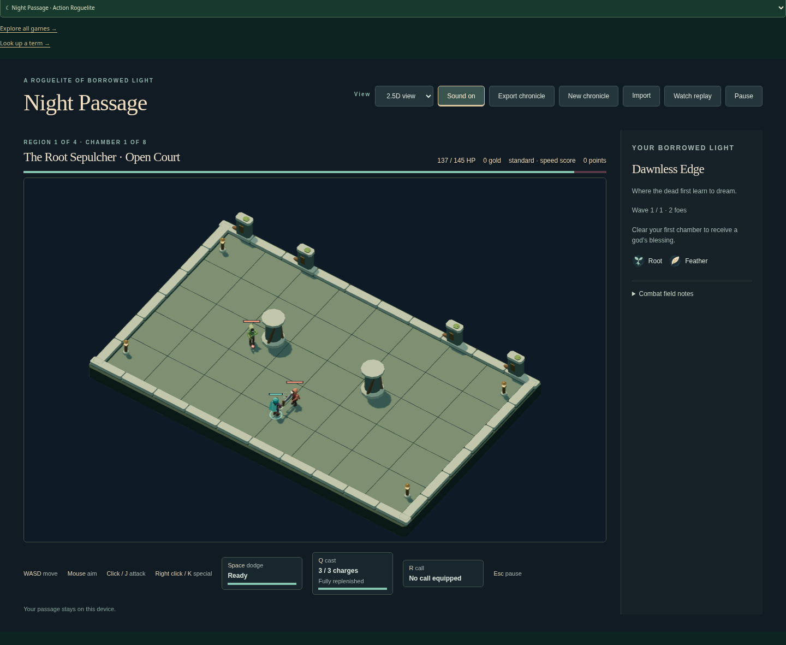
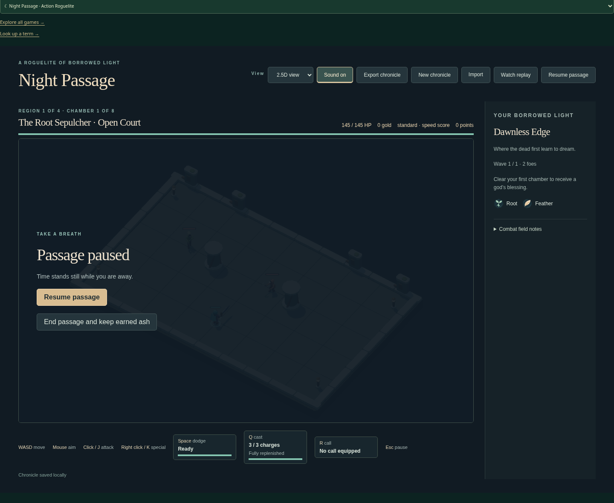

# Toggle Night Passage pause once per Escape press

| Original                                                       | Updated                                                            |
| -------------------------------------------------------------- | ------------------------------------------------------------------ |
|  |  |

Same default 2.5D view, seed, keyboard sequence and 1440 × 1080 viewport at scale 1. Both first pause observations are tick 114. Original resumes and keeps advancing after repeated Escape; Updated remains paused. No art or layout change is claimed.

- Original source: `bebe081234cfbacab30389373f274e7e88be9759`.
- Reviewed implementation: `6d031d262845a9d250cc5df125cf03a31ac15ba7`.
- Change: Ignore repeated Escape keydowns in the live arena handler.
- Acceptance: One Escape press pauses once despite repeats; paused ticks and saved state remain unchanged; release and a fresh press resume; pointer Pause/Resume and held movement remain effective in both live renderers.

Original source failed the paused-heading assertion after repeated Escape at the unchanged 5000 ms budget. The first candidate passed 2/2 in 11.1 s (canvas 2.1 s, scene 6.6 s). Both assert saved-state/tick stability while paused, fresh-press resume, pointer controls and held D movement. The independent replay viewer does not use this live handler.

Pass: two tracked browser cases using the real canvas and scene renderers, scoped lint/format/inventory and build. Independent review accepted with no findings. Images show pause behavior, not fixed-tick pixel parity or rendering performance. The separate replay viewer and full local/unrelated/native suites were not rerun.

Local runtime: Node 24.21.0, npm 11.19.0, Playwright 1.64.0, Chrome 156.0.8078.79. Existing startup, assertion and test guards were retained. This publication reuses valid captures and checks; it adds no gameplay changes. Hosted CI is reported on the draft PR.

Image SHA-256:

- `original-1440.png`: `99d6f8827677acf8b3fd0a57949fc4718beab9fcb2200cb22d3aaf3d0b472ab4`
- `updated-1440.png`: `711d2286ec6193acdda51f596d15cefd0b923c9a1d70df2f419bb356f026a811`
