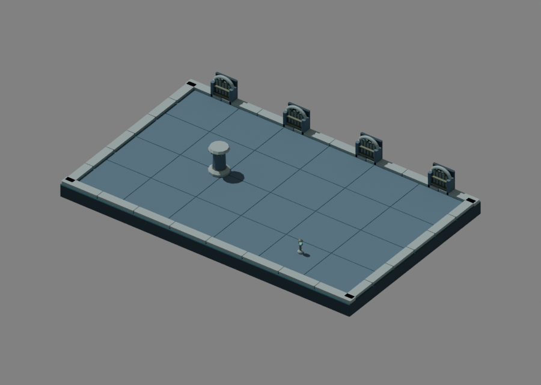
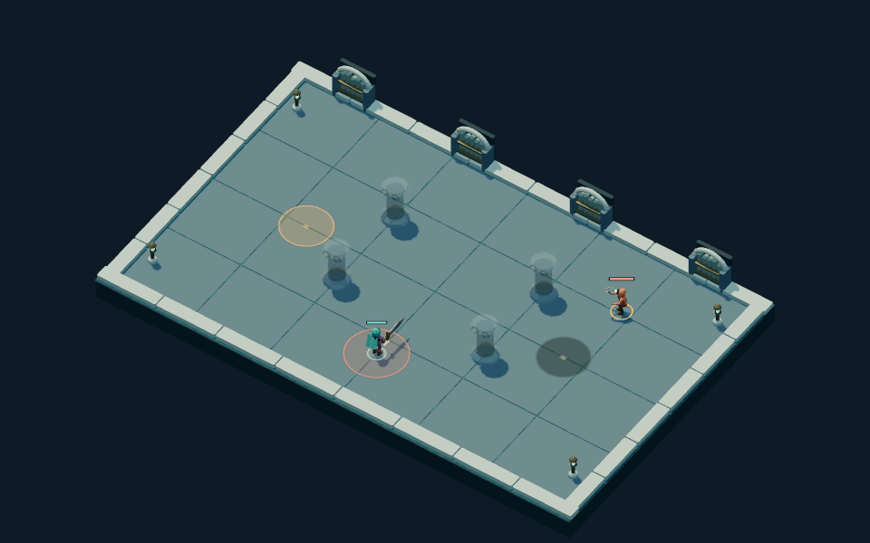

# Drowned Archive · second authored environment

Drowned Archive now uses a saved native kit: broad blue stone paving, narrow
recessed water joints, arched folio niches, scroll capitals and caged aqua lamps.
Pale coping frames the quiet arena; shelves stay on the far boundary and the
foreground stays low. The physical interpretation is a flooded stone archive,
with sealed books and aged fittings rather than loose debris on the combat plane.

## Sources and delivery

The editable master is
`packages/dcc-workbench/subjects/night-passage/environments/archive/source.blend`.
The [source guide](../../../../packages/dcc-workbench/subjects/night-passage/README.md#drowned-archive-environment)
owns construction, saved-source export, review and edit-proof instructions.
The GLB contains **15 meshes** under `Floor`, `Boundary`, `Lantern`, `Pillar`.
Repeated pieces share joined editable meshes by material; `Pillar_cap` stays
separate for local editing. The delivery and adjacent receipt pin saved source,
model and authoring scripts. Re-exporting Root Sepulcher preserved its GLB bytes.

Both regional kits use the same placement contract: floor at or below zero,
raised boundary geometry outside the playable interior, pillars inside the
30-unit disc with height 81, lamps inside an 8-unit disc with height 44. Runtime
scales only pillar X/Z to the rules radius. Private pillar materials fade for
occlusion and windups. Libraries load on regional use and release on arena
teardown; incomplete or late deliveries retain the appropriate fallback.

## Visual self-review

The primary author inspected native clay/material assembly, enlarged pillar and
lamp, side and rear views, all four production layouts at 960 × 600, a matching
390 × 244 view, and the actual game UI. The initial scroll ornaments slightly
exceeded their collision disc. A saved one-unit inward repair corrected those
304 vertices; the shaft, band and gameplay footprint stayed unchanged. The
construction recipe records the same correction for future fresh candidates.

Blue paving and aqua lamps distinguish this region from the rooted Sepulcher.
The arched shelves add identity without occupying player space. The floor is
brighter than the blockout, but orange warnings remain readable and every pillar
fades during hostile windups. At narrow size, capitals, shelves and boundary
shape remain visible; individual folios and scroll curls recede. Paired
[fallback](../../../../packages/dcc-workbench/assets/night-passage/evidence/archive/crossroads-fallback-desktop.png)
and [narrow](../../../../packages/dcc-workbench/assets/night-passage/evidence/archive/crossroads-native-narrow.png)
views use the same controlled state. This is owner self-review, not independent
art approval or user acceptance.

The water is a static recessed material, not simulated water. There are no
reflection, ripple or animated caustic claims. More sculpted wear and richer
shelving remain polish opportunities; the core kit is intentionally economical.

## Verification

Native/browser comparison covers **3,020 native vertices** and **9,912 delivered
vertices**, including export splits, across all 15 meshes. The original and saved
edited models both measured zero positional error against the **0.001 game-unit**
tolerance. Only `Pillar_cap` changes in the disposable edit proof, by exactly four
units; the authoritative source and published delivery stay unchanged.

Four controlled layout comparisons preserve collision probes and exact warning
canvases across native and fallback scenery. Regional switching, paused arrival,
private fade materials and resource teardown have explicit coverage. A separate
UI journey generates a region-two approach through legal commands, imports it,
resumes movement and reloads the chronicle paused. It proves that journey, not a
full campaign played by a human.

Compact measurements, pins and selected capture hashes are retained in
`packages/dcc-workbench/assets/night-passage/archive-review.json`; full vertex
arrays and disposable edited sources remain regenerable under `test-results`.
This was the **second of four** environment kits. The subsequent
[Cinder Court](cinder.md) and [Starless Gate](starless.md) complete regional coverage.
[Reward/loadout symbols](symbols.md) and [patron light effects](patrons.md) are also
delivered. Final integrated review remains queued.
