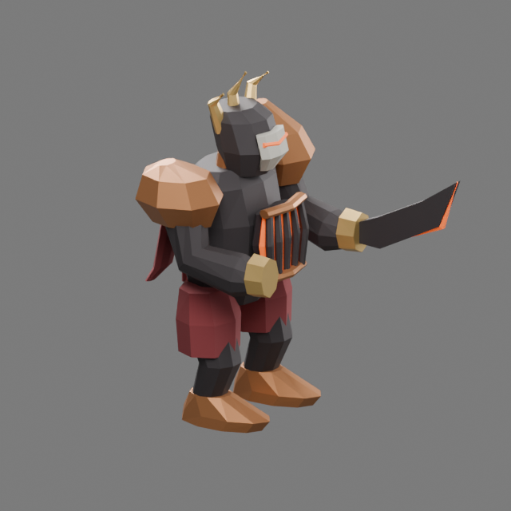

# Ash Regent · third authored guardian

The Cinder Court guardian is a crowned furnace construct with a charcoal cuirass,
ember grate, copper shoulder armor, split burgundy regalia and a hooked cinder
blade. Its tall crown and asymmetric weapon distinguish it from Bellwarden's
bell and Undertow's low shellback. Large dark planes carry the body; restrained
ember accents locate the face, furnace and blade. This is an original stylized
construct, reviewed by the primary author.

## Source and motion

The editable master is
`packages/dcc-workbench/subjects/night-passage/guardians/ashregent/source.blend`.
The [source guide](../../../../packages/dcc-workbench/subjects/night-passage/README.md#ash-regent)
owns reproduction and extension instructions. `guardian-ashregent.glb` is its
baked browser delivery, with source, model and script hashes in the adjacent
receipt. Export evaluates saved actions without reconstructing the master.

Six performances cover idle, run, cross, rain, volley and stagger. The crossed
lane attack sweeps the blade inward, ember rain raises the empty hand above the
crown, and the projectile fan leans the furnace forward. Contact phase 0.45 maps
to the confirmed rules attack, including enraged timing. Crossed lanes, targeted
rain, projectile release, root position and facing remain rules-owned.

## Visual review

The first clay review found boxy shoulders and a slab-like rear mantle. The saved
master was refined with faceted shoulder volumes, two tapered mantle panels and
a higher rain gesture. The fitted body and other saved motion were preserved.
Final front, side, rear and angled clay/material views were inspected along with
the attack contact poses. The furnace grate is raised geometry over an ember
inset; its bars and recess have actual depth.

Native, browser and playback evidence is recorded in
`packages/dcc-workbench/assets/night-passage/ashregent-review.json`. Visual
self-review remains separate from user approval. Bellwarden and Undertow retain
identical model bytes after export through the extended pipeline; their
historical visual receipts remain unchanged.

Controlled 960 × 600 and 390 × 244 captures preserve the same crossed-lane
warning as the fallback. The health bar clears the crown. At narrow scale the
blade edge and individual grate bars recede; copper shoulders, dark body and
ember center carry the identity. Six-fps decoded attack playback was inspected
for preparation, contact and settling; the full unretimed movie is retained.

Native/browser agreement covers **237 frames × 528 surface probes** per delivery.
Maximum error is **0.000001472 model units** against a **0.0001** tolerance. A
saved-copy head-key edit moves the cross surface by **0.1788 model units** while
preserving mesh and weights. These measurements are separate from visual judgment.

## Bounds

[Unlit Sovereign](sovereign.md) now has an authored native model. [Root Sepulcher](sepulcher.md) has the first environment kit; three remain blockouts. In-place walking
does not establish world-space foot locking at arbitrary movement speeds.
Directional locomotion and animation transitions remain polish work. Ground
warnings remain the authoritative danger footprint; the blade's physical reach
does not reproduce the full crossed lanes or projectile fan.
