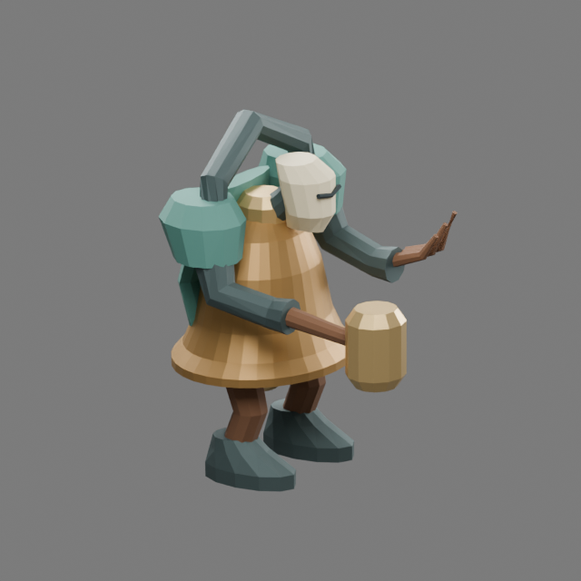

# Bellwarden · first authored guardian

The Root Sepulcher guardian now has a native bronze-bell body, iron suspension,
masked face, heavy sabatons and an asymmetric wooden striker. The broad flared
mouth identifies it against ordinary enemies; the opposite hand invokes roots.
Quiet bronze planes and muted verdigris separate the shell from the limbs.
This is an original stylized construct, reviewed by the primary author.

## Source and motion

The editable master is
`packages/dcc-workbench/subjects/night-passage/guardians/bellwarden/source.blend`.
The [source guide](../../../../packages/dcc-workbench/subjects/night-passage/README.md#bellwarden)
owns reproduction and extension instructions. `guardian-bellwarden.glb` is its
baked browser delivery; the adjacent JSON receipt pins source, model and scripts.
Export evaluates saved actions and does not run construction or repair recipes.

The six clips are idle, run, sweep, rain, wheel and stagger. The three attacks
have separate performances: a lateral striker sweep, a raised root hand and a
swing through the hanging bell. The authored contact is phase 0.45; production
sampling places it at the confirmed rules attack, including the faster enraged
rhythm. Root position, facing, projectile release and orange damage footprints
remain rules-owned. The model uses the existing enemy radius scale and has no
additional collision or damage behavior.

## Visual review

The first clay review found a floating mask connection and small, ambiguous
attack gestures. A repair to the saved master added a neck coupling and changed
the directional attack keys; the rest of the fitted geometry was preserved.
Final front, side, rear and angled views were inspected in clay and materials.
The shell has an actual hollow mouth and wall thickness, with a clapper below
its lip. Large planes carry the identity; small fingers and mask details are
secondary at play scale.

Native and browser evidence, playback and source hashes are recorded in
`packages/dcc-workbench/assets/night-passage/bellwarden-review.json`. Controlled
combat captures compare the authored character to its previous blockout with the
same positions and threat. Desktop and 390-pixel views test readability at play
scale. These captures and owner self-review do not constitute user art acceptance.

Native/browser comparison covers **237 frames × 336 surface probes** per delivery.
Maximum error is **0.000001294 model units** against a **0.0001** tolerance; the
disposable saved edit moves the compared sweep surface by **0.1106 model units**.
These are sampled deformation results, separate from visual judgment.

## Bounds

[Undertow](undertow.md) now has an authored native model. Ash Regent and Unlit
Sovereign still use procedural blockouts. Four
region environment kits remain pending. Bellwarden locomotion is an in-place
heavy walk; dedicated backward/sideways steps and transition blending remain
polish opportunities. Foot support is measured against the native rig, not claimed
as world-space foot locking at every rules speed. Threat footprints remain the
primary guide to danger even when the striker's physical reach is shorter.
