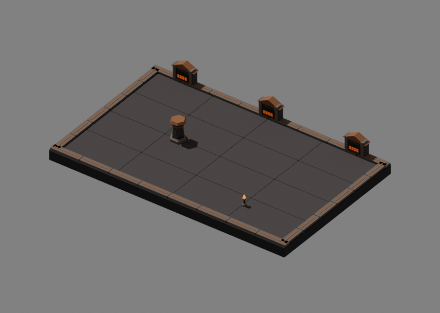
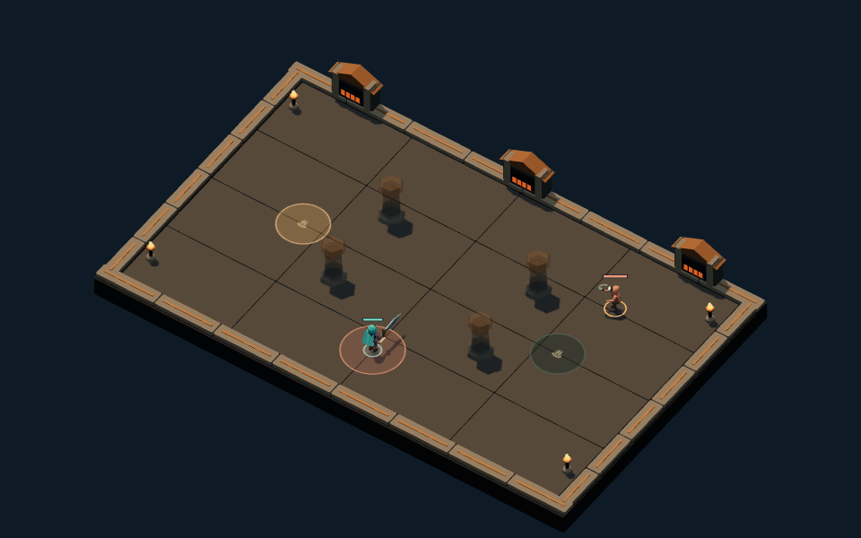

# Cinder Court · third authored environment

Cinder Court now uses an editable native kit: charcoal basalt paving, copper-edged
coping, three peaked furnace monuments, six-sided columns and open ember braziers.
The broad furnace silhouettes and warm metal distinguish it from the rooted
Sepulcher and blue Archive. The floor stays quiet; luminous accents remain at the
boundary and lamps so they do not imitate orange ground warnings.

## Source and placement

`packages/dcc-workbench/subjects/night-passage/environments/cinder/source.blend`
owns the saved geometry and materials. The [source guide](../../../../packages/dcc-workbench/subjects/night-passage/README.md#cinder-court-environment)
owns fresh-candidate construction, saved-source export, review and edit proof.
`environment-cinder.glb` contains **18 meshes** under the same `Floor`, `Boundary`,
`Lantern` and `Pillar` roots. Repeated surfaces join by material; `Pillar_cap`
remains independently editable. Archive and Cinder share small chamfered-block
and material-joining helpers. Re-exporting both older masters preserved their
GLB bytes; only the script receipts changed.

Floor surfaces remain at or below the combat plane. Raised scenery stays outside
the playable interior. The complete pillar fits the 30-unit disc and reaches 81
units high; runtime scales only its X/Z to the authoritative rules radius. The
brazier fits an 8-unit disc and reaches 44 units. Private pillar materials fade
for occlusion and hostile windups. Lazy regional loading, fallback and disposal
use the existing environment library. Rules, seeds and replay versions are unchanged.

## Visual self-review

The primary author inspected native clay/material assembly, pillar front/side/rear,
brazier close-up, all four production layouts, a matching narrow view and the
actual region-three game UI. The first side view exposed column seals floating
away from the tapered shaft. A saved native repair fitted **48 seal vertices** to
the taper; the fresh-candidate recipe records the same fit. Other surfaces stayed
unchanged. The corrected side view shows supported attachments along their length.
Code review also caught a reflected construction basis that reversed the seal
faces. The native repair reversed 30 seal polygons and the recipe now preserves
orientation. A signed-volume delivery check rejects the original inward faces
and passes all three repaired seals; positional agreement alone missed this defect.

The copper caps and furnace roofs carry the large shapes; dark shafts sit behind
actors and warnings. Compared with the [fallback](../../../../packages/dcc-workbench/assets/night-passage/evidence/cinder/crossroads-fallback-desktop.png),
the authored scene has broader paving, restrained edging and a regional boundary
silhouette. At [390 px](../../../../packages/dcc-workbench/assets/night-passage/evidence/cinder/crossroads-native-narrow.png),
warning rings, columns and furnace lights remain readable while small seals and
grille bars recede. Foreground coping stays low. This is owner visual self-review,
not independent art approval or user acceptance.

Flames are static stylized geometry with emissive materials. They do not imply
animated fire, heat haze, particle effects or a dynamic lighting system. Surface
wear and richer furnace construction remain polish opportunities.

## Verification

Native/browser agreement covers all **1,910 native vertices** and **5,786 delivery
vertices**, including export splits. Original and edited models measured zero
positional error within the **0.001 game-unit** tolerance. Only `Pillar_cap`
changes in the disposable edit proof, by exactly four units. Authoritative source
and delivery remain unchanged by verification.

Controlled comparisons cover four layouts at 960 × 600 and 390 × 244. Native and
fallback preserve exact warning canvases and collision probes. Additional checks
cover paused arrival, private pillar materials, regional switching and cleanup.
A legal-command region-three chronicle is imported in the actual UI, resumes
movement, pauses and reloads unchanged. That proves this journey, not a full
human-played campaign. All Cinder-specific checks and captures were refreshed
after the saved seal repair.

Compact measurements and selected capture hashes live in
`packages/dcc-workbench/assets/night-passage/cinder-review.json`. Full sampled
arrays and edited source copies remain regenerable under `test-results`.
This was the **third of four** environment kits. [Starless Gate](starless.md)
completes regional coverage. [Reward/loadout symbols](symbols.md) and
[patron light effects](patrons.md) are also delivered. The final integrated review
remains under the active goal.
