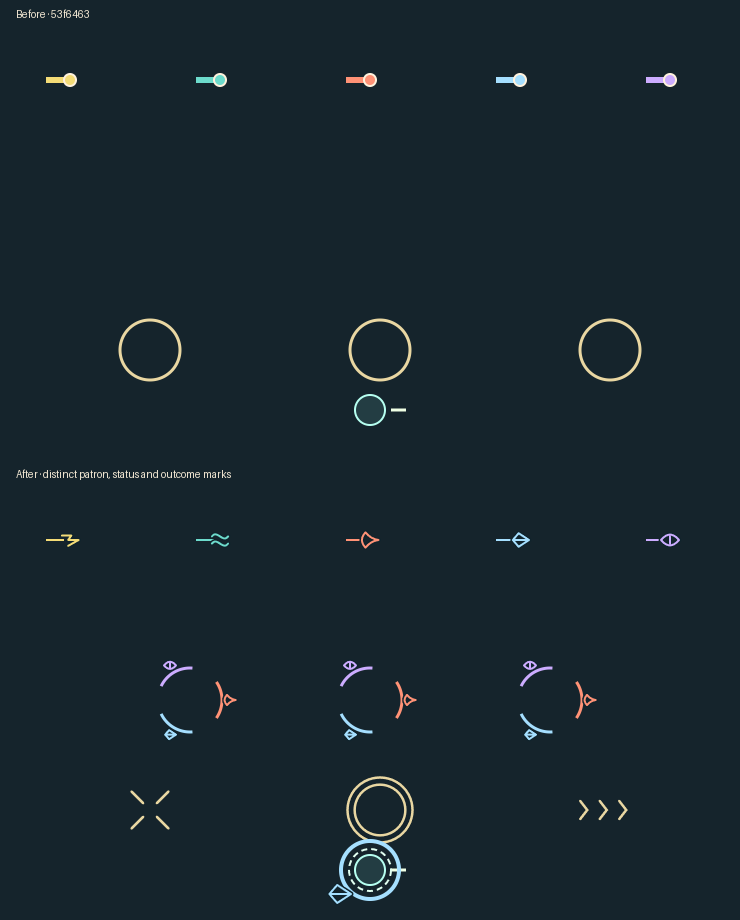
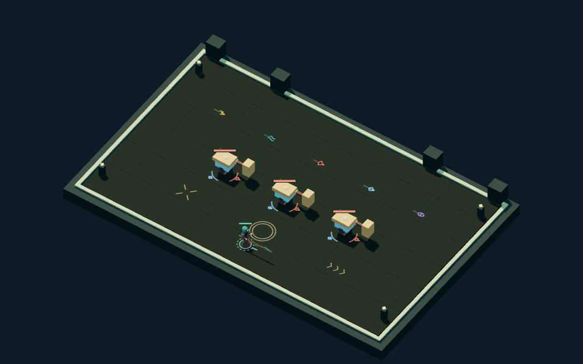

# Night Passage combat marks

This records the earlier ground-mark batch. The subsequent
[patron light effects](patrons.md) add raised spell forms over the same ground
vocabulary; authored actors and all four environment kits have also superseded
the blockouts shown in these retained historical captures.

## Brief and ownership

Make patron shots, simultaneous enemy statuses and transient combat outcomes
distinguishable at the angled play camera. Preserve the authoritative warning
footprints and the existing restrained light-mark palette.

The editable source is
[`combat-marks.ts`](../../../../src/games/night-passage/ui/presentation/scene/combat-marks.ts).
These are symbolic Canvas paths on the existing ground decal, not native geometry.
No Blender master or baked asset changed. Hostile shots have pale-centered red
diamonds; five patron contours use bolt, wave, flame, shard and eye shapes.
Burn, chill and exposure occupy separate sectors, including during hit flash.
The hero's broken pale ring reads the damage-immunity timer.

## Matching comparison



The top panel uses the ground renderer from `53f6463`; the bottom uses this slice.
Both draw the same controlled composite state, including all five patron shots,
simultaneous statuses, hit/burst/dash cues and a Winter call/immunity overlay.
This deliberately crowded fixture compares vocabulary; it is not a captured
legal combat moment. The panels are matching crops from 960 × 640 ground decals.

## Angled play scale



The browser helper regenerates this 960 × 600 scene from the composite fixture,
using the actual scene renderer, native hero and weapon delivery. Unlike the
comparison above, it does not add the Winter call/immunity overlay.

Owner self-review: patron contours remain distinguishable, short shot tails
communicate travel direction, and the separate status sectors survive actor hit
flash. Ground projection foreshortens small symbols; enemy silhouettes and the
room kit remain blockouts. Readability at crowded human-played combat intensity,
enemy artwork and full patron effects still need later review. This is visual
self-review, not independent art approval or user acceptance.

## Reproduction

Run the approved disposable-profile browser harness:

```sh
nvm use
npm run test:browser -- tests/browser/night-passage-parity.spec.ts
```

The helper owns controlled family fixtures, release steps, safe-space probes and
legal-command campaign traversal. It writes disposable screenshots and compact
result summaries under `test-results/night-passage-parity/`. Those outputs are
regenerated rather than committed as replay fixtures. Live UI combat and saved
run journeys remain separate checks; see the
[engineering evidence](../../../engineering/night-passage.md#spell-and-threat-readability).
