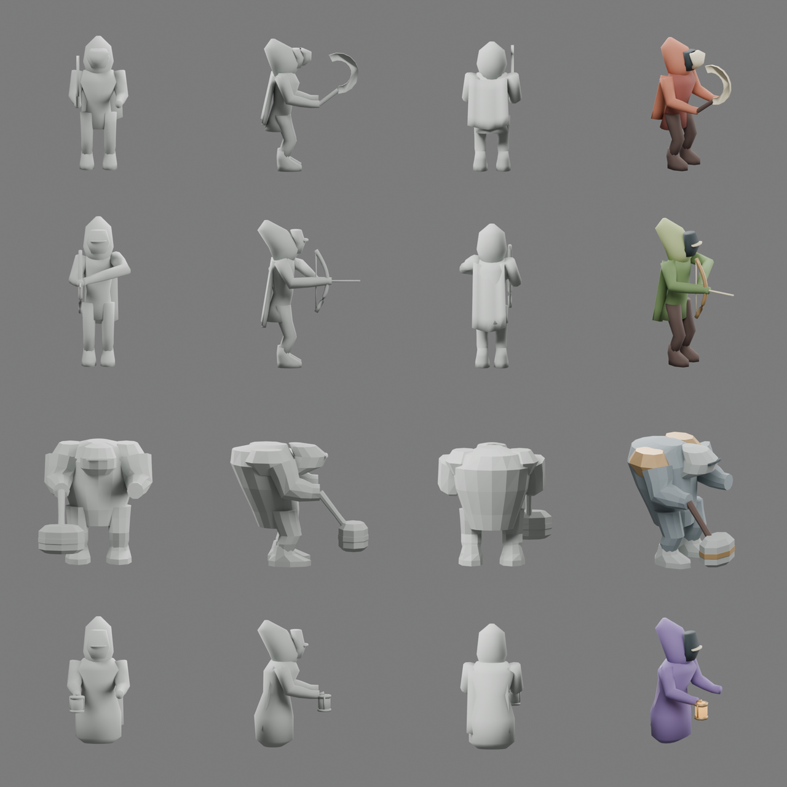
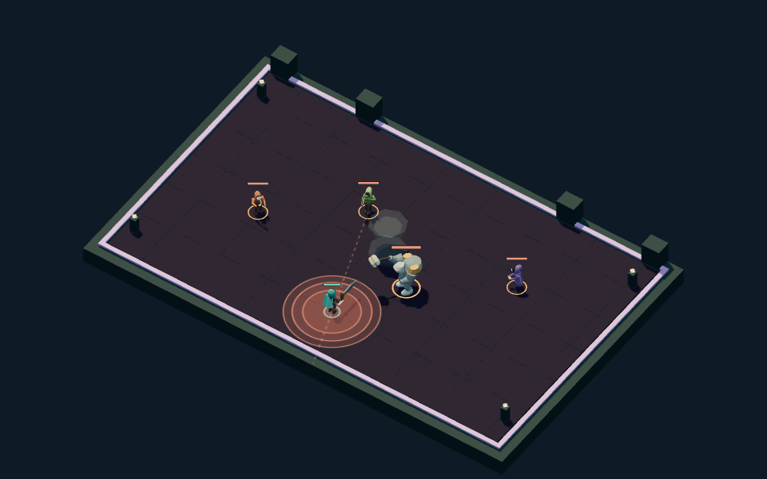

# Night Passage ordinary enemies

## Brief

Replace four gameplay blockouts with distinct original opponents that remain
legible in the angled arena. Keep the native hero's broad sculptural planes,
restrained cloth/metal palette and light face accents. The intended display is
approximately 25–55 pixels tall in the 960-pixel desktop arena; enlarged native views
must also hold up. These are gameplay-scale stylized figures, not realistic
anatomical studies.

| Family | Gesture and identifying contour                     | Material hierarchy                                   |
| ------ | --------------------------------------------------- | ---------------------------------------------------- |
| Hunter | Forward lean, masked face, hooked sickle            | Muted red cloth, dark leather, pale steel            |
| Archer | Narrow upright body, reed hood, long bow            | Olive cloth, worn wood, light face                   |
| Brute  | Compressed head beneath broad shoulders, heavy maul | Stone/plate masses, dark cloth, selective warm metal |
| Witch  | Tapered floating shroud, lantern held clear of body | Violet fabric, pale mask, small luminous lantern     |

## Sources and consumer

The [native source guide](../../../../packages/dcc-workbench/subjects/night-passage/README.md#ordinary-enemy-family)
owns source paths, delivery contracts and native proof. Four saved `.blend`
masters own geometry, weights and clips; the browser consumes their baked GLBs.
Each has idle, locomotion, attack and stagger performances. The rules still own
movement, damage, windup and interruption.

The integration preserves a loading/error fallback for each family. It keeps
independent poses and material feedback on simultaneous enemies while sharing
the family geometry. Current enemy status ground marks and exact threat
footprints remain visible beneath the models. Guardians and environment kits
are separate queued asset batches.

## Review and verification

Rows are hunter, archer, brute and witch. The broad brute and floating witch have
distinct contours; hunter and archer still share a hooded outline, with equipment
and color providing additional separation. Saved-source review repaired the
hunter's handle-to-blade gap and the brute's shaft, then strengthened the brute's
shoulder lift/slam and the archer's hand/string draw.

This 960 × 600 controlled encounter uses the actual arena and native assets.
The [matching fallback view](../../../../packages/dcc-workbench/assets/night-passage/evidence/enemies/fallback.png)
uses the same state with enemy deliveries intentionally unavailable. The
[390 × 244 view](../../../../packages/dcc-workbench/assets/night-passage/evidence/enemies/narrow.png)
preserves the larger silhouettes and warning marks, but loses fine equipment and
face detail. This fixture is not a captured legal combat moment.

The [attack sequence sheet](../../../../packages/dcc-workbench/assets/night-passage/evidence/enemies/attacks.png)
contains ten decoded frames per attack from the retained
[unretimed 1× movie](../../../../packages/dcc-workbench/assets/night-passage/evidence/enemies/enemies-1x.webm).
Rows follow the family order above. Raw clip playback keeps the archer arrow
visible; the separately checked production adapter hides it at release.
The [review receipt](../../../../packages/dcc-workbench/assets/night-passage/enemies-review.json)
pins native sources, deliveries, retained evidence and numerical agreement.

Native front/side/rear clay and material views establish the silhouettes before
repeating the family treatment. Browser evidence covers every delivered clip at
1× playback, production actor activation, simultaneous independent poses, paused
and reduced-motion stability, and a four-family combat view. Native surface
comparison and a disposable saved-control edit verify the source/export/consumer
loop. Review outputs are regenerated under `test-results/night-passage-enemies/`.

Visual judgment is owner self-review, not independent approval or user acceptance.
Technical checks establish delivery and timing behavior; they do not establish
combat feel or finished art quality. Directional locomotion, transition blending,
guardian artwork and region-specific architecture remain later slices.
