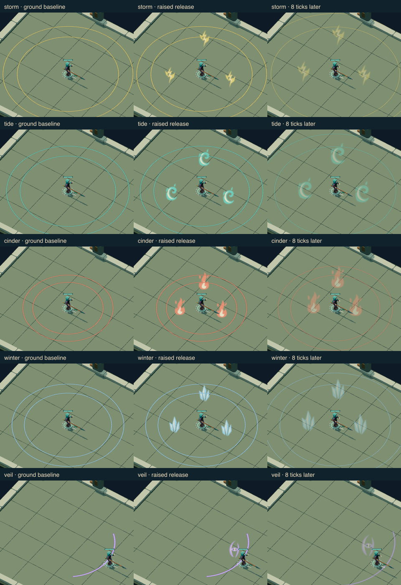
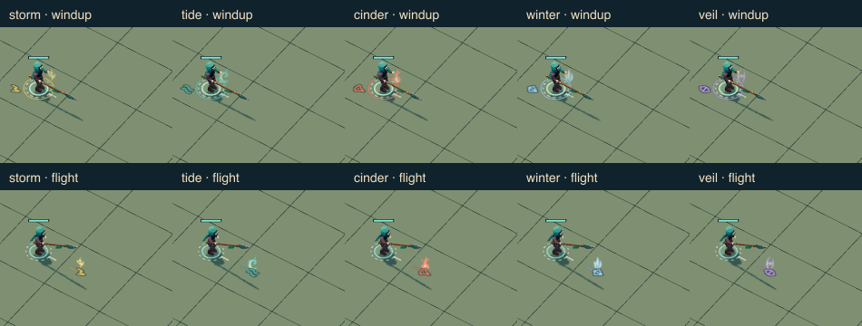
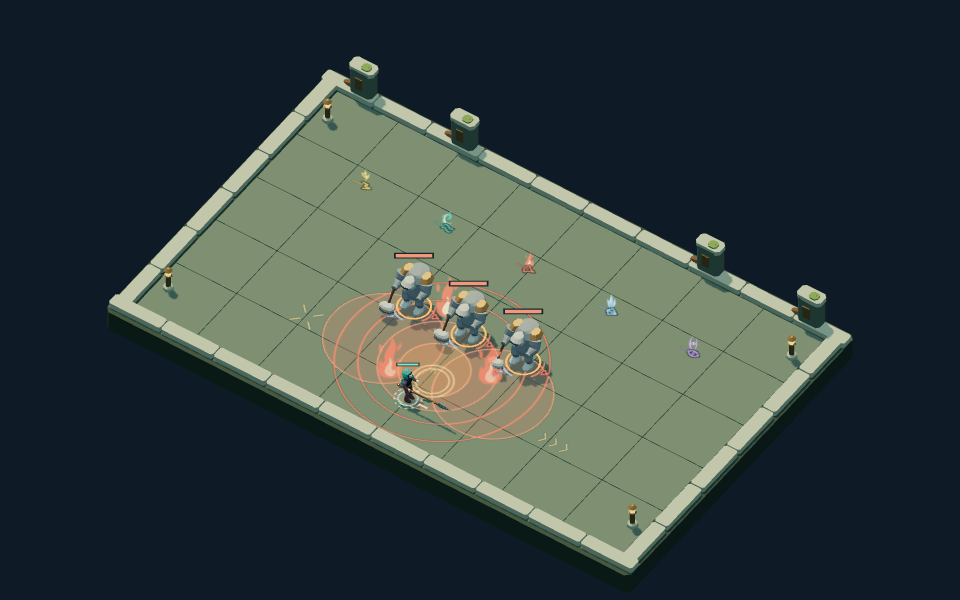

# Night Passage · patron light effects

Five raised light forms give patron spells a visible silhouette at the angled
play camera: Aster's forked leader, Neris's hollow turning crest, Vesta's uneven
flame, Isen's split crystal fan and Nyra's torn crescent around an exposed eye.
Each uses a colored body and a restrained ivory core. These are transient light,
with open negative space to keep opponents and ground warnings visible.

## Source and placement

[`scene/patron-effects.ts`](../../../../src/games/night-passage/ui/presentation/scene/patron-effects.ts)
owns the editable Canvas paths and their rendering lifecycle. Five small
128 × 192 textures feed pooled camera-facing sprites. This light artwork has
no solid mesh, rig or baked motion; the existing saved Blender masters remain
authoritative for characters, weapons and scenery.

Cast/call windup gathers beside the hand, patron projectiles carry a raised core,
and confirmed hits, slashes and bursts release the matching light. Broad bursts
place three small forms within the existing cue; they never fill the arena with
an opaque screen. Simultaneous burn, chill and exposure remain separate ground
marks. Hostile and unblessed shots retain their existing treatment.

Every pose reads the current strike, projectile or cue. There is no particle
history, wall clock, randomness, new saved field or rules-version change.
Cancellation removes the windup immediately; expired cues and chapter changes
cannot leave a stale emitter. Reduced motion removes rise and expansion while
the confirmed lifetime still controls fading. Paused snapshots remain still.

The five existing patron cue colors select their matching light. Unknown colors
retain the original ground cue. A future change to cue identity should extend
this presentation contract deliberately; it must not infer damage from art.

The layer owns at most 48 sprites and reuses their materials. It keeps depth
testing, disables depth writes and leaves shared Sprite geometry to Three.js.
Disposal releases its five textures and all private materials. At the cap,
additional decorative lights are omitted; all authoritative ground cues and
projectiles continue to render. Ground warnings, safe space, collision geometry,
and the Canvas baseline are unchanged.

## Review boundary



The columns show the same confirmed release without the new light layer, with
the layer, and eight rules ticks later. Calls retain open centers and restrained
light; Nyra's rush keeps its directional sweep. The silhouettes differ by shape
as well as color. The source adjustment raised the gathering light from foot
level to hand level after initial close-up review.



The flight row uses patron-marked spear projectiles to compare all five forms,
including Nyra, whose cast is a rush. It is not a claim that all five casts are
single projectiles. The existing three-wave and five-shard fans retain their
confirmed shot counts.



The crowded fixture combines three brute windups, a thorns warning, simultaneous
statuses, five patron shots and a Cinder call. Compared with the
[matching baseline](patrons/crowded-warnings-call-960-before.png), the open light
forms leave the warning boundaries and opponents visible. At
[390 px](patrons/crowded-warnings-call-390.png), overlapping ground rings remain
dense; this slice does not claim to solve crowded combat readability in general.
The [narrow comparison](patrons/narrow-comparison.png) shows all five call motifs
at actual width. Fine forks and eye detail recede there, while the larger contour
and color remain. Touch controls are outside this slice.

Controlled renderer fixtures and legal campaign journeys are separate evidence.
The comparison harness hides only this cosmetic layer for a matching baseline;
it does not change the scene, camera, actors or rules snapshot. The effects are
reviewed at 960 px and 390 px. Native source/export verification belongs to the
unchanged solid assets; this slice verifies their consumer composition with light.

The initial before/after helper overrode a prototype renderer method that Three.js
defines on each instance. Both captures consequently contained the effects. The
corrected helper hides the observed light group directly, preserves each failing
case's captures before assertions, and checks each pair independently. No product
visibility check was weakened. One worker owned the two browser helper/test files;
the parent owned artwork, integration and visual review. This trial incurred one
baseline-method correction; no controlled elapsed-time comparison was made.

## Verification

`npm run check:full` passed: maintenance/static checks, 384 application tests,
22 seeded simulations and 128 geometry tests. Six affected browser journeys
passed: 25 controlled patron states, 52 matching desktop/narrow comparisons,
resource and reduced-motion checks, the existing 85-case ground parity matrix,
five legal fast-forward campaigns with 165 rendered checkpoints, and live
combat/save/context-loss journeys. Fast-forwarded checkpoints are not a full
human-played browser campaign. No native master or baked delivery changed, so no
fresh Blender edit/export proof is claimed for this light-only slice.

Run the affected browser group through the approved disposable-profile harness:

```sh
npx playwright test tests/browser/night-passage-patrons.spec.ts tests/browser/night-passage-parity.spec.ts tests/browser/night-passage-scene.spec.ts --project=functional
```

The [compact receipt](patrons/review.json) retains source and image hashes. Full
captures and generated snapshots remain disposable output under
`test-results/night-passage-patrons/` and `test-results/night-passage-parity/`.

This is owner visual self-review, not independent art approval or user acceptance.
The final integrated campaign review remains a separate goal milestone.
