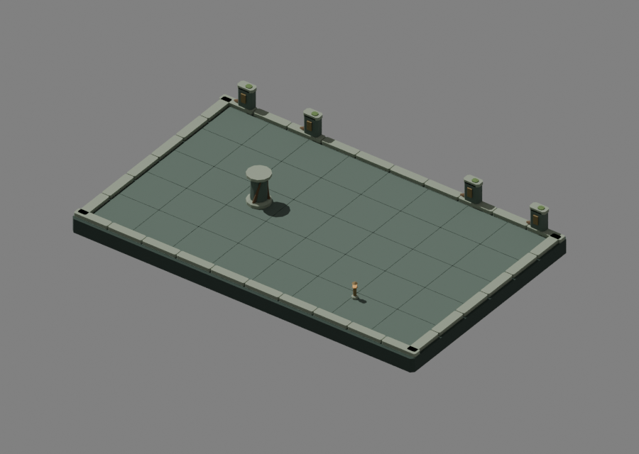
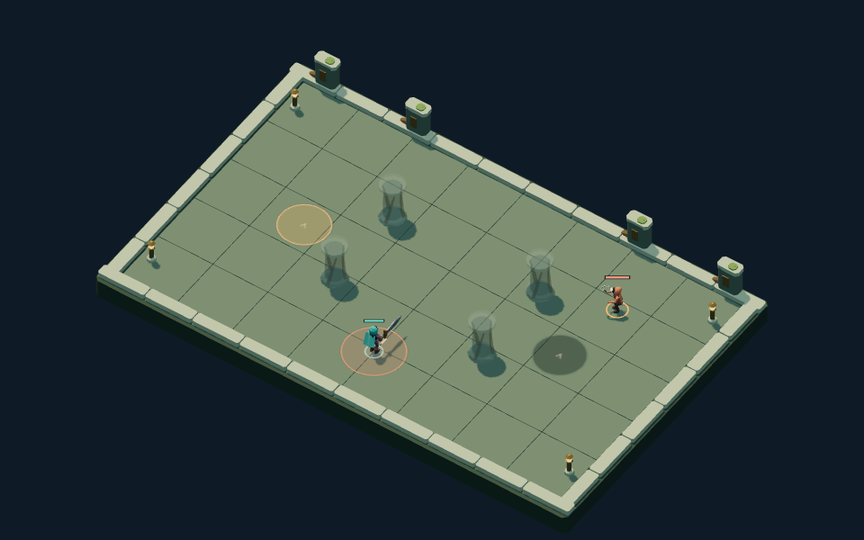

# Root Sepulcher · first authored environment

Root Sepulcher now uses an editable native kit: broad slate slabs, low tomb
boundaries, roots climbing the cover pillars, and bronze lanterns. Pale coping
stones frame a quiet floor; far-side markers carry bronze seals and moss.
Foreground boundaries stay low so the combat plane remains visible.

## Source and placement

The master is
`packages/dcc-workbench/subjects/night-passage/environments/sepulcher/source.blend`.
The [source guide](../../../../packages/dcc-workbench/subjects/night-passage/README.md#root-sepulcher-environment)
owns reproduction and extension instructions. Export reads saved geometry and
materials without rebuilding the room. The GLB has **14 meshes** under four
roots: `Floor`, `Boundary`, `Lantern`, `Pillar`. Repeated stones share joined
editable meshes by material; individual placed pillars own their materials.

The floor top is at the combat plane. Raised boundaries stay outside the
playable interior. Pillars fit the rules collision disc and scale horizontally
to each layout's radius; their height stays **81 game units**. Lanterns remain
at the existing four boundary positions. Every pillar material fades when it
occludes an actor or a hostile windup needs the ground visible.

The whole blockout stays visible until the complete kit loads. Failed or
incomplete loads keep that fallback. A successful load invalidates the paused
frame. Scenery does not consume randomness or change the rules, layouts or
collision geometry.

## Visual review

The primary author inspected native assembly, pillar and lantern views in clay
and materials. Review camera clipping and framing were corrected before visual
judgment; the native geometry required no repair. The root forms connect shaft
to plinth while staying inside the cap footprint. The warm lantern core remains
a restrained accent against the stone. This is owner visual self-review, not
user art approval.

Controlled production comparisons cover all four layouts at **960 × 600** and
**390 × 244**. Native and fallback preserve the same warning decal and collision
results. Pillars fade during windups; the cap, boundary and lantern silhouettes
remain visible at narrow size while fine details recede. The retained
[fallback](../../../../packages/dcc-workbench/assets/night-passage/evidence/sepulcher/crossroads-fallback-desktop.png)
and [narrow view](../../../../packages/dcc-workbench/assets/night-passage/evidence/sepulcher/crossroads-native-narrow.png)
use the same controlled combat state.

Native/browser agreement covers **14 meshes**, **2,164 native vertices** and
**6,664 delivery vertices** including export splits. Both original and edited
deliveries have zero measured positional error against a **0.001 game-unit**
tolerance; only the edited cap differs from the original, by exactly four units.

Production arena comparisons and geometry measurements are retained in
`packages/dcc-workbench/assets/night-passage/sepulcher-review.json`.
The native edit proof raises the cap's saved top vertices by **4 game units**,
saves, reloads and exports the copy. All named meshes are compared against the
native evaluated vertices. The authoritative source and published model stay
unchanged; full arrays and edited copies remain regenerable temporary evidence.

## Bounds

This was the **first of four** environment kits. The subsequent
[Drowned Archive](archive.md), [Cinder Court](cinder.md) and
[Starless Gate](starless.md) complete the four regional kits;
further patron effects/reward icons remain queued. The kit is deliberately simple;
sculpted wear, richer root branching and texture detail remain future polish.
Static geometry agreement does not establish visual approval or a frame-time
improvement. The current scene still uses the established lighting and camera.
