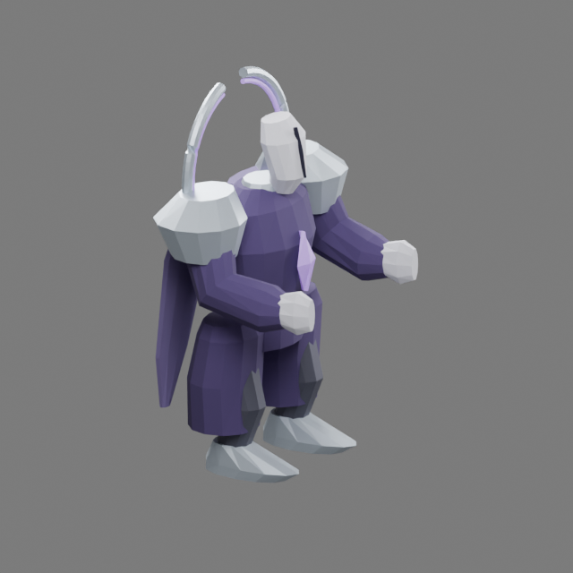

# Unlit Sovereign · fourth authored guardian

The Starless Gate guardian has a broken orbital crown, faceless porcelain mask,
silver shoulder mantle and divided violet vestments. The crown's negative space
and pale mask identify it against the other guardians. Three unequal arcs give
its rotating wheel gesture a visible reference; the long rear panels and split
robe leave the legs free. This is an original stylized figure, reviewed by the
primary author.

## Source and motion

The editable master is
`packages/dcc-workbench/subjects/night-passage/guardians/sovereign/source.blend`.
The [source guide](../../../../packages/dcc-workbench/subjects/night-passage/README.md#unlit-sovereign)
owns reproduction and extension instructions. `guardian-sovereign.glb` is its
baked browser delivery; source, model and script hashes are in the adjacent
receipt. Export evaluates saved geometry and actions without reconstructing them.

Seven clips cover idle, run, cross, rain, pulse, wheel and stagger. Cross divides
the hands with a torso turn; rain raises both hands above the mask; pulse opens
the arms with a forward lean; wheel raises one hand and rotates the broken crown.
The four authored attack contacts at phase 0.45 map to actual rules release,
including enraged timing and pattern wraparound. Position, facing, crossed lanes,
rain sites, pulse safe center and projectile wheel remain rules-owned.

## Visual review

Native front, side, rear and angled views were inspected in clay and materials,
along with all four attack contacts. The crown arcs have real gaps and thickness;
the collar supports the mask, and the split vestments expose the feet. The first
candidate required no geometry repair after review. The floating crown is an
intentional supernatural element, separate from the head's physical connection.

Evidence and source hashes are recorded in
`packages/dcc-workbench/assets/night-passage/sovereign-review.json`. Visual
self-review does not establish user approval. Earlier guardian models remain
byte-identical after export through the extended pipeline, and their historical
visual receipts remain unchanged.

Controlled 960 × 600 and 390 × 244 captures preserve the fallback's crossed-lane
warning. The health bar clears the crown. Fine crown gaps and the mask seam
recede at narrow scale; the pale head, silver shoulders and violet body remain
readable. Six-fps decoded playback covers the four attacks' preparation, contact
and settling; the full unretimed seven-clip movie is retained.

Native/browser agreement covers **280 frames × 432 surface probes** per delivery.
Maximum error is **0.000001329 model units** against a **0.0001** tolerance. A
saved-copy head-key edit moves the cross surface by **0.1310 model units**, while
preserving mesh and weights. These measurements are separate from visual judgment.

## Bounds

All four guardians now have authored native models. Four region environment kits
remain blockouts, and further effects/icons remain queued. In-place locomotion
does not establish world-space foot locking at arbitrary movement speeds.
Directional steps and animation transitions remain polish. Ground warnings
remain the authoritative danger geometry; gestures do not reproduce the full
area of the attacks.
