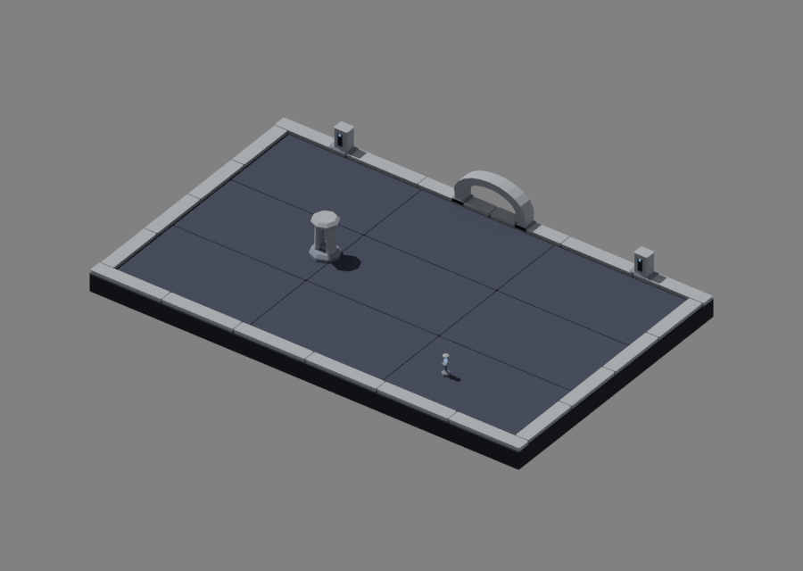
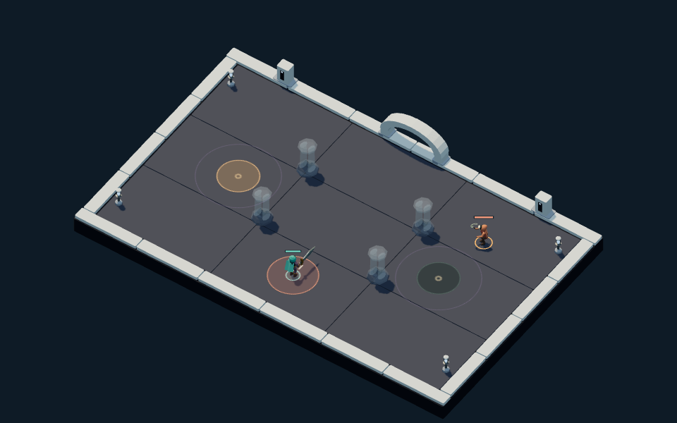

# Starless Gate · fourth authored environment

Starless Gate completes the four regional environment kits: midnight slate,
a broad open limestone arch, two lower stelae, slotted columns and caged cold
lights. A single opening dominates the far boundary. Pale stone frames the
quiet court while the floor carries no constellation marks that could be
confused with void seals.

## Source and placement

`packages/dcc-workbench/subjects/night-passage/environments/starless/source.blend`
is the editable master. The [source guide](../../../../packages/dcc-workbench/subjects/night-passage/README.md#starless-gate-environment)
owns candidate construction, saved export, review and native edit commands.
The kit uses the existing `Floor`, `Boundary`, `Pillar` and `Lantern` contract.
Its `Pillar_cap` remains separately editable; repeated stone surfaces join by
material. Recipes are construction aids, not the exporter’s authority.

All floor surfaces stay at or below zero. Raised scenery remains outside the
playable interior and at most 75 units high. Pillars fit a 30-unit disc and stand 81
units high; lamps fit an 8-unit disc and reach 44 units. Runtime scales pillar
width/depth to the actual cover radius and fades private materials for occlusion
and windups. The tall column slots are decorative; the rules’ circular cover
footprint stays solid. The arch stands outside the arena and is not an exit action.

## Visual self-review

The primary author inspected clay and material assembly from both sides,
column front/side/rear, the beacon close-up, four production layouts, matched
fallback views, 390 px framing and the actual region-four UI.

The first native views exposed a sill protruding through the tapered piers and
black corner patches. Narrowing the saved sill fixed the first issue. The corner
patches were caused by coplanar coping overlaps; adding corner blocks did not
resolve them. The final saved repair removed those additions and shortened the
side segments, leaving clear joints. The recipe records the corrected dimensions.

The arch and pale columns carry the scene’s identity. The dark floor keeps
warnings distinct from stone and cold lights. The
[matching fallback](../../../../packages/dcc-workbench/assets/night-passage/evidence/starless/crossroads-fallback-desktop.png)
and [390 px view](../../../../packages/dcc-workbench/assets/night-passage/evidence/starless/crossroads-native-narrow.png)
record the comparison. Fine beacon structure and column slots become small at
narrow size. This is owner visual self-review, not independent art approval or
user acceptance.

Crystals are opaque emissive surfaces, not glass. Lighting uses the existing
scene rig; there are no dynamic beacon lights or animated skies. Sculpted wear
and additional surface detail remain polish opportunities.

## Verification

Delivery checks enforce bounds, pins and finite geometry. Rays pass through the
arch and column openings and hit both exterior arch faces, detecting sealed
openings and reversed front/back faces. Native proof compares all **988 native
vertices** and **3,036 delivery vertices** across **14 meshes**, accounting for
export splits. Both models agree with zero positional error within the
**0.001 game-unit** tolerance. A disposable copy
raises the saved cap top by four units, saves, reloads and exports; all other
surfaces and the authoritative source/delivery remain unchanged.

Browser comparisons exercise all four layouts at desktop and 390 px with exact
warning-canvas and collision equality against fallback. They also cover paused
arrival, regional switching, private material fading and failed loads. A legal
region-four chronicle reaches the authored arena, resumes movement and reloads
paused. It proves that journey, not a human-played campaign.

`packages/dcc-workbench/assets/night-passage/starless-review.json` retains compact
measurements, source/model pins and selected capture hashes. Full sampled arrays
and edited native copies remain regenerable under `test-results`. All four kits
now have authored sources, and [reward/loadout symbols](symbols.md) are delivered.
[Patron light effects](patrons.md) are delivered. The final integrated campaign review stays under the active goal.
