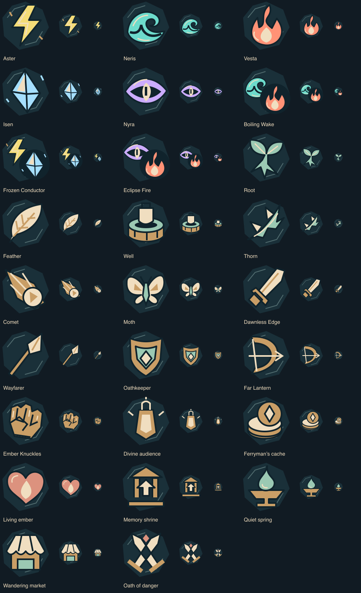
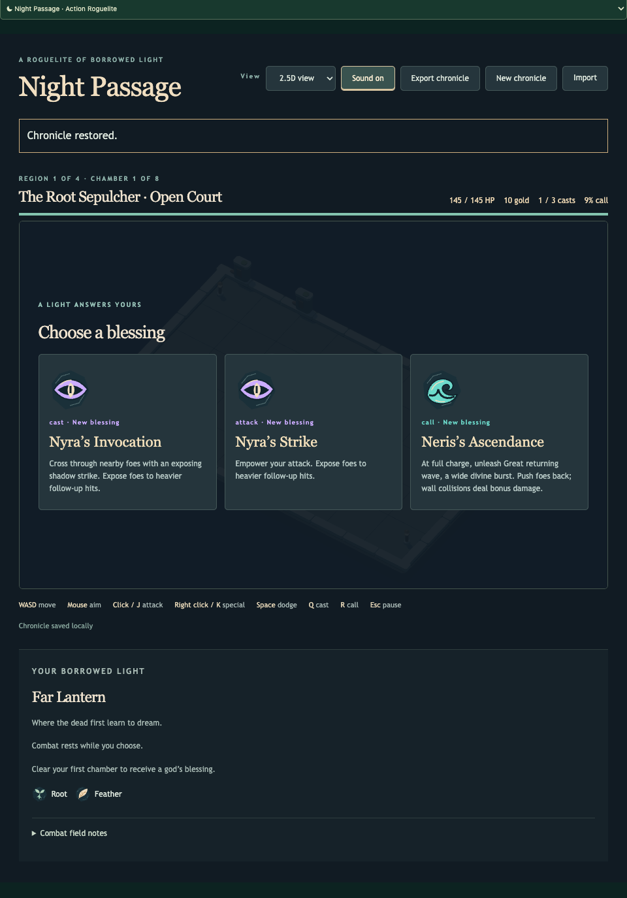

# Night Passage · reward and loadout symbols

The decision UI now uses **26 original SVG symbols**: five patrons, three paired
patron marks for duos, six runes, five weapons and seven chamber rewards. Names,
effects, prices, ranks, replacement notices and locked states remain HTML text.
Shapes distinguish identities as well as color; symbols are decorative and do
not change accessible control names.

## Source and placement

`src/games/night-passage/ui/Artwork.tsx` owns the editable vector source. Typed
records cover `GodId`, `RuneId`, `WeaponId` and `Reward`; a missing known member
fails TypeScript. Four small components draw patrons, runes, weapons and rewards.
Duos compose their two patrons from the existing boon requirements, rather than
introducing separate game definitions. `REWARD_ART_LABELS` supplies catalogue
labels only; the game’s actual route labels and effects stay authoritative.

Patrons retain the combat vocabulary: bolt, wave, flame, shard and eye. The six
runes depict Root, Feather, Well, Thorn, Comet and Moth. Weapon contours match the
five weapon families. A lantern identifies a divine audience; stacked coins,
a living ember, a shrine, a spring, a market awning and crossed blades identify
the other rewards. A shared dark seal and restrained engraving unify the set.

The quay uses 36 px weapon symbols and 24 px rune symbols. Blessing, route and
market choices use 64 px symbols on desktop and 48 px beside text on narrow
screens. The build sidebar repeats patrons at 36 px and equipped runes at 24 px.
A duo shows both patrons. These images do not encode blessing slot or rank;
those remain explicit text. Disabled choices retain the existing disabled style.

The [export catalogue](../../../../packages/workshop-tools/art/catalogue.tsx)
uses the same components under `night-passage/`. Standalone exports get intrinsic
sizes and accessible labels from the exporter; inline SVGs are hidden from the
accessibility tree and cannot take keyboard focus. No remote assets or SVG IDs
are needed. Rules, seeds, content versions and persistence are unchanged.

## Review and verification

Owner visual self-review inspected every symbol at 128, 64 and 24 px and the
actual quay, blessing, route, market and sidebar at desktop and 390 px. Broad
contours remain distinct; thin engraving and paired patron detail recede at
24 px. Duo marks are used at 36 px or larger. The narrow hub scrolls within its
existing decision panel; keyboard focus and all selections remain reachable.
The overlay uses safe centering so taller content starts within the scroll area.

The initial export duplicated intrinsic dimensions because the inline component
supplied them as well as the exporter. Removing them from the inline SVG restored
the established export contract. All **630 SVGs** then decoded successfully:
**26 additions, no removals, no changed existing assets, 604 identical pixel
hashes** under the recorded Sharp renderer. This is regression evidence, not an
art-quality score. The complete export and large comparison sheets remain
regenerable under `test-results/night-passage-symbols-*`.

Browser journeys use actual controls and legally generated chronicles to verify
keyboard loadout selection, locked runes, offered art/text correspondence,
blessing choice, route travel, market purchase, Eclipse Fire's paired patrons
on its choice and owned build, and exact save/reload. The first
market checkpoint could not afford the test purchase; its fixture was corrected
to reach an affordable market through accepted commands. No game gold or rules
were changed to satisfy the test.

The repository check passed: maintenance/static checks, 384 application tests and
22 seeded simulations. Twelve unique affected browser journeys passed, including
the final four artwork journeys after the fixture correction. The artwork cases
use 2.5D at 960 px and 2D at 390 px. Geometry was not rerun for this SVG/UI slice.

Selected screenshots and a [compact review receipt](symbols/review.json) retain
source and image hashes alongside these results.
This completes the reward/loadout icon batch. [Patron light effects](patrons.md) are now delivered. The
final integrated campaign review remains under the active goal. Visual review is
owner self-review; independent art approval and user acceptance are not claimed.
