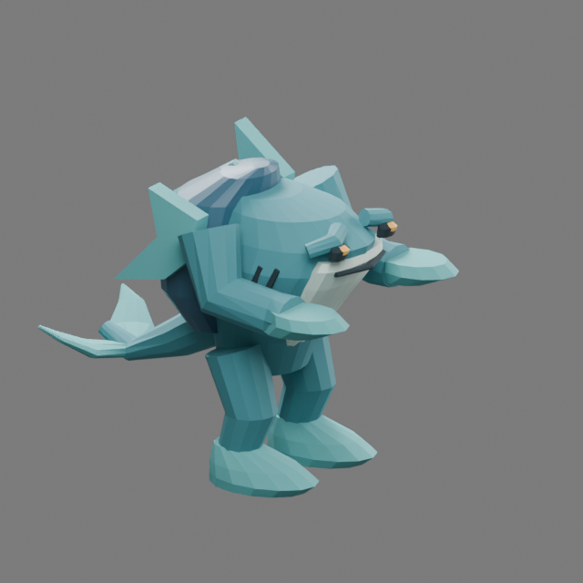

# Undertow · second authored guardian

The Drowned Archive guardian has a squat teal body, pale throat, shellback,
asymmetric shoulder fins, webbed feet and a forked tail. Its low silhouette
contrasts with Bellwarden's upright bell and suspension frame. Amber eyes and
gill slits are secondary details; the body and fins carry its identity at play
scale. This original stylized tide creature was reviewed by the primary author.

## Source and motion

The editable master is
`packages/dcc-workbench/subjects/night-passage/guardians/undertow/source.blend`.
The [source guide](../../../../packages/dcc-workbench/subjects/night-passage/README.md#undertow)
owns reproduction and extension instructions. `guardian-undertow.glb` is its
baked browser delivery; its JSON receipt pins source, model and scripts. Export
evaluates saved actions without reconstructing or retiming the master.

Six clips cover idle, run, charge, volley, pulse and stagger. Charge leans the
shell and head forward; volley raises and opens the palms; pulse spreads the
arms and turns the tail. The authored contact is phase 0.45. Production sampling
places that contact at the confirmed attack transition, including enraged timing.
The rules own charge travel, aim, projectile release and ground danger geometry.

## Visual review

Native front, side, rear and angled views were inspected in clay and materials.
The broad joined body and rear shell support the limb connections; asymmetric
fins and forked tail break the outline. The first candidate required no geometry
repair after review. Saved playback was inspected at six decoded frames per
second for preparation, contact and settling; the full unretimed movie is retained.

Controlled production captures compare the native character with its previous
fallback at the same positions and charge warning. The health bar clears the
body. At 390 pixels wide the eye and gill details recede, while the teal body and
orange lane remain readable. This self-review does not establish user acceptance.
Evidence and hashes are in
`packages/dcc-workbench/assets/night-passage/undertow-review.json`.

Native/browser comparison covers **237 frames × 448 surface probes** per delivery.
Maximum error is **0.000001287 model units** against a **0.0001** tolerance. A
disposable saved head-key edit moves the charge surface by **0.1748 model units**
without changing mesh or weights. These deformation measurements are separate
from visual judgment. Bellwarden was re-exported through the shared pipeline
with identical model bytes; its historical evidence remains unchanged.

## Bounds

Ash Regent, Unlit Sovereign and the four environment kits remain blockouts.
In-place locomotion is not world-space foot locking at arbitrary movement speeds.
Dedicated directional steps and animation transitions remain polish work. The
ground warning is the authority for danger, including the pulse's safe center;
body gestures do not reproduce the full area of every attack.
