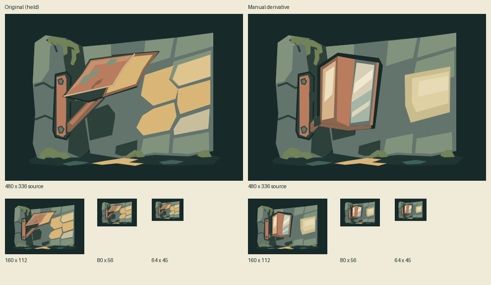
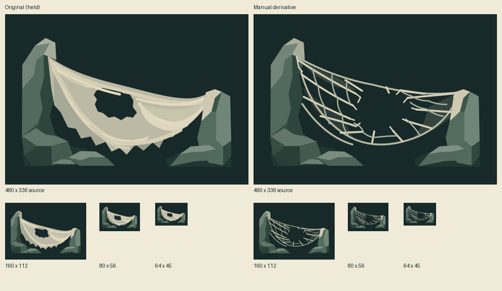

# Manual repairs of two held source concepts

Two hand-authored derivatives repair specific material/function defects. They remain unassigned source candidates, with no game slot, runtime adapter or selection. The exact generated parents and their holds are unchanged; no originals or generation payloads are copied into this bundle. [record.json](record.json) records exact parent commits/paths/digests, manual briefs, changes and output hashes once. API calls/spend/reservations: **0 / $0 / $0**; historical usage and unknown reservations elsewhere are untouched.

## Matched review and reuse decision

The existing folded reflector reads as an awning; the web reads as opaque torn cloth. These existing sources cannot yet meet their stated function/material briefs at 160×112 and 80×56. Reusing their architecture, supports, anchors and ground while replacing only the failing surfaces gives a bounded repair. These are preserved review derivatives for selective integration, not parallel runtime assets or approved replacements. The art lane owns the small source bundle; the serial merger owns canonical history registration. One optimized comparison per family supplies native and compact evidence; temporary diagnostics and staged transport stay ignored.

### Mounted reflector



Parent: [#151 at bbabec4f](https://github.com/qianyizhang/game/blob/bbabec4f451850b1a7b41a275467e68d619f19f7/docs/art/assets/cartographer-wayfinding-fixtures-2026-11-06/corner-light-reflector.svg). Its [canonical call and hold](https://github.com/qianyizhang/game/blob/bbabec4f451850b1a7b41a275467e68d619f19f7/docs/art/assets/cartographer-wayfinding-fixtures-2026-11-06/call.json) remain authoritative for generation.

[Manual SVG](corner-reflector-manual.svg): retain the bolted wall bracket and stone corner, replace the sloped mottled face with upright thick-rimmed folded metal planes and restrained hard reflection bands, and consolidate the wall illumination into one bounded patch. The upright mounted fixture and reflection read more clearly at 160×112/80×56; at 64×45 its folded-plane and metal distinction softens. This is an illustrative light arrangement, not a ray-traced optical result or engineering certification. Current Cartographer route UI continues to use `src/games/cartographer/ui/FrontierArt.tsx` and `MapCues.tsx`; this source does not introduce navigation behavior.

### Torn silk aftermath



Parent: [#153 at ba349aa2](https://github.com/qianyizhang/game/blob/ba349aa26bf46474585d556eb070148d3a1d95ca/docs/art/assets/spire-aftermath-source-studies-2026-11-06/ruptured-web.svg). Its [canonical call and hold](https://github.com/qianyizhang/game/blob/ba349aa26bf46474585d556eb070148d3a1d95ca/docs/art/assets/spire-aftermath-source-studies-2026-11-06/call.json) remain authoritative for generation.

[Manual SVG](ruptured-web-manual.svg): keep both unequal stone anchors and ground; replace opaque folds, scalloped hem and cloth highlights with sparse connected tension/cross strands, a displaced open tear and a few translucent attachment fans. At 160×112/80×56 the network and negative space distinguish it from the old fabric; at 64×45 some strands/frays merge and the material is a generic torn web/net. `src/games/spire/content/world.ts` supplies the existing Spit Web context, not a contract for visible persistent aftermath. No creature, VFX timing, trigger, damage or persistence rule is proposed.

Both are **improved author candidates**, not independent or user aesthetic acceptance. Original hold records remain held. Any later consumer needs its own composition, accessible framing and actual-game review.

### Suspended market remains held

The [#140 market parent](https://github.com/qianyizhang/game/blob/8413515555f8e0afcca789396de36c93f6b5205b/docs/art/assets/expansion-archive-spire-2026-11-06/spire-exordium-city/city-suspended-market.svg) was assessed read-only at 480×336 and compact sizes. Its canopy/railing obscure the usable trading area. Tiny goods added behind that occlusion would not reliably establish market function. No derivative is attempted here; its covered-balcony/weak-market hold stays intact. A later composition repair should expose one broad merchant counter with two distinct merchandise masses and a visible load path, then reassess at 80×56 before adding details. No paid regeneration is requested.

## Validation and serial handoff

Passed: repository SVG safety; isolated import/verify of both children with exact parent closure; actual gallery previews/lineage, parent holds and canonical generation/manual records, disabled Use and 1440/390/320px × 16/20px text layouts without overflow/page errors. System Chromium exercised the actual source gallery in isolation, not the guarded application browser suite. Final-base `npm run format:maintenance` and live `npm run assets:history -- verify` passed (709 assets, 323 baseline revisions, zero selections). No application, game or registry code changed; broad application/native suites were not repeated. Expanded transparent renders show 30px reflector and 33px web minimum foreground inset without clipping. Structural comparison confirms 32 reflector and 22 web parent elements unchanged. The retained comparisons use CairoSVG 2.9.1/Pillow 13.0.0 and separately rasterize each requested size; PNG optimization preserves exact decoded pixels, dimensions, alpha, mode and color interpretation.

At creation, delivery base is `29dae62ccb46321160c455909d0061cbe0133e9c`; #151/#153 are open. **Parent registration dependencies and this bundle's canonical registration remain draft blockers.** Parent files can be inspected at the exact Git references above without bringing unrelated unmerged artwork into this diff. The isolated validation imports their actual parent closure temporarily, with no production registry edit. The merger must reconcile against the current canonical parents, preserve their holds and register these manual children before marking ready. No game/default or other candidate branch is changed.

Rebuild the additive two-child transport from the canonical record at repository root. This writes only ignored `test-results/semantic-repairs-history-import.json`; it does not register anything. Parent revisions must already exist when the merger imports it.

```python
import json
from pathlib import Path

d = Path("docs/art/assets/semantic-hold-repairs-2026-11-07")
c = json.loads((d / "record.json").read_text())
a = c["id"]
h = dict(
    schema=1,
    assets=[],
    attempts=[dict(
        id=a, title="Manual semantic repairs / reflector and torn silk",
        date=c["date"], outcome="manual",
        notes="Hand-authored source derivatives; original holds unchanged. Briefs, parent digests and review: record.json.",
        files=[(d / f).as_posix() for f in ["record.json", "README.md"] + [o["comparison"]["file"] for o in c["outputs"]]],
    )],
    revisions=[dict(
        id=a + ":" + Path(o["file"]).stem, asset=None, attempt=a,
        label="Manual source repair / " + Path(o["file"]).stem,
        file=(d / o["file"]).as_posix(), digest=o["sha256"],
        parents=[o["parent"]["revision"]], runtimeFile=None, runtimeDigest=None,
        notes="Manual derivative. " + o["changes"] + " Review: " + o["review"],
    ) for o in c["outputs"]],
)
p = Path("test-results/semantic-repairs-history-import.json")
p.parent.mkdir(parents=True, exist_ok=True)
p.write_text(json.dumps(h, indent=2) + "\n")
```
